# Fast Card：传牌与抢按钮

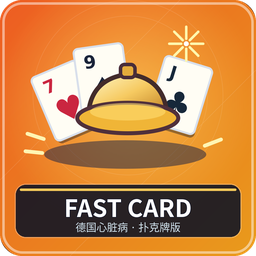

4 人，四座桌或八座桌均可。游戏中每人不断接收、传出扑克牌，凑好组合就抢按桌心按钮；打完设定局数，累计分最高者获胜。

## 准备与牌面

腾空快捷栏九格。17 张牌是四种花色的 10、J、Q、K 各一张，加一张小丑。花色没有大小，普通点数也不互相比大小，只检查相同点数的数量。随机一人拿 5 张，其余每人 4 张，持 5 张者先传。

## 一小局照着做

1. 有 5 张牌时，读自己的牌，挑一张不需要的牌，选中它按 Q。
2. 系统把牌传给下一座位；接收者变为 5 张，继续同样操作。你无需手动丢到对方身上。
3. 接牌、传牌过程中不断检查自己的牌型。满足下表即可右键桌心按钮，抢先者触发这一小局结算。
4. 看到别人按下后，自己也要尽快按，不需要自己凑齐牌型。系统比较响应先后，决定谁扣分。
5. 看小局得分和排行榜，等自动发下一局。全部局数结束再比较总分。

| 抢按时真正持有的牌型 | 抢按者 | 其余人 |
| --- | --- | --- |
| 四张同点数 | +1 | 最慢一人 −1 |
| 三张同点数与小丑 | +2 | 最慢两人各 −1 |
| 四张同点数与小丑 | +3 | 另外三人各 −1 |

组合按实际持有的牌判断。五张牌的“四张同点数＋小丑”本身就是有效的 3 分组合，不必为了传一张把它拆掉；也不要把“只能四张牌时抢按”当成规则。只有持 5 张者可以传牌，其他人按 Q 不会把不属于当前传牌阶段的牌传出去。

## 一个例子

你有 Q、Q、Q、小丑、10，选择 10 按 Q 后，剩下三 Q＋小丑，可抢按争取 2 分。若你直接持有四 Q＋小丑，则是 3 分组合。别人见你抢按，也要马上按；得分来自你的组合，其他人的扣分来自抢按速度。

## 设置与容易出错的地方

大厅可以设本场 1～999 小局，默认 5。默认忽略无有效组合的乱按；打开“乱按判负”后，乱按者扣 1 分并结束小局。新手可以先关闭惩罚，熟悉传牌方向后再打开。

小丑只能按上表配合三张或四张同点数，不能把两张同点数补成四张。看到别人按按钮时别再等自己凑牌，立即响应。未轮到的传牌会返还，等提示更新后再操作。

离线暂停、结束投票见[通用说明](00-新手入门与界面图例.md)。管理员中止：`/function fast_card:admin/abort`。

<!-- BEGIN COMPONENTS -->

## 组件实图与逐件图鉴

这些图片直接取自配套资源包，立体物件按实际 Java 模型渲染。卡牌展示真实正面，动画纹理取第一帧；皮肤头像、发光和粒子属于游戏内动态效果。

### 17 张传牌牌库

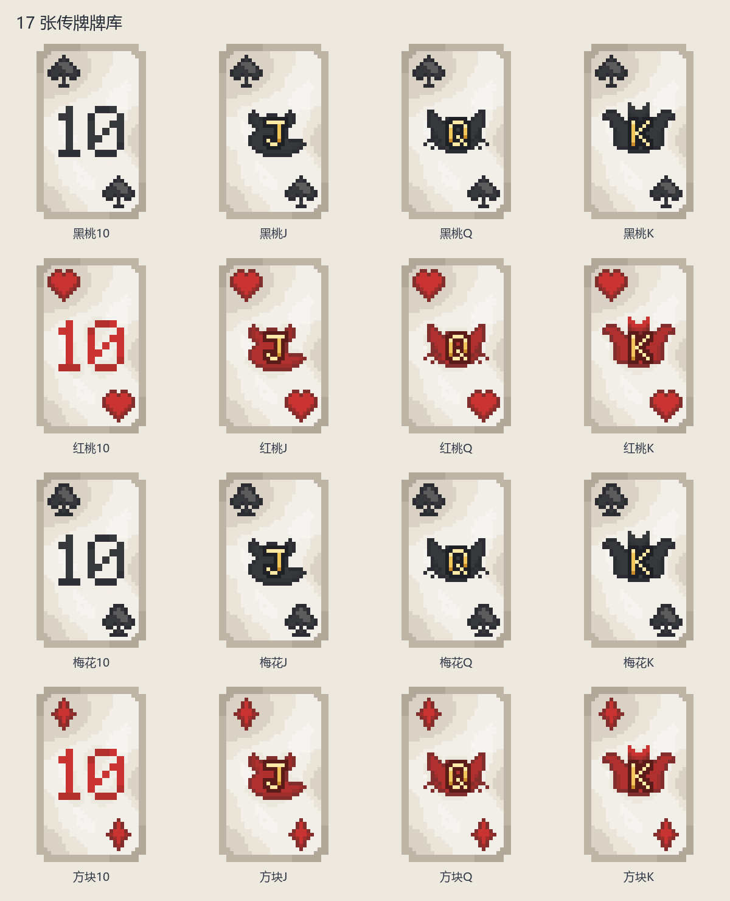

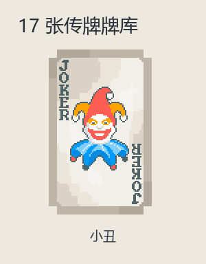

| 实图 | 名称 | 数量／所属 | 用途与区别 |
| --- | --- | --- | --- |
| 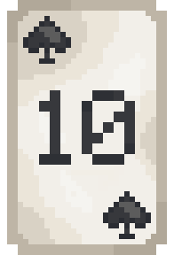 | 黑桃10 | 1 | 点数和花色见牌角；不同游戏的大小关系及连续牌规则分别说明。 |
| 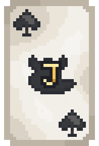 | 黑桃J | 1 | 点数和花色见牌角；不同游戏的大小关系及连续牌规则分别说明。 |
| 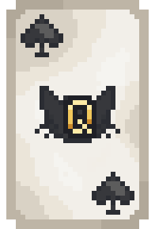 | 黑桃Q | 1 | 点数和花色见牌角；不同游戏的大小关系及连续牌规则分别说明。 |
| 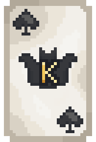 | 黑桃K | 1 | 点数和花色见牌角；不同游戏的大小关系及连续牌规则分别说明。 |
| 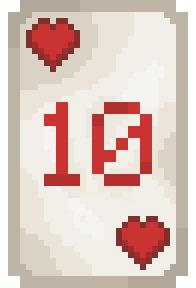 | 红桃10 | 1 | 点数和花色见牌角；不同游戏的大小关系及连续牌规则分别说明。 |
| 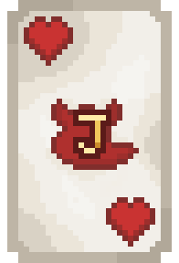 | 红桃J | 1 | 点数和花色见牌角；不同游戏的大小关系及连续牌规则分别说明。 |
| 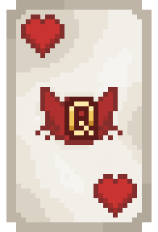 | 红桃Q | 1 | 点数和花色见牌角；不同游戏的大小关系及连续牌规则分别说明。 |
| 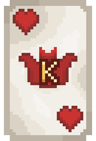 | 红桃K | 1 | 点数和花色见牌角；不同游戏的大小关系及连续牌规则分别说明。 |
|  | 梅花10 | 1 | 点数和花色见牌角；不同游戏的大小关系及连续牌规则分别说明。 |
| 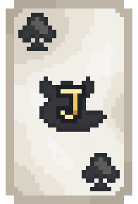 | 梅花J | 1 | 点数和花色见牌角；不同游戏的大小关系及连续牌规则分别说明。 |
| 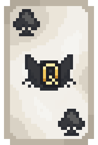 | 梅花Q | 1 | 点数和花色见牌角；不同游戏的大小关系及连续牌规则分别说明。 |
| 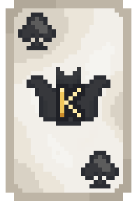 | 梅花K | 1 | 点数和花色见牌角；不同游戏的大小关系及连续牌规则分别说明。 |
| 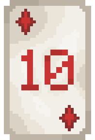 | 方块10 | 1 | 点数和花色见牌角；不同游戏的大小关系及连续牌规则分别说明。 |
| 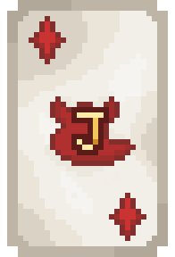 | 方块J | 1 | 点数和花色见牌角；不同游戏的大小关系及连续牌规则分别说明。 |
| 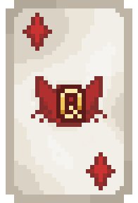 | 方块Q | 1 | 点数和花色见牌角；不同游戏的大小关系及连续牌规则分别说明。 |
| 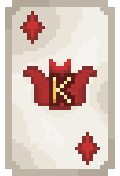 | 方块K | 1 | 点数和花色见牌角；不同游戏的大小关系及连续牌规则分别说明。 |
| 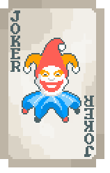 | 小丑 | 1 | 专用特殊牌；是否使用见该游戏牌库。 |

### 牌盒

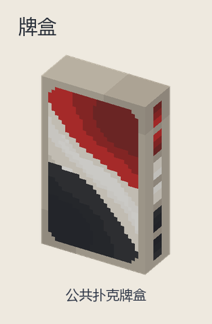

| 实图 | 名称 | 数量／所属 | 用途与区别 |
| --- | --- | --- | --- |
| 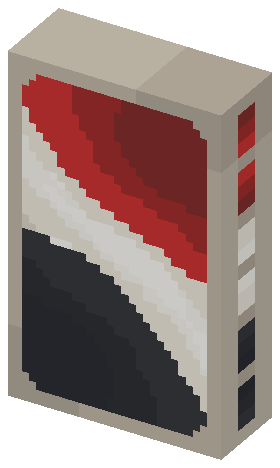 | 公共扑克牌盒 | 1 | 仅用于发牌、收牌展示，不是可带走的手牌。 |

<!-- END COMPONENTS -->

[返回说明书目录](README.md)
