# 赌命德州扑克

2～8 人。用自己的两张底牌和桌上五张公共牌组成最佳五张牌，赢下小局就免开枪；弃牌或摊牌失利要接受左轮判定。整场最后一名存活玩家获胜。这里用子弹代替筹码，没有盲注或奖池。

## 准备与读牌

腾空快捷栏九格。使用不含大小王的 52 张扑克：黑桃、红桃、梅花、方块各 2～A。每局重洗，存活者各得两张秘密底牌，公共牌先盖住。每人从 1 发子弹和一次换牌机会开始。

手牌只有本人知道；公共牌翻开后所有人共用。比较的是七张牌里最好的五张，可以使用两张、一张甚至零张底牌。系统自动找最佳组合，花色不分大小。A 固定算最大点数 14，本版 **A2345 不是顺子**。

## 轮到你时

第 8 格 Call 按 Q 跟注，第 9 格 Fold 按 Q 弃牌；持 Call 按 F 全押。前三个普通阶段，你也可先持一张底牌按 Q 换牌，换完仍需跟注、全押或弃牌。

| 阶段 | 普通跟注 | 全桌完成后 |
| --- | --- | --- |
| 第一次行动 | 子弹 1→2 | 翻前三张公共牌 |
| 第二次行动 | 2→3 | 翻第四张 |
| 第三次行动 | 3→4 | 翻第五张 |
| 最终抉择 | 没有普通跟注，只能全押或弃牌 | 多人留下则摊牌 |

每阶段只行动一次，按座位轮换，跳过空座、已弃牌和死亡者。有人提前全押后，所有未弃牌者改为只能跟随全押或弃牌，全桌不能再换牌。全押把子弹数设为 8。若只剩一人未弃牌，此人直接赢小局；否则响应结束自动翻完公共牌后比牌。

## 一次换牌怎样选

前三个普通阶段，轮到你且全桌无人全押时，底牌 Q 打开三个真实候选。点一个替换原底牌，每局仅一次。退出按钮默认选第一张，不能用关窗口重新刷候选。

原底牌、没选中的两张进入本局弃牌区，不再回到抽牌堆。换牌不消耗本阶段决定，因此换完记得继续 Call、All in 或 Fold。

## 十种牌型，从大到小

| 牌型 | 组成 | 示例 |
| --- | --- | --- |
| 皇家同花顺 | 同花 10JQKA | 黑桃 10JQKA |
| 同花顺 | 同花连续五张 | 红桃 56789 |
| 四条 | 四张同点＋一张 | 9999A |
| 葫芦 | 三张同点＋一对 | KKK22 |
| 同花 | 同花五张，不必连续 | 同为梅花的 2、5、8、J、K |
| 顺子 | 连续五点数，不必同花 | 6789T |
| 三条 | 三同点＋两散张 | QQQA7 |
| 两对 | 两组对子＋一张 | JJ88A |
| 一对 | 一组对子＋三散张 | 66AK9 |
| 高牌 | 不属于上述组合 | AKJ83 |

同类型先比主要组合，再比其余踢脚牌；例如同样一对 K，先比最大的散张，再比下一张。牌型和有效五张完全相同则并列胜者，都免开枪。

## 左轮和下一局

Fold 退出本小局，立即用当前子弹数扣一次扳机。摊牌的输家都按 8 发判定；赢家不用开枪。1～7 发的死亡概率分别是子弹数除以 8；8 发为 95% 死亡、5% 卡弹。一次判定只扣一次扳机，动画不会重抽结果。

空枪或卡弹后仍活着，等待下一小局；死亡才淘汰整场。新局重新洗牌，子弹重置 1、换牌机会恢复。只剩一名存活者整场结束。弃牌不是安全退出，不保证存活。

第一次玩可先观察公共牌再决定风险，不要把一对当成比顺子更强。换牌后尚未行动、最终阶段不能普通加弹、全押后无人可再换牌，是最常见的三个卡点。

本游戏无独立玩法设置。离线暂停等见[通用说明](00-新手入门与界面图例.md)。管理员中止：`/function liars_holdem:admin/abort`。

<!-- BEGIN COMPONENTS -->

## 组件实图与逐件图鉴

这些图片直接取自配套资源包，立体物件按实际 Java 模型渲染。卡牌展示真实正面，动画纹理取第一帧；皮肤头像、发光和粒子属于游戏内动态效果。

### 扑克牌面示例与完整牌库清单

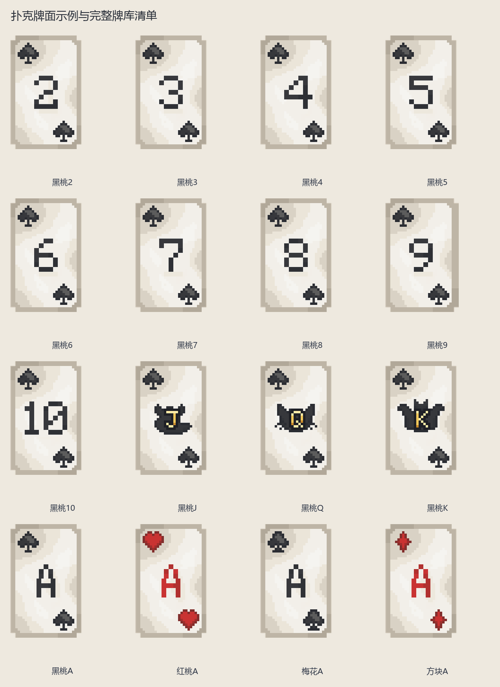

| 实图 | 名称 | 数量／所属 | 用途与区别 |
| --- | --- | --- | --- |
| 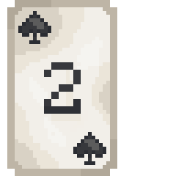 | 黑桃2 | 1 | 点数和花色见牌角；不同游戏的大小关系及连续牌规则分别说明。 |
| 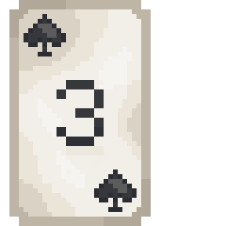 | 黑桃3 | 1 | 点数和花色见牌角；不同游戏的大小关系及连续牌规则分别说明。 |
| 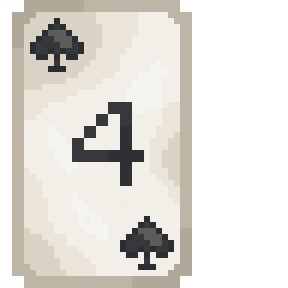 | 黑桃4 | 1 | 点数和花色见牌角；不同游戏的大小关系及连续牌规则分别说明。 |
| 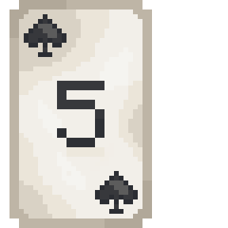 | 黑桃5 | 1 | 点数和花色见牌角；不同游戏的大小关系及连续牌规则分别说明。 |
| 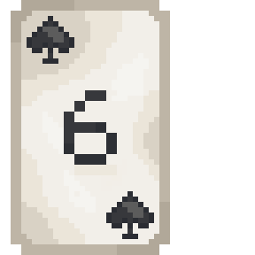 | 黑桃6 | 1 | 点数和花色见牌角；不同游戏的大小关系及连续牌规则分别说明。 |
| 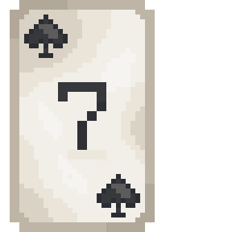 | 黑桃7 | 1 | 点数和花色见牌角；不同游戏的大小关系及连续牌规则分别说明。 |
| 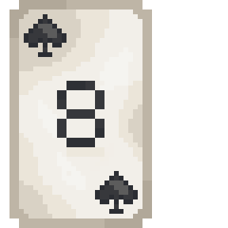 | 黑桃8 | 1 | 点数和花色见牌角；不同游戏的大小关系及连续牌规则分别说明。 |
| 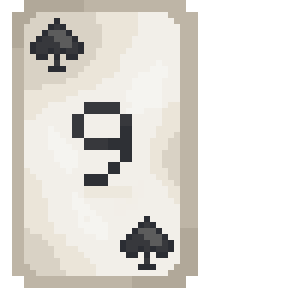 | 黑桃9 | 1 | 点数和花色见牌角；不同游戏的大小关系及连续牌规则分别说明。 |
| 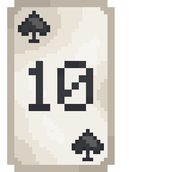 | 黑桃10 | 1 | 点数和花色见牌角；不同游戏的大小关系及连续牌规则分别说明。 |
| 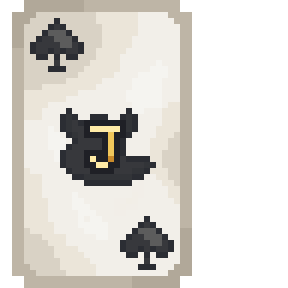 | 黑桃J | 1 | 点数和花色见牌角；不同游戏的大小关系及连续牌规则分别说明。 |
| 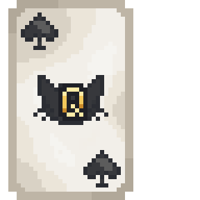 | 黑桃Q | 1 | 点数和花色见牌角；不同游戏的大小关系及连续牌规则分别说明。 |
| 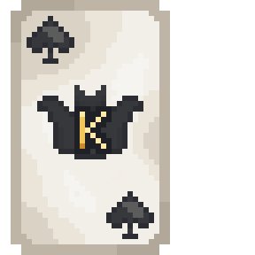 | 黑桃K | 1 | 点数和花色见牌角；不同游戏的大小关系及连续牌规则分别说明。 |
| 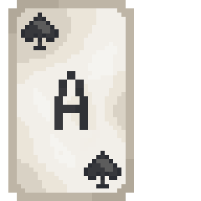 | 黑桃A | 1 | 点数和花色见牌角；不同游戏的大小关系及连续牌规则分别说明。 |
| 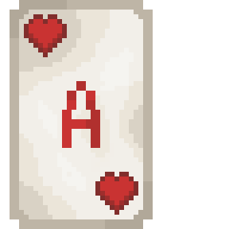 | 红桃A | 1 | 点数和花色见牌角；不同游戏的大小关系及连续牌规则分别说明。 |
| 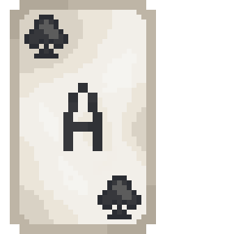 | 梅花A | 1 | 点数和花色见牌角；不同游戏的大小关系及连续牌规则分别说明。 |
| 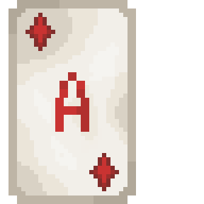 | 方块A | 1 | 点数和花色见牌角；不同游戏的大小关系及连续牌规则分别说明。 |

花色与点数只改变牌角和花色图案，省略重复的大图。下表列出实际全部牌面：

| 花色 | 全部点数 | 各牌面张数 |
| --- | --- | --- |
| 黑桃 | 2、3、4、5、6、7、8、9、10、J、Q、K、A | 1 |
| 红桃 | 2、3、4、5、6、7、8、9、10、J、Q、K、A | 1 |
| 梅花 | 2、3、4、5、6、7、8、9、10、J、Q、K、A | 1 |
| 方块 | 2、3、4、5、6、7、8、9、10、J、Q、K、A | 1 |

### 牌盒

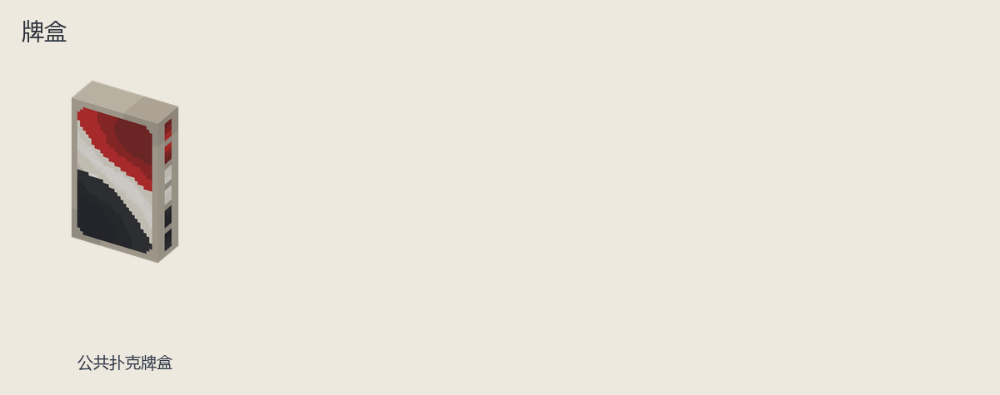

| 实图 | 名称 | 数量／所属 | 用途与区别 |
| --- | --- | --- | --- |
| 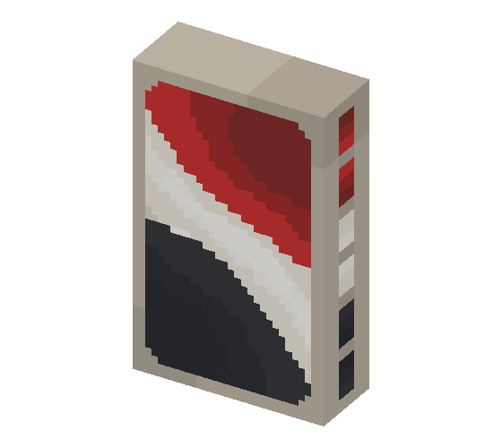 | 公共扑克牌盒 | 1 | 仅用于发牌、收牌展示，不是可带走的手牌。 |

<!-- END COMPONENTS -->

[返回说明书目录](README.md)
