# 花火：合作拼出烟花

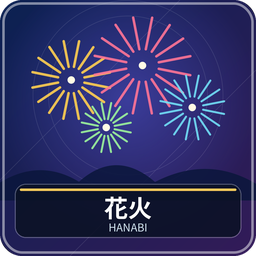

2～5 人合作游戏。所有人共享得分、提示标记和失误次数。你看得见队友的真实手牌，却看不见自己的，只能依据正式提示把各色烟花从 1 接到 5。

## 准备和认识牌

清空快捷栏第 1～5、9 格及副手。2～3 人各 5 张，4～5 人各 4 张，首位随机。基础五色为白、红、蓝、黄、绿；每色 1 有三张，2、3、4 各两张，5 一张，合计 50 张。彩色风暴另加彩色 1～5 各一张，形成第六列。

自己的快捷栏显示未知牌背或已获提示，其他人真实手牌显示在角落。牌位很重要：提示针对当时该位置的那张牌，补来的新牌会清除旧提示。桌心显示提示数、失误数、牌库和烟花得分；桌角可看公开弃牌。

## 你的回合：只做以下一件

| 行动 | 怎么做 | 后续 |
| --- | --- | --- |
| 出一张牌 | 选手牌 Q | 恰好接上该色下一数则入烟花，否则弃掉并加一次失误 |
| 弃一张牌 | 选手牌 F | 放入公开弃牌，恢复一枚提示；提示已满也允许弃 |
| 提示一位队友 | 第 9 格 Q，选玩家，再选颜色或数字 | 花一枚提示，必须至少命中一张，所有符合的牌同时标记 |

出牌／弃牌后，牌库有牌便补回原位置，再轮到下家。提示不能给自己，不能只指出两张同色中的一张，取消窗口不扣提示。没有提示标记就不能提示。请勿通过聊天直接读出队友的未知牌，讨论也不能代替正式提示。

例如红色烟花堆顶是 2，下一张只能红 3。红 1、红 2、红 4 都会失败。若你只知道某张是红牌，尚不能确定能出；可等数字提示，或结合可见牌和弃牌推理。每色只有一张 5，弃掉以后需要恢复奖励才有机会找回。

## 完成一列时的奖励

成功放上数字 5 先恢复一枚提示，再从独立的六张奖励中随机取得一张，立即处理，奖励不占手牌和额外回合。

| 奖励种类 | 数量 | 玩家该做什么 |
| --- | --- | --- |
| 提示恢复 | 2 | 自动恢复一枚提示 |
| 弃牌恢复 | 2 | 从公开弃牌中选一张放回普通牌库；没有弃牌则无效果 |
| 完全提示 | 1 | 选另一名玩家的一张牌，公开该张的颜色和数字 |
| 风险调整 | 1 | 选 0～2，提示与失误同时增加该数；达到失误上限立即失败 |

奖励窗口关闭后，第 9 格 Q 重开。必须处理完奖励才能普通行动。提示恢复不超过上限。

## 牌库耗尽和结束

本版牌库抽空后 **继续打完所有剩余普通手牌**，空手玩家自动跳过，不采用每人最后一回合的规则。失误达到上限立即失败，记 0 分；五列全部完成为 25 分，彩色风暴全部完成为 30 分；否则所有普通牌用完后，烟花各列顶数相加就是全队分数。没人单独得分。

大厅可设提示上限 1～32，默认 8；失误上限 1～9，默认 3；彩色风暴默认关闭。第一次玩推荐基础五色和默认上限。

离线会暂停全桌；窗口不会暂停计时或代替选择。管理员中止：`/function hanabi:admin/abort`。共同操作见[新手入门](00-新手入门与界面图例.md)。

<!-- BEGIN COMPONENTS -->

## 组件实图与逐件图鉴

这些图片直接取自配套资源包，立体物件按实际 Java 模型渲染。卡牌展示真实正面，动画纹理取第一帧；皮肤头像、发光和粒子属于游戏内动态效果。

### 烟花牌示例：数字与各颜色

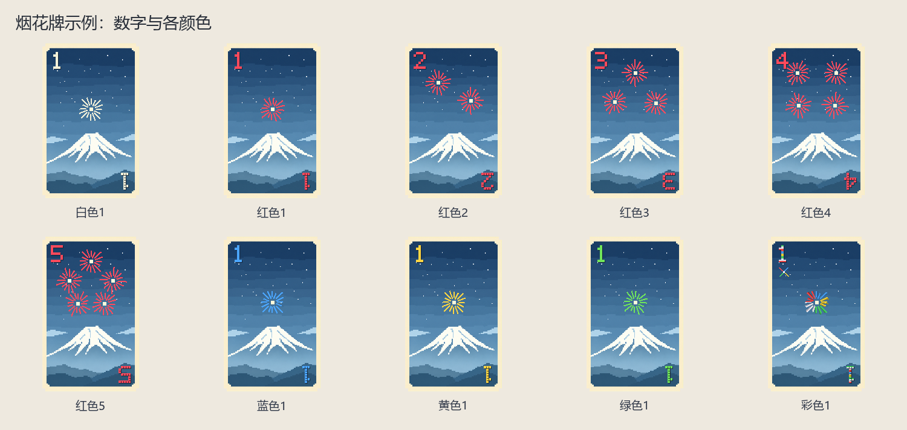

| 实图 | 名称 | 数量／所属 | 用途与区别 |
| --- | --- | --- | --- |
| 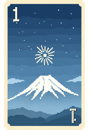 | 白色1 | 3 | 只能在白色烟花堆顶为 0 时打出。 |
| 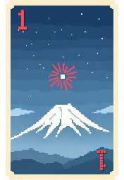 | 红色1 | 3 | 只能在红色烟花堆顶为 0 时打出。 |
| 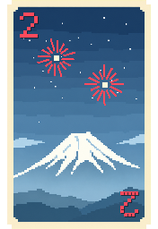 | 红色2 | 2 | 只能在红色烟花堆顶为 1 时打出。 |
| 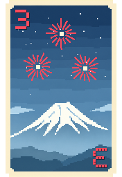 | 红色3 | 2 | 只能在红色烟花堆顶为 2 时打出。 |
| 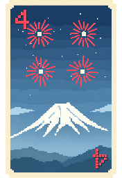 | 红色4 | 2 | 只能在红色烟花堆顶为 3 时打出。 |
| 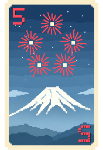 | 红色5 | 1 | 只能在红色烟花堆顶为 4 时打出。 |
| 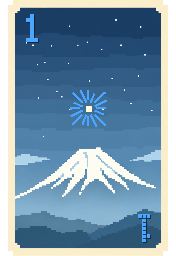 | 蓝色1 | 3 | 只能在蓝色烟花堆顶为 0 时打出。 |
|  | 黄色1 | 3 | 只能在黄色烟花堆顶为 0 时打出。 |
| 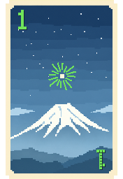 | 绿色1 | 3 | 只能在绿色烟花堆顶为 0 时打出。 |
|  | 彩色1 | 1 | 只能在彩色烟花堆顶为 0 时打出。仅彩色风暴启用。 |

完整牌库：白、红、蓝、黄、绿各有 1×3、2×2、3×2、4×2、5×1；可选彩色另有 1～5 各一。相同版式不重复逐色展开。

### 隐藏信息与提示后的牌面

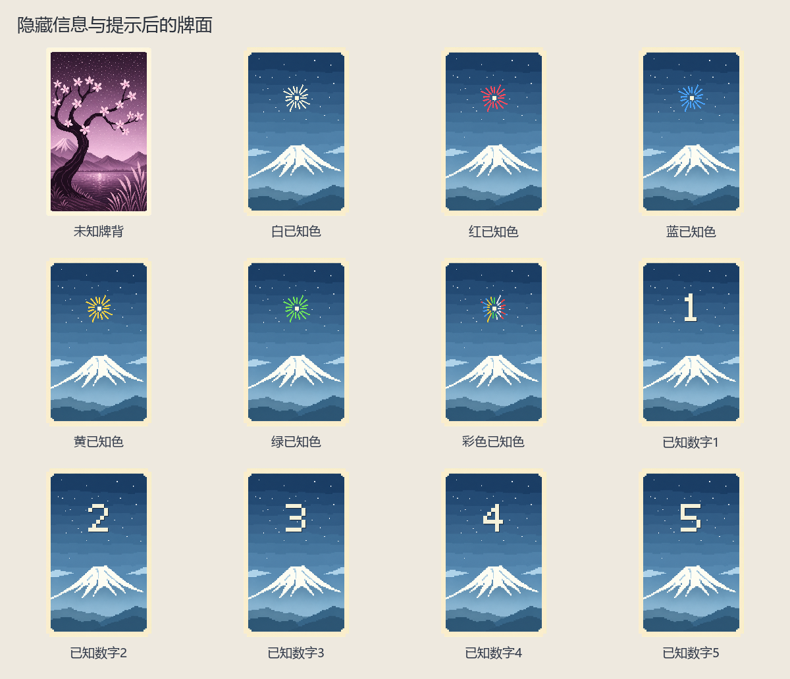

| 实图 | 名称 | 数量／所属 | 用途与区别 |
| --- | --- | --- | --- |
| 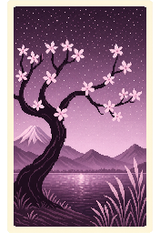 | 未知牌背 | — | 自己看不见尚未获得提示的牌。 |
|  | 白已知色 | — | 只知道颜色，不知道数字。 |
|  | 红已知色 | — | 只知道颜色，不知道数字。 |
|  | 蓝已知色 | — | 只知道颜色，不知道数字。 |
|  | 黄已知色 | — | 只知道颜色，不知道数字。 |
|  | 绿已知色 | — | 只知道颜色，不知道数字。 |
|  | 彩色已知色 | — | 只知道颜色，不知道数字。 |
|  | 已知数字1 | — | 只知道数字，不知道颜色。 |
|  | 已知数字2 | — | 只知道数字，不知道颜色。 |
|  | 已知数字3 | — | 只知道数字，不知道颜色。 |
|  | 已知数字4 | — | 只知道数字，不知道颜色。 |
|  | 已知数字5 | — | 只知道数字，不知道颜色。 |

<!-- END COMPONENTS -->

[返回说明书目录](README.md)
