# 出包魔法师：猜你手里有什么

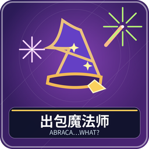

2～5 人。你能看见别人的咒语石，却不知道自己的石头，轮到你时声明一个编号，猜中就施法，猜错就失血并结束回合。每小局赚取塔层，累计达到目标者赢整场。

## 准备与读懂操作物

腾空快捷栏九格。36 枚普通咒语石：1 号一枚、2 号两枚，依此到 8 号八枚。每小局每人 6 生命、5 枚隐藏石，另预留 4 枚秘密石。秘密石不用于普通摸牌或施法。左上角看别人真实石头和自己剩余数量，桌心看生命，桌角可查已施放数量。

第 1～8 格是声明编号的按钮，不代表你实际拥有这枚石。第 9 格是结束回合。真实手牌由系统秘密保存，不要用九张按钮来推算自己的持有牌。

## 你的回合

1. 根据别人的石头、公开已用数量和总数，决定猜一个编号，选对应操作牌按 Q。
2. 自己确有此石：移出一枚，完整结算效果，之后可以继续猜，也可以第 9 格 Q 安全结束。
3. 自己没有：通常扣 1 生命并结束；猜 1 号失败则随机扣 1～3。
4. 同一回合连续成功时，后一次编号 **不能低于前一次**，相同编号可以重复声明。成功用过 6 后再报 4 也会失败。
5. 回合结束才补到 5 枚，普通牌库不足就尽量补，然后轮下家。

所有生命最多恢复到 6。左右邻座按牌桌的游戏顺序理解，空座不算玩家。

## 八种咒语及取舍

| 号 | 咒语 | 成功效果 | 新手要点 |
| --- | --- | --- | --- |
| 1 | 古代巨龙 | 随机 1～3，其他所有人各失去该数生命 | 只有一枚，猜错自己也受 1～3 伤害 |
| 2 | 黑暗幽灵 | 其他人各失 1，自己恢复 1 | 同时攻击与治疗 |
| 3 | 甜蜜的梦 | 自己恢复随机 1～3 | 满血时不会超出 6 |
| 4 | 猫头鹰 | 私看一枚剩余秘密石 | 本局存活时每次成功另得一层，秘密石领完仍记录奖励 |
| 5 | 闪电暴风雨 | 左右邻各失 1 | 两人局不会对同一人扣两次 |
| 6 | 暴风雪 | 左邻失 1 | 看清攻击方向 |
| 7 | 火球 | 右邻失 1 | 与暴风雪目标不同 |
| 8 | 魔法药水 | 自己恢复 1 | 数量最多，但报 8 后本回合只能继续报 8 |

例如先猜 3 成功，再猜 3 也可；再猜 5 成功后只能猜 5～8。继续猜能争取清空五石，但猜错会失血和交回合。不知道就安全结束，补牌后重新从低编号选择。

## 一小局和整场怎样计分

有人打空全部手牌，或任何人生命归零，就立即结算本小局。打空者或用最后一次攻击击倒别人的施法者得 3 层，其他存活者各 1 层；若施法失败导致自己倒下，则没有击倒胜者，其余存活者各 1 层。存活者再加本局猫头鹰奖励，倒下者无存活与猫头鹰分。

全部奖励结算后，达到目标者共同获胜；未达到则重建牌库、生命与隐藏石，保留塔层开始下一局。大厅目标可设 1～32，默认 8。

常见误会：操作按钮不是真牌；同号可以连放；治疗不能超上限；秘密石不是抽到自己普通手中的牌。管理员中止：`/function abraca:admin/abort`；暂停和回座见[共同操作](00-新手入门与界面图例.md)。

<!-- BEGIN COMPONENTS -->

## 组件实图与逐件图鉴

这些图片直接取自配套资源包，立体物件按实际 Java 模型渲染。卡牌展示真实正面，动画纹理取第一帧；皮肤头像、发光和粒子属于游戏内动态效果。

### 36 枚咒语石，8 种效果

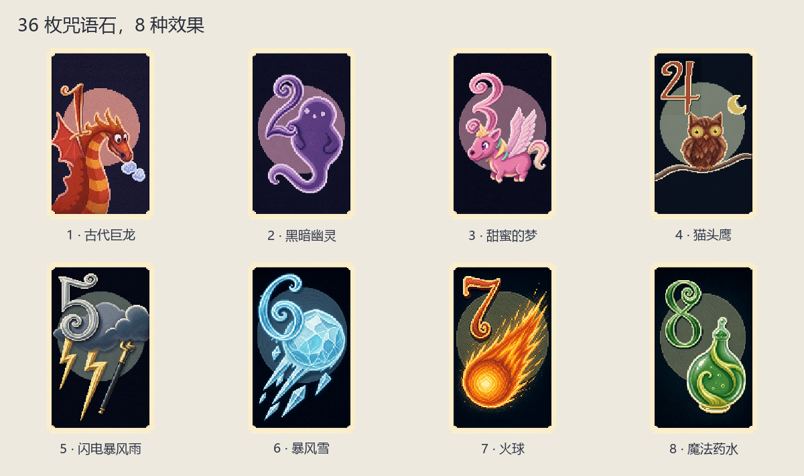

| 实图 | 名称 | 数量／所属 | 用途与区别 |
| --- | --- | --- | --- |
| 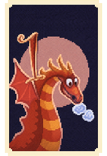 | 1 · 古代巨龙 | 1 | 其他所有人受到同样的随机 1～3 点伤害。 |
| 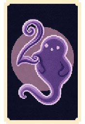 | 2 · 黑暗幽灵 | 2 | 其他人各失 1 生命，自己恢复 1。 |
| 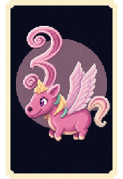 | 3 · 甜蜜的梦 | 3 | 自己恢复随机 1～3 生命。 |
| 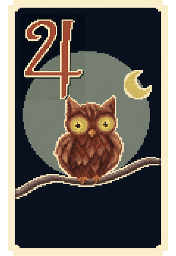 | 4 · 猫头鹰 | 4 | 私下查看一枚秘密石，存活结算时获得额外塔层。 |
| 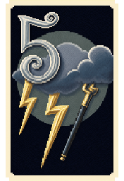 | 5 · 闪电暴风雨 | 5 | 左右邻座各失 1 生命；两人局不重复扣。 |
| 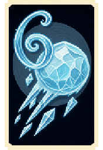 | 6 · 暴风雪 | 6 | 左邻失 1 生命。 |
| 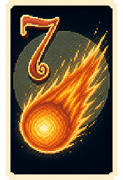 | 7 · 火球 | 7 | 右邻失 1 生命。 |
| 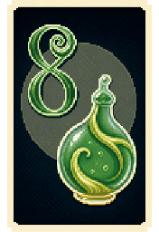 | 8 · 魔法药水 | 8 | 自己恢复 1 生命。 |

### 牌背、秘密石与牌盒

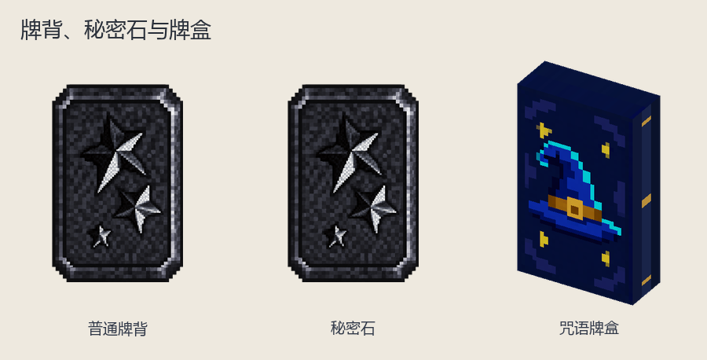

| 实图 | 名称 | 数量／所属 | 用途与区别 |
| --- | --- | --- | --- |
| 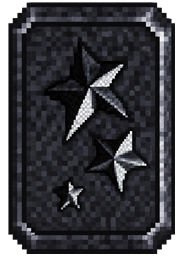 | 普通牌背 | — | 本人未知咒语。 |
|  | 秘密石 | 4 | 每小局预留 4 枚；猫头鹰用于查看。 |
| 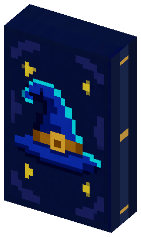 | 咒语牌盒 | 1 | 剩余普通咒语石。 |

<!-- END COMPONENTS -->

[返回说明书目录](README.md)
