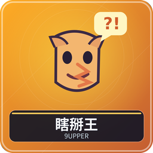
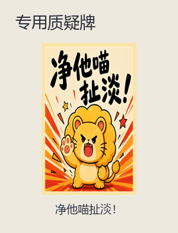
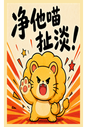

# 瞎掰王：谁真的知道答案

3～8 人。围绕一条冷知识，大聪明通过问答找老实人；其他人编出可信解释，争取被当作老实人。每人当一次大聪明后比较累计分，最高者获胜。

## 开始前

腾空快捷栏第 8、9 格。准备聊天或语音，让每个人都能参与问答。题目是系统抽取的文字，不是需要从背包打出的扑克牌；每轮更换，整场不保证题目不重复。没有独立玩法参数。

## 三种身份和信息边界

| 身份 | 看得见什么 | 应该做什么 |
| --- | --- | --- |
| 大聪明 | 题目词语与关键词，不看真答案 | 向其他人提问、质疑，最后指认老实人 |
| 老实人 | 题目、关键词、真实答案 | 按真相解释，让大聪明相信自己 |
| 瞎掰人 | 题目与关键词，不知道真答案 | 编一个自洽的解释，争取被指认 |

每轮一位大聪明、一位老实人，其余瞎掰人。阅读阶段只有老实人立即知道其身份并可看真答案，阶段结束才公开大聪明并私下告知其余身份。不要把私人答案贴到聊天。

## 一轮分五步

1. **读题 20 秒。**用紫色染料 Q 可以重开阅读窗口。老实人抓紧记下答案，阅读结束后不能再查；其他人读词语和关键词，准备解释。
2. **公布本轮角色。**确认谁是大聪明；其他人不公开自己到底是老实人还是瞎掰人。
3. **自由问答。**大聪明可询问每个人、追问细节、比较不同解释，没有固定发言顺序。
4. **可选质疑。**大聪明持“净他喵扯淡！”按 Q 选择一人，每轮最多一次。质疑结果要等结算揭晓，不会立即结束问答。
5. **最终指认。**绿色染料“结束问答并指认”Q，选一人认为是老实人。随后揭示身份、加减分，轮换下一位大聪明。

初始大聪明随机，之后按实际座位轮换、跳过空座，每人一次。还没有指认就不算完成这轮，关窗口可用当前工具重开。

## 计分逐项相加

| 事件 | 得失 |
| --- | --- |
| 指对老实人 | 大聪明 +1，老实人 +1 |
| 指到瞎掰人 | 那名瞎掰人 +1 |
| 质疑瞎掰人 | 大聪明 +1，目标 −1 |
| 错疑老实人 | 大聪明 −3，老实人 −1 |

例如大聪明正确质疑甲为瞎掰人，最终又正确指认乙为老实人：大聪明本轮共 +2，甲 −1，乙 +1。质疑与指认是两次独立判断，不能只做质疑就等下一轮。

## 第一次提问可以这样做

让所有人先各用一句话解释，再追问一个具体情景。对两种相互矛盾的答案问同样细节，观察能否自圆其说。老实人不应直接读答案原文，瞎掰人可以利用公开关键词，但不能偷看老实人的屏幕。

本游戏主要组件是文字题目、三种身份信息、阅读工具、一次质疑牌和最终指认工具；完整身份与得分均在上表，不存在额外可主动发动的身份技能。

暂停等见[共同操作](00-新手入门与界面图例.md)。管理员中止：`/function bullshit:admin/abort`。

<!-- BEGIN COMPONENTS -->

## 组件实图与逐件图鉴

这些图片直接取自配套资源包，立体物件按实际 Java 模型渲染。卡牌展示真实正面，动画纹理取第一帧；皮肤头像、发光和粒子属于游戏内动态效果。

### 专用质疑牌

| 实图 | 名称 | 数量／所属 | 用途与区别 |
| --- | --- | --- | --- |
|  | 净他喵扯淡！ | 1 | 大聪明每轮可质疑一人；不代替最终指认。 |

<!-- END COMPONENTS -->

[返回说明书目录](README.md)
