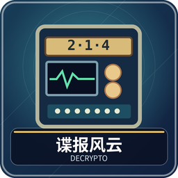

# 谍报风云：让队友懂，让对手猜不透

3～8 人。四人以上分两队，每队保有四个秘密词，靠三条线索传递三位密码；队友解密，对方拦截。三人局改为两人合作对一名截密者。

## 准备与组件

清空九格快捷栏。默认书本输入无需 OP；设置改为文字对话框后，加密者提交文字需要 OP。4～8 人默认随机均分，奇数红队多一人；固定座位分队时，四座桌对座同队，八座桌北南／东西两队。每队 2～4 人，人数差不超过一。开局前可分别设置加密时间和猜码时间，默认均不限时。

四个秘密词分别固定编号 1、2、3、4，整场不变。密码由三个互不相同的数字组成，如 314。系统提供的笔记记录公开线索和正确对应关系。绿标是成功拦截，红标是本队解密失败。这些都是文字信息与标记，不是一副有固定插画效果的行动牌。

## 每个人负责什么

两人队轮换“加密兼拦截者”和解密者：加密者写完自己的提示后，负责拦截对手密码，队友解密本队密码。三人队分别轮换加密、解密、拦截；四人队多一个轮空位。轮空可看己方词和笔记但不能提交。两队同轮同步进行，统一结算后再轮换职责。

加密者看密码，按密码顺序为对应词各写一条线索。解密者知道己方四词却不知道密码，要猜本队数字；拦截者不知道对手四词，只能靠公开历史猜对手密码。加密者交出线索后不要参与猜码讨论。

## 一整轮怎么走

1. 两队加密者同时编写并提交三条线索，例如密码 314 就依次提示第 3、1、4 个词。先交的一队等待，双方交齐或加密时间到后统一公开有效提示。
2. 两队解密者猜己方密码，拦截者猜对方密码，同时操作；第一轮只有解密，没有拦截。按窗口依次选三个不同数字，顺序必须正确。
3. 所有应交的答案交齐，或猜码时间到后，统一公布正确密码和猜测，记入历史。拦对得绿标，己方解错得红标；已提交答案不能重选。
4. 统一检查双方胜负，再进入下一轮并轮换职责。没有“红队整套做完才轮到蓝队”的等待顺序。

## 可选限时与超时处理

大厅“游戏设置”有两个独立选项：**加密限时**与**拦截＋解密限时**。每项可选不限时、60、90、120、180、240 秒，默认不限时；三人局也适用。

- **加密阶段**从发放本轮提示册／操作物时开始计时，两队共用这一个倒计时。先交的队不会为另一队重新计时。时间到，没交有效提示的队记 **一次传讯失误（红标）**，该队这次密码的己方解密、对手拦截均取消；另一队若已交提示，其密码照常被解密和拦截。
- **猜码阶段**在有效提示公开时开始，所有本轮解密和拦截共用新的倒计时。时间到只结算已有答案：未交的解密按错误计一次红标，未交的拦截按失败处理，不额外罚红标。已交答案照常保留。
- 如果两队加密都超时，两队各记一次红标，直接检查胜负并进入后续流程，不再让玩家猜不存在的提示。一次加密超时不会因为取消的解密再罚一次红标。若超时已触发终局，游戏立即结束。
- 倒计时在 BetterTitle 中持续显示剩余秒数。收到“加密超时”提示物时可按 Q 查看说明；超时之后旧提示册不能补交本轮。
- 提交齐全会提前结束该阶段，不必等倒计时归零。玩家离线造成整桌暂停时，计时也暂停；全部原玩家重连后继续剩余时间，重载不会获得一份新的完整时间。

**例：**红队已交提示，蓝队加密超时。蓝队得一枚红标；蓝队密码不再猜，红队也没有对此密码的拦截机会。红队密码依然由红队解密、蓝队拦截；若是第一轮，仍只有红队解密。

## 写线索和提交

书本模式：书与笔恰好三页，第 1、2、3 页按顺序各写一条非空线索；点“完成”，**不签名**，再 Q 丢出提交。被退回时改正空页或页数。

对话框模式：加密者紫色染料 Q，按显示顺序填写三条，每条 1～24 字符；关闭不保留草稿。猜码者紫色染料 Q 重开选择窗口，已经提交则不能擅自换码。

线索应与词语有语义联系，使用公开常识。不要直接说词或翻译，不用字数、位置、拼音、谐音和私人暗号；整场不重复已经用过的线索。比如“苹果”可以提示“果园”，之后“牛顿”，让己方懂又不马上泄露给对手。

## 结束与三人特例

两队模式先得两枚绿标获胜，或累计两枚红标落败，同轮统一结算后检查；双方同轮满足胜利条件则平局。加密超时也会检查累计红标。达到设置轮数仍无胜负则结束，不补猜词决胜。设置轮数 1～32，默认 8。

三人局随机一人全场截密，另两人轮换加密、解密；第一轮不拦截，共五轮。截密成功次数加合作队解密失败次数累计到二，截密者胜；否则五轮后合作队胜。

例如自己解密正确，不代表对方拦截失败；双方猜测独立结算。绿色、红色不是一般积分，目标是两枚；密码 314 与 341 也不是同一个答案。

管理员中止：`/function decrypto:admin/abort`。离线暂停和回座见[共同操作](00-新手入门与界面图例.md)。

<!-- BEGIN COMPONENTS -->

## 组件实图与逐件图鉴

这些图片直接取自配套资源包，立体物件按实际 Java 模型渲染。卡牌展示真实正面，动画纹理取第一帧；皮肤头像、发光和粒子属于游戏内动态效果。

本游戏的信息通过文字、书本和原版染料显示；没有额外的独立棋盘或插画牌组。正文逐项说明身份、操作物与题卡类别。

<!-- END COMPONENTS -->

[返回说明书目录](README.md)
