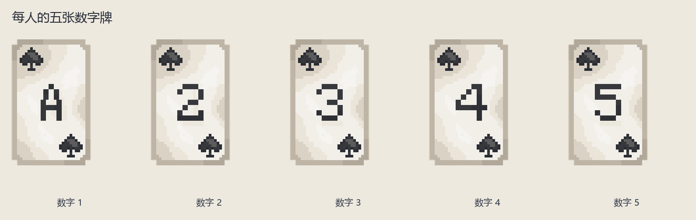
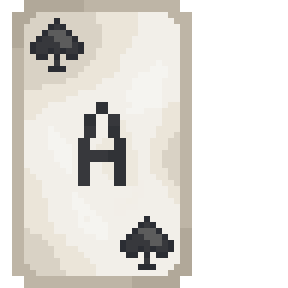
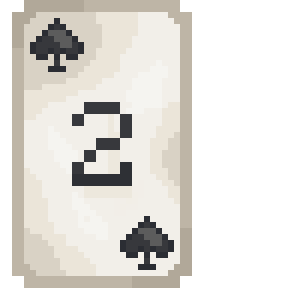
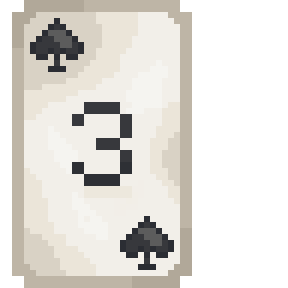
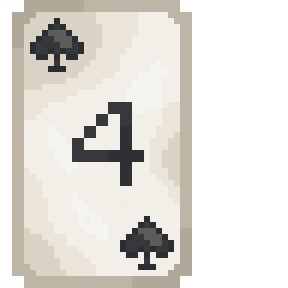
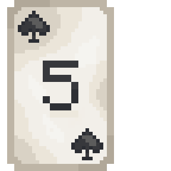

# 临界点：别让总数失控

3～6 人。每局随机一位狼人，其余村民。大家秘密使用数字牌控制全桌总数，安全回合留下线索，危机则进入找狼投票。狼人希望最终投错或平票，村民希望认出狼人或安全撑完五轮。

## 准备与组件

腾空九格快捷栏。每人获得数字 1、2、3、4、5 各一张，整局各只能用一次；没有抽牌或补牌。黑色染料表示“这轮倾向出大”，白色表示“倾向出小”，绿色为准备下一轮，红色为发动主动投票，紫色是投票窗口入口。身份只有本人知道，村民与狼人都使用相同数字牌。

## 一轮照着做

1. 先用黑／白染料 Q 公开表态。表态不锁定实际数字，可以说大却出小。
2. 表态工具收走，手中出现未用数字。选一张按 Q，秘密锁定，等所有人交牌。可以讨论倾向，不能直接约定每人的具体数字。
3. 全部交齐计算总和，和下表安全线比较。等于安全线也安全。
4. 安全则公开每人这轮的数字。前四轮每人用绿色 Q 准备，全员准备后下一轮；也可有人用红色 Q 发动主动最终投票。
5. 超线则危机，只公开总和，不公开各人牌，直接最终投票。五轮全安全且没有主动投票，村民直接胜。

| 人数 | 3 | 4 | 5 | 6 |
| --- | --- | --- | --- | --- |
| 安全线＝3×人数＋2 | 11 | 14 | 17 | 20 |

主动投票结束数字阶段，是整局唯一一次最终投票，不是每人都能投完再继续。发动不能取消。安全时准备不代表可以把已出数字拿回来。

## 最终投票

每人秘密选一名其他玩家，不能自己、不能弃权。窗口关闭用紫色 Q 重开。全员提交后：唯一最高票是狼人，村民胜；唯一最高票是村民，狼人胜；最高票不唯一，狼人也胜。

危机本身不会直接让狼人赢，还要投票。例如四人出 2、3、4、5，总和 14 安全且公开；若是 3、3、4、5，总和 15，只公布 15，再投票。即使大家知道总数超标，也不知道是谁实际偏离表态。

## 初次游玩要点

留意某人前几轮已用过什么数字；后期可选数越来越少，不能只看本轮发言。村民没必要每轮都出小，因为大牌不会消失，最后仍要用。投票平票对狼人有利，村民应在投票前充分讨论。

固定玩法，无独立规则设置。离线等见[共同操作](00-新手入门与界面图例.md)。管理员中止：`/function critical_point:admin/abort`。

<!-- BEGIN COMPONENTS -->

## 组件实图与逐件图鉴

这些图片直接取自配套资源包，立体物件按实际 Java 模型渲染。卡牌展示真实正面，动画纹理取第一帧；皮肤头像、发光和粒子属于游戏内动态效果。

### 每人的五张数字牌

| 实图 | 名称 | 数量／所属 | 用途与区别 |
| --- | --- | --- | --- |
|  | 数字 1 | 每人 1 张 | 本游戏按 1 点计，不按扑克 A 的大小。 |
|  | 数字 2 | 每人 1 张 | 每名玩家整局限用一次；不比较花色。 |
|  | 数字 3 | 每人 1 张 | 每名玩家整局限用一次；不比较花色。 |
|  | 数字 4 | 每人 1 张 | 每名玩家整局限用一次；不比较花色。 |
|  | 数字 5 | 每人 1 张 | 每名玩家整局限用一次；不比较花色。 |

<!-- END COMPONENTS -->

[返回说明书目录](README.md)
