# 骷髅牌：你敢翻几张花

2～6 人。把花与骷髅秘密扣在桌上，竞价承诺自己能翻出多少安全花。成功挑战两次，或成为唯一仍有牌的玩家，就赢整场。

## 准备与四张牌

清空快捷栏九格。每人三张花、一张骷髅。花翻开安全，骷髅一翻开挑战立即失败。八个座号使用八套不同图案，规则完全一样；每张图案在本页图鉴展示。手中本人看正面，其他人看牌背，不能从别人手持模型判断类型。

每轮按 Q 扣牌，叫号、加价、翻别人牌堆和自选失牌通过必要窗口完成，紫色 Q 可重开。最先放的牌在底，新放在顶，翻牌从顶开始。

## 每轮的五个阶段

1. **所有人先扣一张。**秘密选手中花或骷髅 Q，等大家完成。
2. **轮流加牌或开价。**起始者随机，之后顺座位。轮到你可 Q 再扣一张，或叫愿意翻的数量。没手牌必须叫号。
3. **开始竞价后不再加牌。**轮到你只能提高或放弃。开价至少等于自己扣牌数，不大于桌上总数；后续至少为“自己扣牌数”和“当前价＋1”中的较大值。放弃后本轮不能重新加价。
4. **最高叫价者挑战。**仅一人未放弃，或有人叫到全部牌数，就确定挑战者。先自动翻自己整叠，再逐次选择其他玩家的堆顶。
5. **结算收牌。**翻够承诺数量且全是花则成功；碰到骷髅立即失败。没永久丢掉的牌回手，短暂计分后下一轮。

## 失败会失去什么

翻别人的骷髅：从挑战者全部剩余牌等概率随机永久丢一张；翻自己的骷髅：挑战者秘密自选一张永久丢弃，也能选这轮已扣的牌。丢的具体牌不公开且不补回；失去最后一张便淘汰。牌少仍能继续，只是选择更少。

成功记一次挑战胜利，第二次即整场胜。挑战者成为下轮先手；若其淘汰，顺延下一位存活者。别人放弃竞价不代表其扣牌退出，挑战者仍可翻那个人的堆。

## 一个挑战例子

你扣两张，全桌共九张，叫 4；另一人叫 6，其余全放弃。对方先把自己的全部牌翻完，再从其余玩家顶牌选择，合计翻到六朵花才赢一次。只要过程中见骷髅，就算已经翻出五朵花也失败。

别把“桌上有六朵花”当作“能安全找到六朵花”：自己整叠必须先翻，别人的底牌也得逐张从上打开。自己的骷髅还在底层时，最高竞价会迫使你翻它，风险很大。

固定玩法，无独立参数。管理员中止：`/function skull:admin/abort`。离线等见[共同操作](00-新手入门与界面图例.md)。

<!-- BEGIN COMPONENTS -->

## 组件实图与逐件图鉴

这些图片直接取自配套资源包，立体物件按实际 Java 模型渲染。卡牌展示真实正面，动画纹理取第一帧；皮肤头像、发光和粒子属于游戏内动态效果。

### 八个座位的花牌、骷髅与牌背

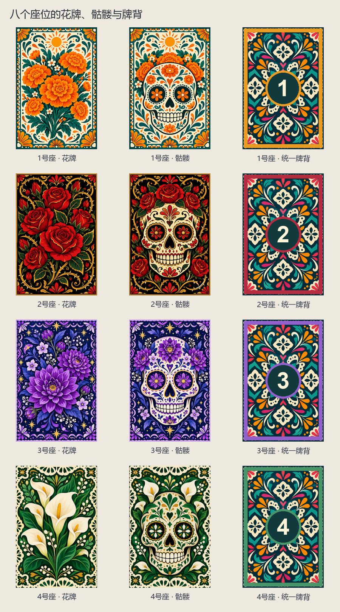

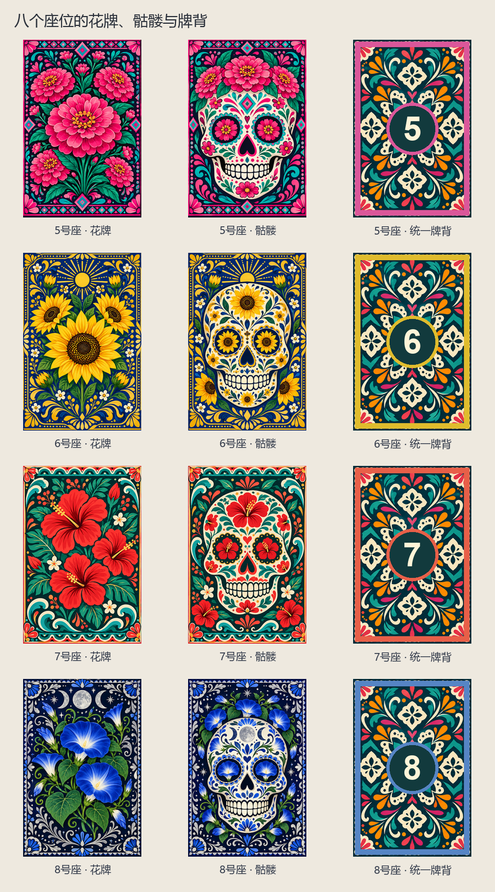

| 实图 | 名称 | 数量／所属 | 用途与区别 |
| --- | --- | --- | --- |
| 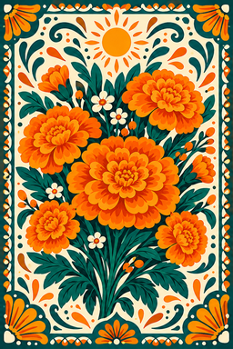 | 1号座 · 花牌 | 3 | 挑战时翻到即安全，累计花数。 |
|  | 1号座 · 骷髅 | 1 | 挑战者翻到立即失败。 |
| 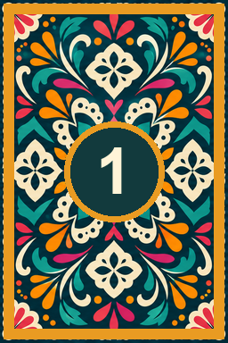 | 1号座 · 统一牌背 | — | 扣放时不公开正面。 |
| 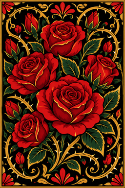 | 2号座 · 花牌 | 3 | 挑战时翻到即安全，累计花数。 |
| 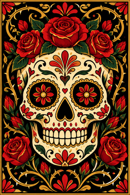 | 2号座 · 骷髅 | 1 | 挑战者翻到立即失败。 |
| 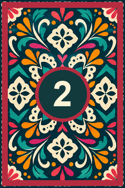 | 2号座 · 统一牌背 | — | 扣放时不公开正面。 |
|  | 3号座 · 花牌 | 3 | 挑战时翻到即安全，累计花数。 |
|  | 3号座 · 骷髅 | 1 | 挑战者翻到立即失败。 |
| 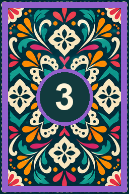 | 3号座 · 统一牌背 | — | 扣放时不公开正面。 |
|  | 4号座 · 花牌 | 3 | 挑战时翻到即安全，累计花数。 |
|  | 4号座 · 骷髅 | 1 | 挑战者翻到立即失败。 |
| 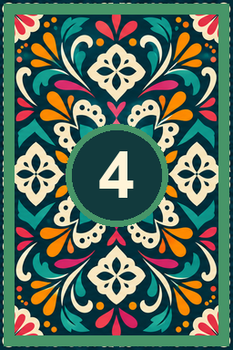 | 4号座 · 统一牌背 | — | 扣放时不公开正面。 |
| 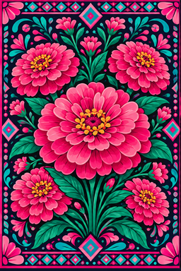 | 5号座 · 花牌 | 3 | 挑战时翻到即安全，累计花数。 |
|  | 5号座 · 骷髅 | 1 | 挑战者翻到立即失败。 |
| 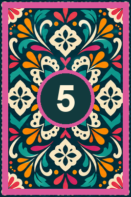 | 5号座 · 统一牌背 | — | 扣放时不公开正面。 |
| 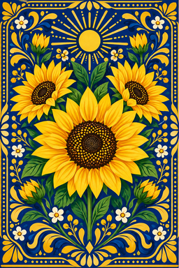 | 6号座 · 花牌 | 3 | 挑战时翻到即安全，累计花数。 |
|  | 6号座 · 骷髅 | 1 | 挑战者翻到立即失败。 |
| 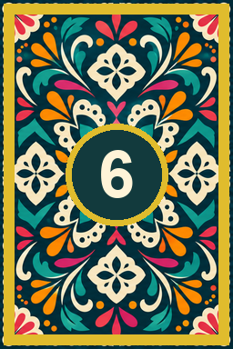 | 6号座 · 统一牌背 | — | 扣放时不公开正面。 |
| 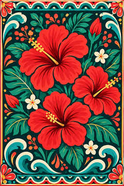 | 7号座 · 花牌 | 3 | 挑战时翻到即安全，累计花数。 |
| 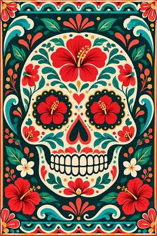 | 7号座 · 骷髅 | 1 | 挑战者翻到立即失败。 |
| 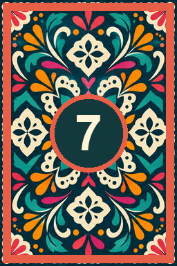 | 7号座 · 统一牌背 | — | 扣放时不公开正面。 |
|  | 8号座 · 花牌 | 3 | 挑战时翻到即安全，累计花数。 |
|  | 8号座 · 骷髅 | 1 | 挑战者翻到立即失败。 |
| 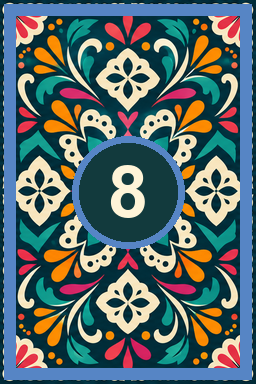 | 8号座 · 统一牌背 | — | 扣放时不公开正面。 |

<!-- END COMPONENTS -->

[返回说明书目录](README.md)
