# 斗地主：经典、2v2 与八人双桌赛

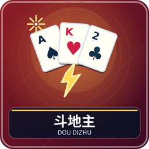

至少一名真人，空位补人机。大厅可选经典三席、2v2 四席、4v4 八席；4v4 只用八座桌。经典一名地主对两名农民，地主先出完则地主胜，任一农民先出完两名农民都胜。组队赛另按固定队伍计分，见后文。

## 准备与扑克基础

腾空快捷栏第 9 格。54 张＝四种花色 2～A 各一张，加小王、大王。每副由三人各拿 17 张，留三张底牌，地主确定后拿底牌成为 20 张，并先出。

点数从小到大：3、4、5、6、7、8、9、10、J、Q、K、A、2、小王、大王。花色无大小；顺子、连对、飞机的连续主体不含 2 和王。图鉴展示点数与花色示例，并列出完整 54 张清单，三种模式都用同一副。

## 选牌和跟牌

轮到你第 9 格紫色染料 Q 打开手牌。点击实卡选择，再点取消，金框表示已选；“清空”取消全部。按“出牌”提交，“不出”让过；“提示”从较小合法应牌起轮选候选，选好后仍需点出牌。窗口关了可 Q 重开，关闭不会自动出。

一墩开始叫“领出”，可以选任意合法牌型；其他人必须同型、同张数且更大，或用炸弹／王炸。可以不出，即使能压也允许。连续两家不出，这墩结束，最后出牌者重新领出；领出者不能不出。桌面旧牌只作记录，比较以当前有效上一手为准。

## 所有牌型

| 类型 | 组成与最小长度 | 例子／比较 |
| --- | --- | --- |
| 单张、对子、三张 | 1、2、3 张同点 | 对 9 压对 8，不能用三张压对子 |
| 三带一／三带二 | 三同点＋一散张／一对 | 777K／777KK，比三张部分 |
| 顺子 | 至少五个连续单点 | 34567，比最高点；长度须相同 |
| 连对 | 至少三个连续对子 | 334455，比最高对；长度相同 |
| 飞机 | 至少两组连续三张，可不带或每组带一单／一对 | 333444、33344457、3334445577，比主体 |
| 四带二单／四带二对 | 四同点＋两单／两对 | 四带两单的两单可成一对；带牌不改四张主体 |
| 炸弹 | 四同点 | 压全部普通牌；同为炸弹比点数 |
| 王炸 | 大王＋小王 | 最大，压所有炸弹 |

飞机单翅可出现一对，但同一点数最多当两张翅膀，不能同时带大小王。带牌不能替代缺失主体。同点数较大不代表不同牌型也能压，比如三张 A 不能压一对 3。

## 叫地主的三种方式

| 模式 | 每个人该做什么 |
| --- | --- |
| 叫分，默认 | 随机先叫，不叫或叫比当前高的 1～3；3 分立即确定，最高者地主 |
| 叫抢，经典可选 | 第一轮叫／抢／不要，每次抢翻倍；有资格者按提示进入第二轮，首个抢者确定；仅剩一人无需再问 |
| 手速，经典可选 | 发牌后三人同时抢叫，最早有效提交者为地主；前 2 秒×4，至 5 秒×2，至 15 秒×1，无人叫重发 |

经典全员不叫重发，不计副数；组队固定叫分，全员不叫为本副流局、0 分，照常换轮空者并计副数。

## 经典三人计分

底分为叫分；叫抢和手速底分 1。初始倍数再与每次炸弹、王炸的×2相乘。地主胜且两农民从没出过牌是春天；农民胜且地主只出过一手是反春天，都再×2。

底分×倍数是每名农民得失，地主得失两倍。例如底分 2、一次炸弹，地主胜则地主 +8，两农民各 −4。选赢副制时每位胜者记 1 分。打完设置副数比较累计分，局间自动继续。

## 2v2 固定队伍

四方橙／青各两人，对座是队友。每副随机／轮换一人暂不发牌，其余三人各 17 张并叫分。确定地主后 **地主的固定队友轮空**；若该队友已拿牌，整手转给原轮空的另一队玩家，两位对手当农民。轮空者 HUD 可只读看本队地主手牌，不能代替他操作。

地主赢＝地主队赢，任一农民赢＝农民队赢。分数制只给胜队加叫分×实际倍数；赢副制胜队 +1。每副最初叫分轮空者按座位轮换，流局也轮换，整场比较队分。

## 4v4 八人双桌赛

八座桌四边依次为红1／红3、蓝2／蓝4、红2／红4、蓝1／蓝3。奇数座甲桌，偶数座乙桌；两桌同牌序，分别按 2v2 规则确定地主和轮空。只操作自己的分桌。

两桌都结束后比较红蓝双方本副在两桌获得的分数：领先队得分，分数制每副最多 12，赢副制领先 +1，同分双方 0。单桌流局另一桌继续；双流局本副两队 0。规定副数后累计相同继续加副，直到分出胜负。

隐藏比分模式只在终场公布累计比分，约四分之三赛程时暂停，请每位真人用染料预测己队领先／落后的差距：0～6、7～12、13～17、18+。交齐私下判断对错再继续；平分时两种 0～6 都对。单副赛直接结算。

## 设置和新手排错

大厅可选模式、1～32 副（默认 1）、叫地主方式、分数／赢副、4v4 比分公开方式、正常／不洗牌、音乐、余牌数、记牌器、每步不限时或 30／60／90／120 秒。组队固定叫分。不洗牌更易保留组合，不改变牌型规则。

没任何合法应牌时真人约 5 秒自动不出；设时限后，跟牌超时不出，领出超时出最小单张，叫分超时不叫。人机是补位练习策略，可能漏掉最优组合。角落行动箭头与倒计时能确认是否轮到自己。

不能出时先查牌型、张数和主体大小，再查是否选入多余牌。“提示”不会自动提交，“不出”也不是投降。管理员中止：`/function doudizhu:admin/abort`；暂停见[共同操作](00-新手入门与界面图例.md)。

<!-- BEGIN COMPONENTS -->

## 组件实图与逐件图鉴

这些图片直接取自配套资源包，立体物件按实际 Java 模型渲染。卡牌展示真实正面，动画纹理取第一帧；皮肤头像、发光和粒子属于游戏内动态效果。

### 扑克牌面示例与完整牌库清单

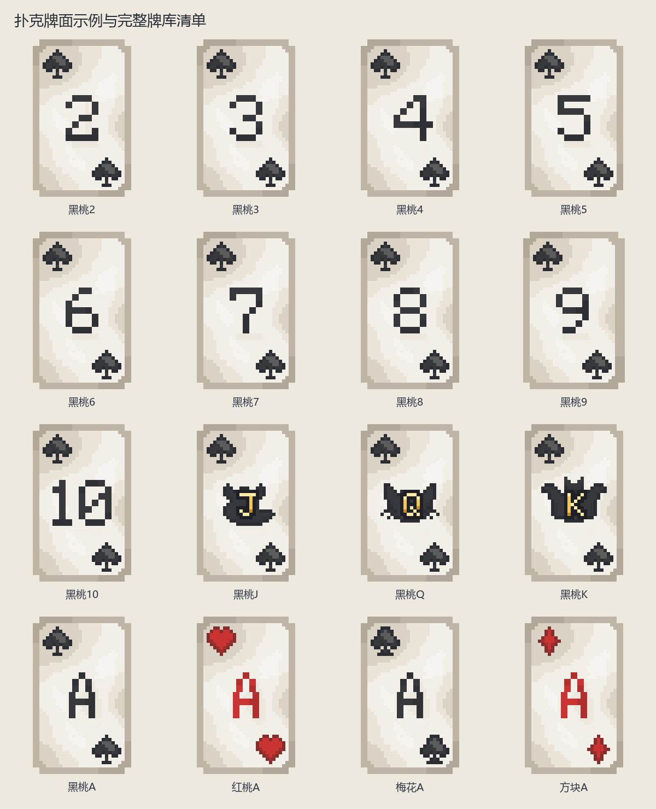

| 实图 | 名称 | 数量／所属 | 用途与区别 |
| --- | --- | --- | --- |
| 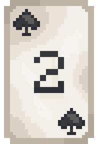 | 黑桃2 | 1 | 点数和花色见牌角；不同游戏的大小关系及连续牌规则分别说明。 |
| 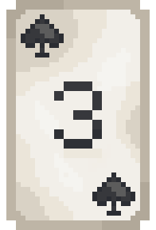 | 黑桃3 | 1 | 点数和花色见牌角；不同游戏的大小关系及连续牌规则分别说明。 |
| 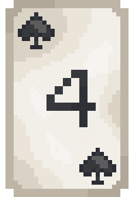 | 黑桃4 | 1 | 点数和花色见牌角；不同游戏的大小关系及连续牌规则分别说明。 |
| 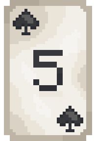 | 黑桃5 | 1 | 点数和花色见牌角；不同游戏的大小关系及连续牌规则分别说明。 |
| 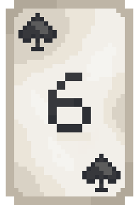 | 黑桃6 | 1 | 点数和花色见牌角；不同游戏的大小关系及连续牌规则分别说明。 |
| 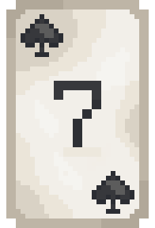 | 黑桃7 | 1 | 点数和花色见牌角；不同游戏的大小关系及连续牌规则分别说明。 |
| 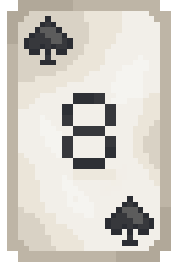 | 黑桃8 | 1 | 点数和花色见牌角；不同游戏的大小关系及连续牌规则分别说明。 |
| 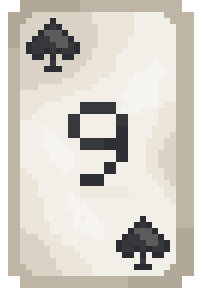 | 黑桃9 | 1 | 点数和花色见牌角；不同游戏的大小关系及连续牌规则分别说明。 |
| 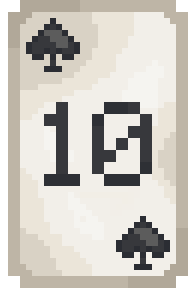 | 黑桃10 | 1 | 点数和花色见牌角；不同游戏的大小关系及连续牌规则分别说明。 |
| 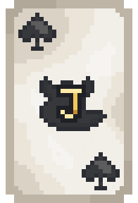 | 黑桃J | 1 | 点数和花色见牌角；不同游戏的大小关系及连续牌规则分别说明。 |
| 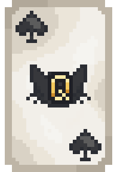 | 黑桃Q | 1 | 点数和花色见牌角；不同游戏的大小关系及连续牌规则分别说明。 |
| 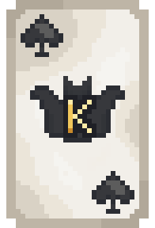 | 黑桃K | 1 | 点数和花色见牌角；不同游戏的大小关系及连续牌规则分别说明。 |
| 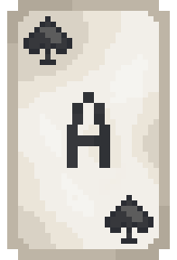 | 黑桃A | 1 | 点数和花色见牌角；不同游戏的大小关系及连续牌规则分别说明。 |
| 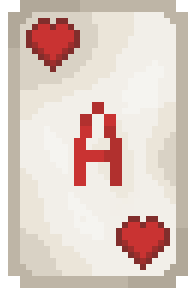 | 红桃A | 1 | 点数和花色见牌角；不同游戏的大小关系及连续牌规则分别说明。 |
| 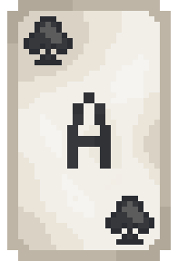 | 梅花A | 1 | 点数和花色见牌角；不同游戏的大小关系及连续牌规则分别说明。 |
| 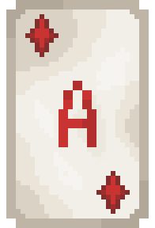 | 方块A | 1 | 点数和花色见牌角；不同游戏的大小关系及连续牌规则分别说明。 |

### 大小王

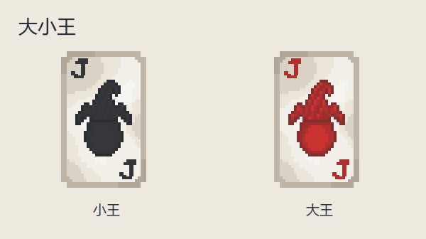

| 实图 | 名称 | 数量／所属 | 用途与区别 |
| --- | --- | --- | --- |
| 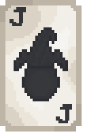 | 小王 | 1 | 专用特殊牌；是否使用见该游戏牌库。 |
| 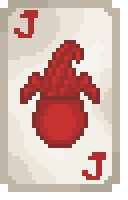 | 大王 | 1 | 专用特殊牌；是否使用见该游戏牌库。 |

花色与点数只改变牌角和花色图案，省略重复的大图。下表列出实际全部牌面：

| 花色 | 全部点数 | 各牌面张数 |
| --- | --- | --- |
| 黑桃 | 2、3、4、5、6、7、8、9、10、J、Q、K、A | 1 |
| 红桃 | 2、3、4、5、6、7、8、9、10、J、Q、K、A | 1 |
| 梅花 | 2、3、4、5、6、7、8、9、10、J、Q、K、A | 1 |
| 方块 | 2、3、4、5、6、7、8、9、10、J、Q、K、A | 1 |
| 王 | 小王、大王 | 1 |

### 牌盒

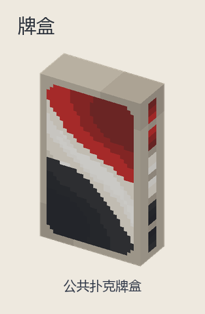

| 实图 | 名称 | 数量／所属 | 用途与区别 |
| --- | --- | --- | --- |
| 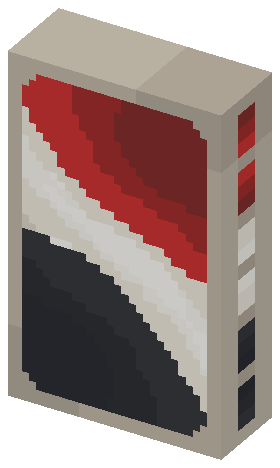 | 公共扑克牌盒 | 1 | 仅用于发牌、收牌展示，不是可带走的手牌。 |

<!-- END COMPONENTS -->

[返回说明书目录](README.md)
