# UNO：先出完牌，别忘了喊

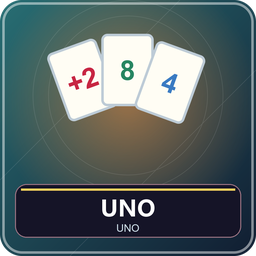

2～8 人。匹配颜色、数字或功能符号轮流出一张，先把手牌出完赢小局；剩一张前要喊 UNO。默认玩一局，也能按固定局数累计分或赛到目标分。

## 准备和牌面

腾空快捷栏第 1 格，系统给每人七张，随机先手、默认顺时针，以数字牌开场。手牌在本人 BetterTitle 显示，只有本人正常回合第 1 格有手牌操作物，Q 打开选牌。

牌库共 108：红黄绿蓝每色 0 一张，1～9 各两张，跳过、反转、+2 各两张；黑色变色、变色 +4 各四张。本页展示全部数字、功能和颜色的代表牌面，列出完整数量，省略换色重复图。卡角颜色、数字／功能决定能否跟，图案相同牌会在菜单合并显示数量。

## 你的回合

1. 看当前有效顶牌和颜色。桌上每人最近一次旧出牌不是新的跟牌依据。
2. Q 开面板，点一张选中，金框显示；再点同牌取消，点另一种转移选中。
3. 同颜色、同数字或同功能符号至少满足一项就可出；普通变色随时可出。点“出牌”才提交，若出完只剩一张应点“出牌并喊 UNO”。
4. 不想出或无合法牌，点“摸一张”。若刚摸的合法，可出这张或保留结束；不能改出原手牌，不能一直摸到能出。
5. 变色牌先选红黄绿蓝，再提交；选色不等于牌已经打出。

每回合只出一张，不能一次出相同两张，不能抢出，不能叠罚牌。主动摸牌即使有合法牌也允许。

## 每种功能牌

| 牌 | 完整效果 |
| --- | --- |
| 跳过 | 下一家失去回合 |
| 反转 | 行动方向反向；二人局等于跳过对手，自己再行动 |
| +2 | 下一家摸两张并失去回合，不得再 +2 转嫁 |
| 变色 | 出牌者指定新颜色，可仍选原色 |
| 变色 +4 | 指定颜色；下一家接受摸四并跳过，或提出质疑 |

二人局对手吃 +2／接受 +4 后也回到你行动。牌堆空时保留弃牌顶，其余洗回摸牌堆；若牌都在手里，只摸现存数量。

## +4 的合法性和质疑

合法条件是出牌前手中 **没有当前颜色的牌**，不是“没有任何可出牌”。其他颜色但同点数的牌不影响 +4；普通黑变色也不算当前色。

默认可诈唬，由被罚者在必要窗口决定：接受，自己摸四跳过；质疑成功，出牌者原有当前色，改由出牌者摸四，质疑者正常行动；质疑失败，自己摸六跳过。系统查看出牌前快照，只公开结果不公开整手。关窗口不取消响应，可点聊天入口重开。

若设置关闭质疑，系统直接拒绝非法 +4，不能诈唬。最后一张 +4 也先处理质疑，再宣布小局结果；质疑成功让原出牌者重新摸牌，小局继续。

## 喊 UNO、罚牌和结算

打出倒数第二张时应同时喊 UNO。手动模式漏喊会暂停普通回合，默认三秒内本人可补喊，别人可抓；服务器先收到有效操作优先。别人先抓到漏喊者摸二，本人先补喊安全，无人抓则不罚。窗口关了时间仍在走。自动喊设置开启后系统代喊。

先出完赢小局，末张功能牌仍执行完。胜者得其他玩家手牌总分：数字按面值，跳过／反转／+2 每张 20，变色／+4 每张 50。固定局数比总分，目标分先到者胜；默认单局回大厅。

## 设置和首回合示例

大厅可选单局、固定 1～32 局（默认 3）或目标 100～1000 分（默认 500）；自动喊默认关，+4 质疑默认开，抓 UNO 1～5 秒（默认 3）。本包没有 7-0 换手、罚牌叠加或扩展换手牌。

当前红 7，你可出任意红牌、其他色 7 或普通变色；蓝跳过不能靠“也是功能牌”就跟。若出红 +2，下家不能用蓝 +2 叠加。只剩两张时先选好牌，再用“出牌并喊 UNO”。

管理员中止：`/function uno:admin/abort`；共同暂停和资源包问题见[新手入门](00-新手入门与界面图例.md)。

<!-- BEGIN COMPONENTS -->

## 组件实图与逐件图鉴

这些图片直接取自配套资源包，立体物件按实际 Java 模型渲染。卡牌展示真实正面，动画纹理取第一帧；皮肤头像、发光和粒子属于游戏内动态效果。

### UNO 全部功能与颜色示例

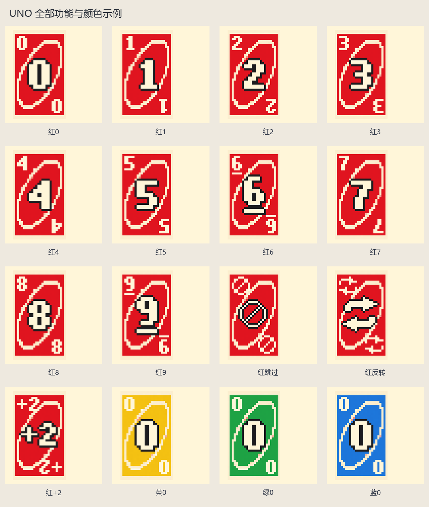

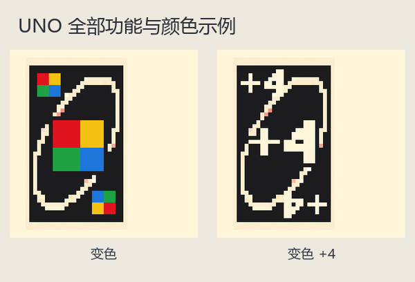

| 实图 | 名称 | 数量／所属 | 用途与区别 |
| --- | --- | --- | --- |
| 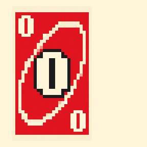 | 红0 | 1 | 同色或同数字可出；计分按面值。 |
| 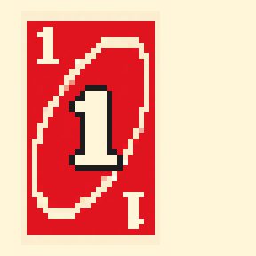 | 红1 | 2 | 同色或同数字可出；计分按面值。 |
| 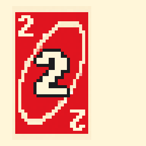 | 红2 | 2 | 同色或同数字可出；计分按面值。 |
| 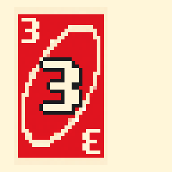 | 红3 | 2 | 同色或同数字可出；计分按面值。 |
| 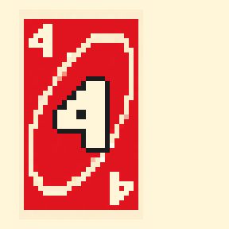 | 红4 | 2 | 同色或同数字可出；计分按面值。 |
| 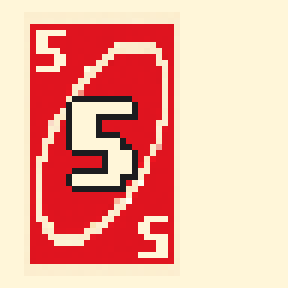 | 红5 | 2 | 同色或同数字可出；计分按面值。 |
| 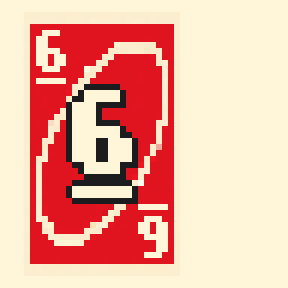 | 红6 | 2 | 同色或同数字可出；计分按面值。 |
| 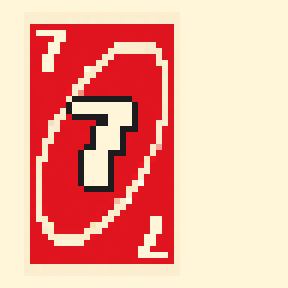 | 红7 | 2 | 同色或同数字可出；计分按面值。 |
| 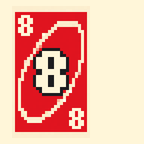 | 红8 | 2 | 同色或同数字可出；计分按面值。 |
| 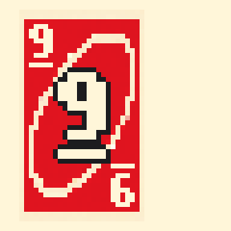 | 红9 | 2 | 同色或同数字可出；计分按面值。 |
| 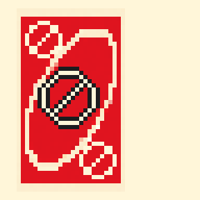 | 红跳过 | 2 | 下一家跳过回合。 |
| 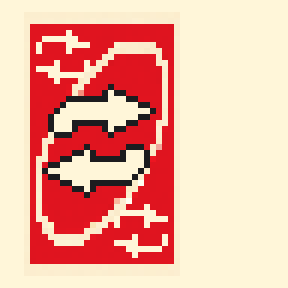 | 红反转 | 2 | 反转行动方向；二人时等于跳过。 |
| 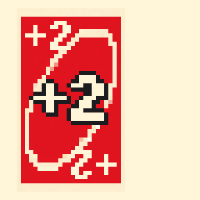 | 红+2 | 2 | 下一家摸 2 张并跳过；不能叠加。 |
| 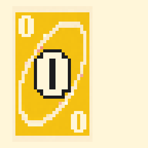 | 黄0 | 1 | 同色或同数字可出；计分按面值。 |
| 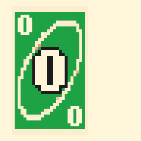 | 绿0 | 1 | 同色或同数字可出；计分按面值。 |
| 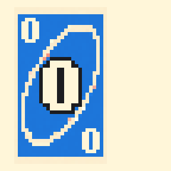 | 蓝0 | 1 | 同色或同数字可出；计分按面值。 |
| 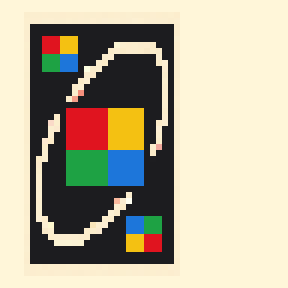 | 变色 | 4 | 指定后续颜色，50 分。 |
| 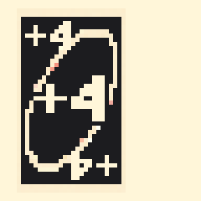 | 变色 +4 | 4 | 指定颜色并要求下一家接受或质疑，50 分。 |

完整颜色／牌型清单：红、黄、绿、蓝每色都有 0、1、2、3、4、5、6、7、8、9、跳过、反转、+2；每色 0 一张，其他各两张。变色与变色 +4 无固定色，各四张。相同符号的四色效果相同，省略换色重复图。

<!-- END COMPONENTS -->

[返回说明书目录](README.md)
