# 国际象棋：保护自己的王，将死对方

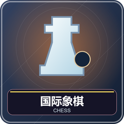

1～2 人，一人自动加人机。双方轮流走一枚棋子，白先。目标是让对方的王受攻击而无合法解法，叫“将死”；不会直接把王吃掉。

## 棋盘、准备和开局摆法

腾空快捷栏第 9 格。8×8 棋盘，白视角右下角为浅格，列 a～h，横行从白方近侧 1 到 8。双方各 16 子。白方第一横行从 a1 到 h1 是车、马、象、后、王、象、马、车，八兵在第二横行；黑方同样布在第八、七横行，后在 d 列、王在 e 列。图鉴展示全部六类棋子的双方外观。

默认按座位选边：南北向白南黑北，东西向白西黑东，双人各坐一侧；侧边座位要换座或设置随机分边。单人可执任一方，电脑执另一方。随机分边后系统调整到对应侧，白方仍先走。

## 六种棋子怎样走

| 子 | 每方 | 走法 | 吃法／限制 |
| --- | --- | --- | --- |
| 王 | 1 | 任意方向一格 | 不能走进被攻击格，两王不能相邻 |
| 后 | 1 | 横、竖、斜任意距离 | 不能越子 |
| 车 | 2 | 横、竖任意距离 | 不能越子 |
| 象 | 2 | 斜任意距离 | 不越子，一生留同色格 |
| 马 | 2 | 一个方向两格、转直角一格 | 可跳过棋子，不受“马腿”影响 |
| 兵 | 8 | 向前一格，初始位可两格 | 斜前一格吃子，不后退，不直吃 |

除兵外，走到敌子格就吃掉敌子，不能停在自己棋子格。任何走法都不能让自己的王仍被将军。“将军”是王正在被攻击，被将军必须移动王、吃掉攻击子或阻挡攻击线；马的攻击不能靠挡线解除。

## 在游戏里走一步

右键己子选中，金框与 actionbar 显示棋种，绿色框表示合法目标；右键另一己子可换选，再右键空格或敌子格走子。非法尝试取消选择，重新选子。动画期间等落位再走下一步。

第 9 格 Q 打开悔棋、和棋、认输等菜单。双人悔棋与协议和棋需对方同意，等待仍计时，有新走子旧申请失效。双人悔棋撤回最后一步；人机悔棋回到自己上次走子前，必要时连电脑应手一起撤回。认输要本人再次确认。

## 三条特殊走法

**王车易位：**王和该侧车从未动过，中间无子，王当前、经过、到达格都不受攻击。选王后点最终格：白王 e1→g1 或 c1，黑王 e8→g8 或 c8，车自动移动。走过再回原位也不能易位。

**吃过路兵：**对方兵刚从初始位走两格，停在与你兵并排格，你仅在紧接下一手可斜进其经过的空格吃掉它。会暴露自己王则不可走，晚一手权利消失。

**升变：**兵到对方底线必须选后、车、象或马，通常选后，不能升王或继续当兵。关选择窗后第 9 格 Q 重开，等待升变也计时。

## 胜负、和棋和时间

将死胜；无合法走法但王未受攻击叫逼和。双方同意、确定子力不足等也和棋。三次重复和连续 100 个半回合未动兵／吃子可由当前方在菜单认领；五次重复、150 个半回合自动和棋。相同局面还要比较行棋方、易位权、有效过路兵权。最后一步将死优先。罕见封闭死局可能需协议处理。

一方超时／认输通常判负；若能确定对手无法将死则和棋。设置每人无限制或 5～30 分钟，默认 10，无加秒；只有行棋方扣时，走子动画暂停，电脑思考扣电脑时间。初学可先无限制、打开可走格提示。

大厅另可选五种棋盘色、四种棋子色、方向、分边、人机简单／普通／困难。外观不改变规则。正常终局回大厅保留棋面，直到重开或换游戏。

管理员中止：`/function chess:admin/abort`。掉线暂停等见[共同操作](00-新手入门与界面图例.md)。

<!-- BEGIN COMPONENTS -->

## 组件实图与逐件图鉴

这些图片直接取自配套资源包，立体物件按实际 Java 模型渲染。卡牌展示真实正面，动画纹理取第一帧；皮肤头像、发光和粒子属于游戏内动态效果。

### 棋盘与棋子组合预览

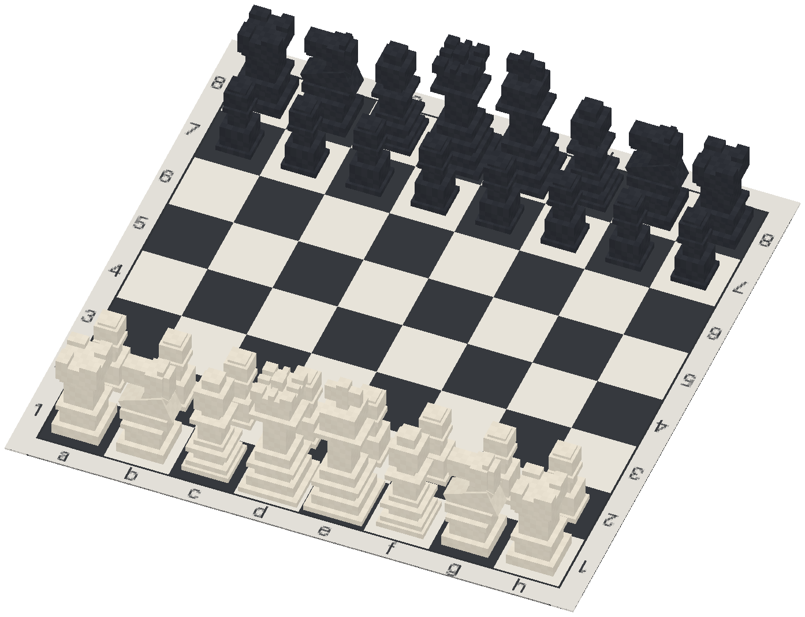

国际象棋为标准开局；其他组合用于辨认组件与位置，具体初始布局由游戏自动摆放。配色不改变规则，不重复展开同模型换色图。

### 双方全部 32 枚棋子：12 种外观

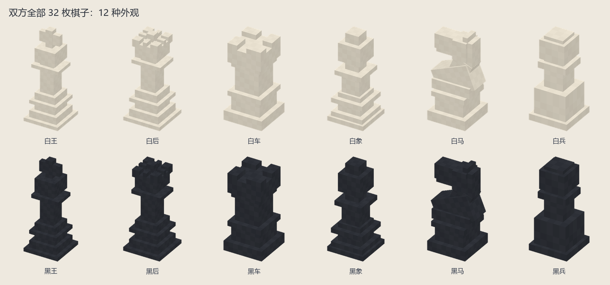

| 实图 | 名称 | 数量／所属 | 用途与区别 |
| --- | --- | --- | --- |
| 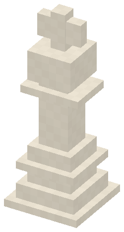 | 白王 | 1 | 任意方向一格；不能进入被攻击格。 |
| 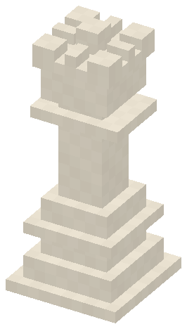 | 白后 | 1 | 横竖斜线任意距离，不越子。 |
| 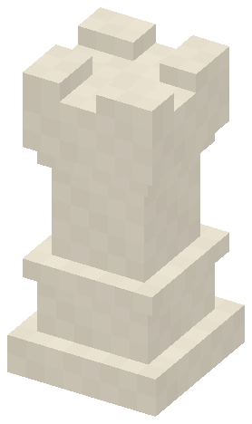 | 白车 | 2 | 横竖任意距离，不越子。 |
| 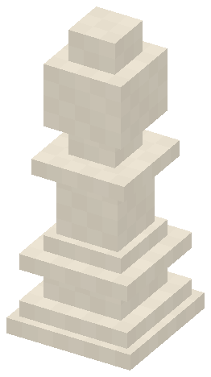 | 白象 | 2 | 斜线任意距离，不越子。 |
| 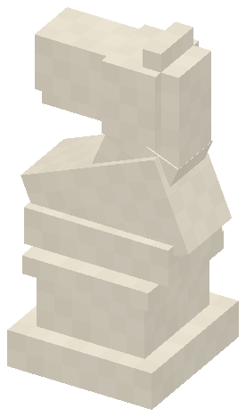 | 白马 | 2 | 日形跳跃，可越子。 |
| 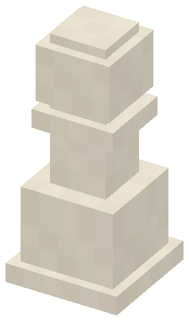 | 白兵 | 8 | 向前行、斜前吃；首步两格及升变见正文。 |
| 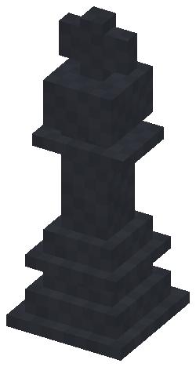 | 黑王 | 1 | 任意方向一格；不能进入被攻击格。 |
| 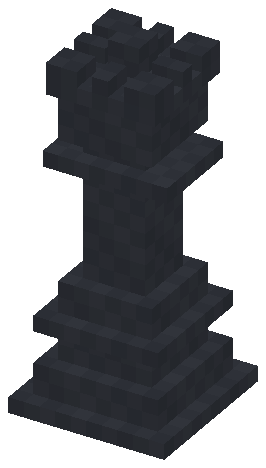 | 黑后 | 1 | 横竖斜线任意距离，不越子。 |
| 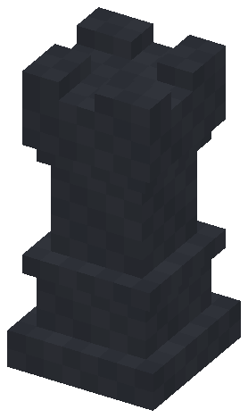 | 黑车 | 2 | 横竖任意距离，不越子。 |
| 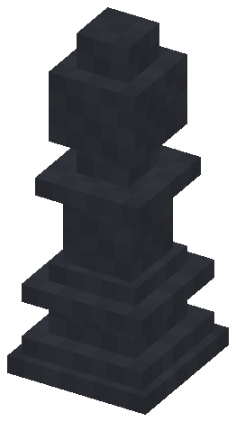 | 黑象 | 2 | 斜线任意距离，不越子。 |
| 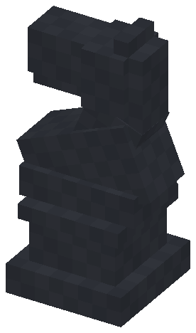 | 黑马 | 2 | 日形跳跃，可越子。 |
| 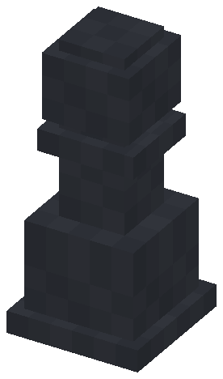 | 黑兵 | 8 | 向前行、斜前吃；首步两格及升变见正文。 |

<!-- END COMPONENTS -->

[返回说明书目录](README.md)
