# 中国象棋与揭棋

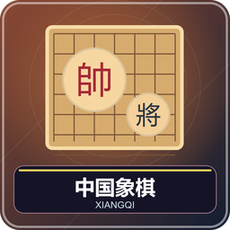

1～2 人，一人对练习人机，两人正常对弈。红先，一次走一子，将死对方、使其无合法着法、对手超时或认输即可胜。与国际象棋不同，象棋的无子可动也判负。

## 棋盘与初始阵容

棋子放在 9 路、10 横线的交点，中央楚河汉界分两侧；两端米字形 3×3 区域为九宫。每方帅／将一、仕／士二、相／象二、马二、车二、炮二、兵／卒五，合计 16。

从己方视角看底线左右依次车马相仕帅仕相马车；炮在前两横线的第二、八路；五兵在再前方隔一路一个。对方镜像。系统自动摆好，不需手工拿子布置。

腾空第 9 格。默认按座位选边，南北向红南黑北，东西向红西黑东；双人需各坐一侧，或改随机分边。单人电脑执另一方，红方始终先行。

## 七类棋子逐一学

| 棋种 | 移动和吃子 | 最易混淆之处 |
| --- | --- | --- |
| 帅／将 | 九宫横直一格 | 将帅不能在同一路无子隔挡而照面 |
| 仕／士 | 九宫斜一格 | 标准局不能出九宫 |
| 相／象 | 斜走两格“田” | 中间象眼有子就堵，标准局不得过河 |
| 马 | 一直一斜的“日” | 先直行的马腿有子，该方向不能走 |
| 车 | 横直任意距离 | 中间不能有棋子 |
| 炮 | 不吃时同车，吃时隔一枚炮架 | 恰好一个炮架，敌我都能当架 |
| 兵／卒 | 未过河前进一格，过河也能横一格 | 从不后退，走到底只能横行 |

除炮吃法特殊外，合法走到敌子位置就吃掉。不能使己方将帅暴露。被将军时，只能走能解除攻击的一手；不能为吃别的子而忽视将军。

## 在桌面操作

右键己子选中，金框表示当前子，绿色表示合法落点；再右键目标走／吃，右键另一己子换选。非法行棋会取消，重选即可。行动与吃子有动画，聊天记录起止位置，被吃子缩小放在吃子者右手边。

第 9 格 Q 打开对局菜单，申请悔棋、和棋或确认认输。双人悔棋撤回最后一着，需对方同意；人机自动同意并退回真人上次走前，连电脑应手撤回。自己尚未走过不能悔棋，结束后也不能。

## 揭棋：先按位置走，翻明再按身份走

大厅可改为揭棋。每方将帅明置，其余 15 子随机盖在常规位置，双方都不知道暗子是谁。暗子第一步按 **它所在初始位置应有棋种** 行走；例如兵位暗子先走兵步，翻出车后以后按车走。

翻明的仕／士可出九宫，相／象可过河，但象眼仍能被堵；其他规则同标准，将帅仍守九宫且不能照面。被吃的暗子继续盖住，不公开身份。提示与电脑不读取秘密身份，悔棋会恢复翻明前状态。图鉴中的“暗子”就是这种盖面，不是第八种正常棋种。

## 终局、重复和设置

标准局双方仅剩将帅士象等确定非进攻子力可自动和棋；揭棋士象能进攻，不套用这项。第三次相同局面且同一方行棋时，仅一方连续将军则该方负，其余和；连续双方合计 120 着不吃子也和，兵卒移动不重置。本包使用休闲简化裁定，复杂长捉棋例可双方协议处理。

设置标准／揭棋、经典／木色棋盘与棋子、方向、分边、可走点、人机三档及每人无限制／5～30 分钟，默认 10，无加秒。动画不扣时，电脑思考扣其时间。终局回大厅保留棋面，重开才重摆。

管理员中止：`/function xiangqi:admin/abort`。离线等见[共同操作](00-新手入门与界面图例.md)。

<!-- BEGIN COMPONENTS -->

## 组件实图与逐件图鉴

这些图片直接取自配套资源包，立体物件按实际 Java 模型渲染。卡牌展示真实正面，动画纹理取第一帧；皮肤头像、发光和粒子属于游戏内动态效果。

### 棋盘与棋子组合预览

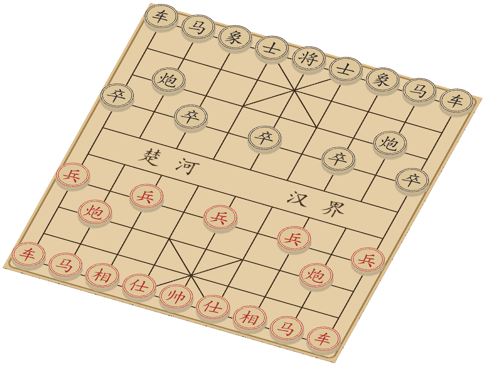

国际象棋为标准开局；其他组合用于辨认组件与位置，具体初始布局由游戏自动摆放。配色不改变规则，不重复展开同模型换色图。

### 全部棋种与揭棋盖面

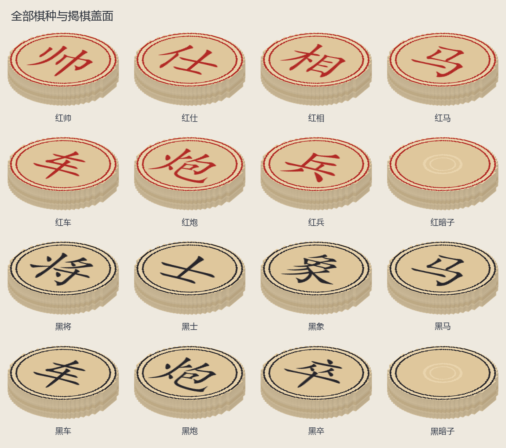

| 实图 | 名称 | 数量／所属 | 用途与区别 |
| --- | --- | --- | --- |
| 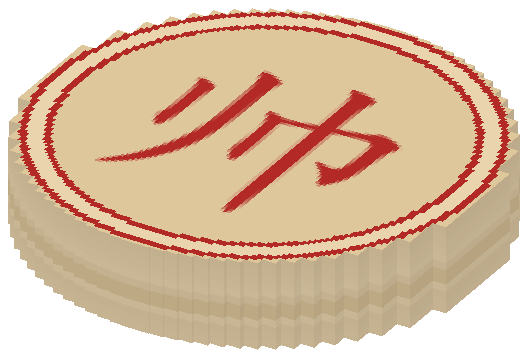 | 红帅 | 1 | 九宫内横直一格；不能将帅照面。 |
| 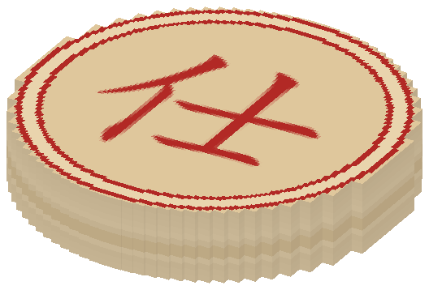 | 红仕 | 2 | 九宫斜一格；揭棋翻明后可离宫。 |
| 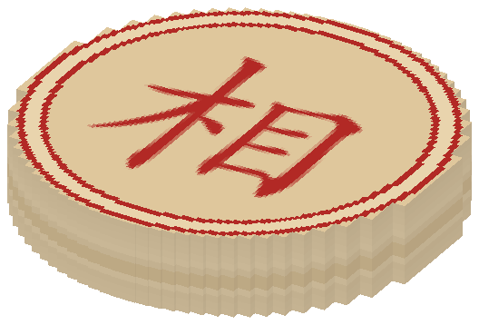 | 红相 | 2 | 田字，堵象眼不能走；标准局不得过河。 |
| 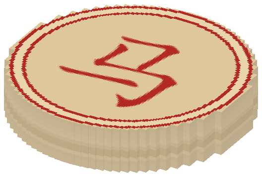 | 红马 | 2 | 日字，先检查马腿。 |
| 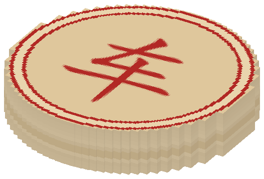 | 红车 | 2 | 横竖任意距离，不越子。 |
| 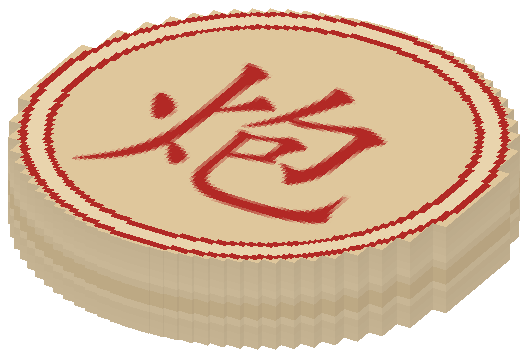 | 红炮 | 2 | 平移同车，吃子必须隔一个炮架。 |
| 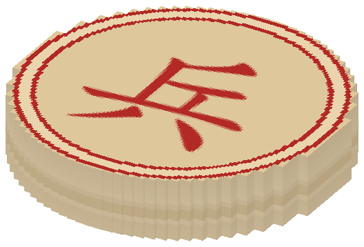 | 红兵 | 5 | 前进一步，过河可左右，不后退。 |
| 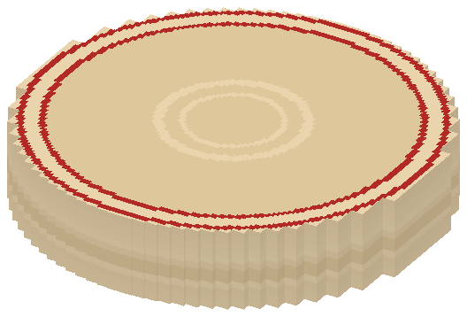 | 红暗子 | 15 | 仅揭棋使用，首步按位置规则，落地再翻明。 |
| 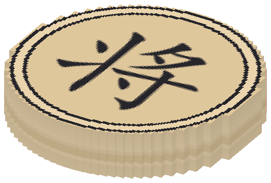 | 黑将 | 1 | 九宫内横直一格；不能将帅照面。 |
| 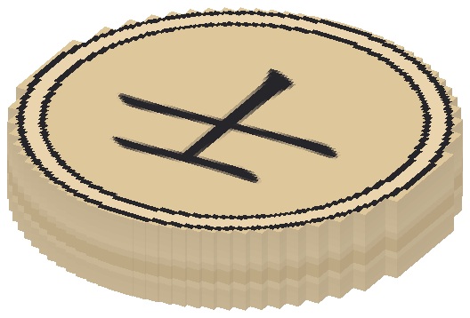 | 黑士 | 2 | 九宫斜一格；揭棋翻明后可离宫。 |
| 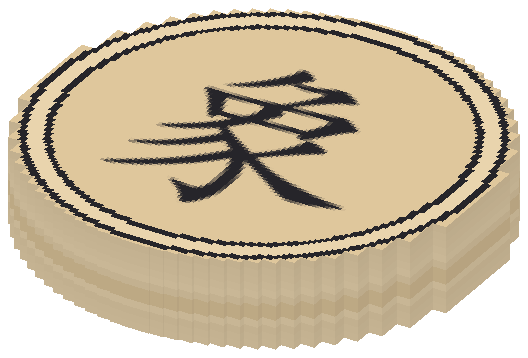 | 黑象 | 2 | 田字，堵象眼不能走；标准局不得过河。 |
| 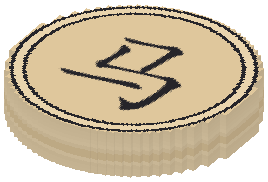 | 黑马 | 2 | 日字，先检查马腿。 |
| 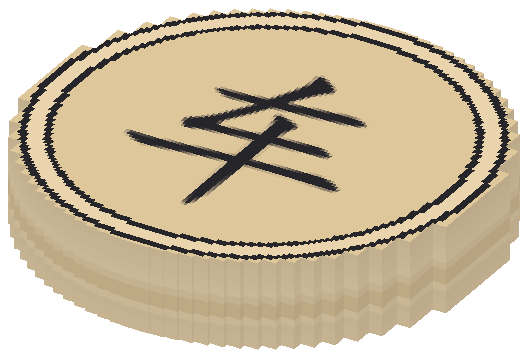 | 黑车 | 2 | 横竖任意距离，不越子。 |
| 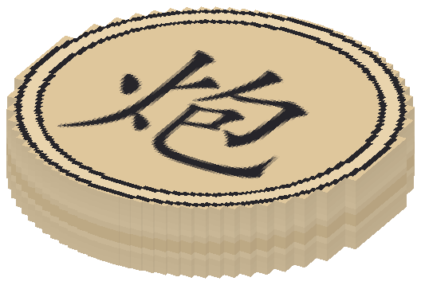 | 黑炮 | 2 | 平移同车，吃子必须隔一个炮架。 |
| 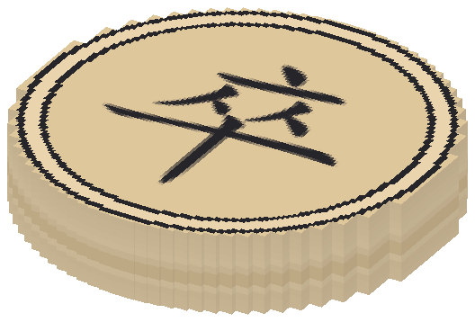 | 黑卒 | 5 | 前进一步，过河可左右，不后退。 |
| 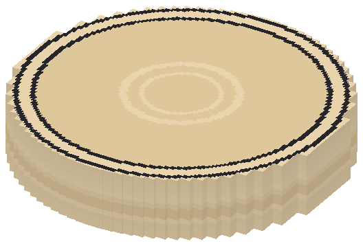 | 黑暗子 | 15 | 仅揭棋使用，首步按位置规则，落地再翻明。 |

<!-- END COMPONENTS -->

[返回说明书目录](README.md)
