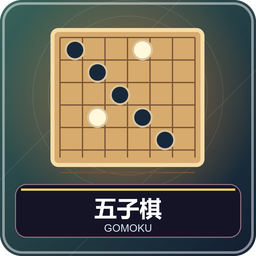
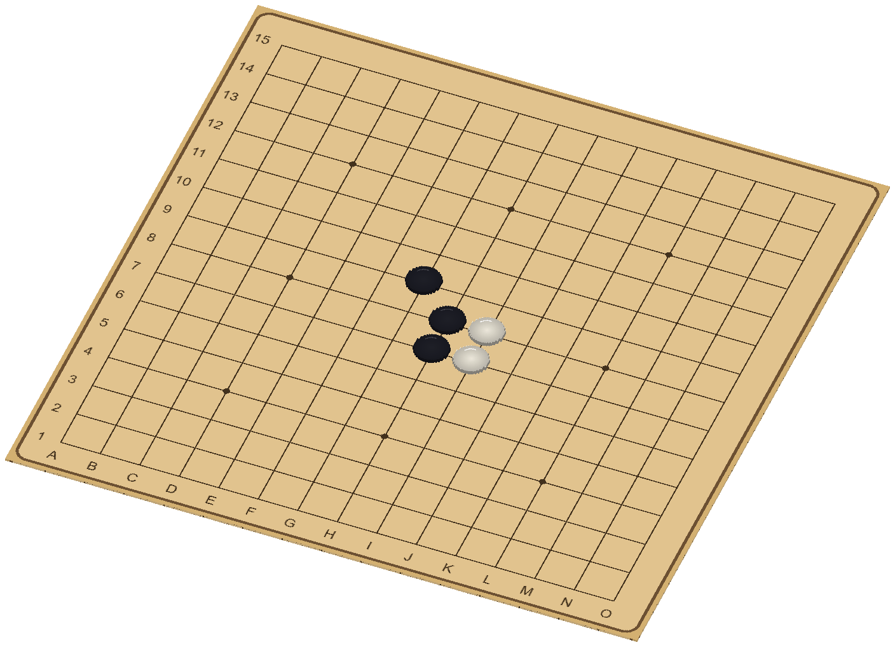
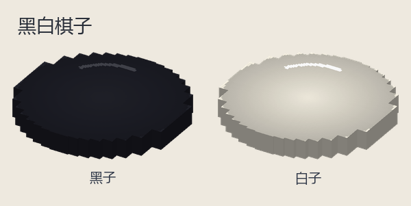
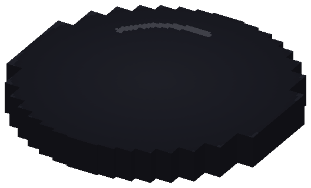
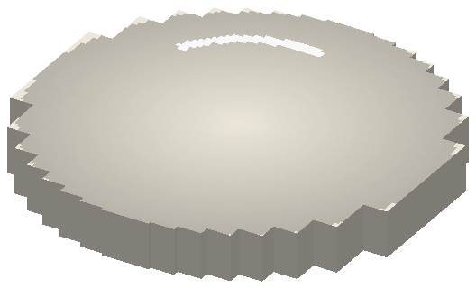

# 五子棋：先连五枚

1～2 人，单人对电脑。黑先，双方轮流在空交点放一枚同色棋，横、竖或任一斜线连续五枚及以上即胜。本包为自由五子棋，无三三、四四等禁手，六枚及以上长连也算胜。

## 准备与组件

腾空第 9 格，入座选五子棋。棋盘默认 15×15，可改 13 或 19 路，棋子固定黑白。棋放线的交点，不放方格中央，不能叠放、移动或吃掉已有子。选边默认随机并自动调座，也可按座位，南北向黑南白北、东西向黑西白东。

图鉴展示棋盘和两种圆形棋子。小十字标最新落子，绿色连线标胜利，不是额外能主动使用的棋种。

## 你的回合

1. 看行动提示与自己的颜色，观察对方是否下一手就能连五。
2. 准星指向空交点右键，落子自动记录坐标并播放下降动画。
3. 若设“同点两次确认”，第一次预选，再点同一点才落下；点别处则换预选。
4. 落位后判断五连，没有则轮对方。动画中不要重复点击。

19 路密集时用第 9 格 Q 的坐标落子，按行列精确选择。Q 菜单还有悔棋、和棋、认输；双人前两者须对方同意，认输本人确认。人机悔棋回到真人上次落子前，电脑应手也撤回；尚未落子不能悔棋。

## 连线例子和终局

一行已有黑子在第 4、5、6、7 交点，下一枚落第 3 或 8 就成五。若中间隔一个空点，还不算连续，须补上空隙。斜线两种方向都检查。不能用一横三枚加一竖两枚凑五，五枚要在一条直线上。

棋盘填满无人胜或双方协议则和棋；超时、认输判对方胜。终局短暂展示后回大厅保留棋面，重开、换游戏或换棋盘大小才清空。

## 大厅设置和第一次练习

| 项目 | 可选内容 |
| --- | --- |
| 棋盘 | 13／15／19，默认 15；经典／木色 |
| 方向与分边 | 黑南／黑西；随机或按座位 |
| 计时 | 每人无限制或 5～30 分钟，默认 10，无加秒 |
| 辅助 | 坐标、最后一手标记默认开；单击落子或两击确认 |
| 人机 | 简单、普通、困难，默认普通 |

初学推荐 13 路、无限制、两击确认。先挡对手能立即成五的位置，再找自己能同时制造两处威胁的落点。电脑是休闲练习对手，不保证最优。

计时只扣行动方，动画暂停。管理员中止：`/function gomoku:admin/abort`；离线暂停见[共同操作](00-新手入门与界面图例.md)。

<!-- BEGIN COMPONENTS -->

## 组件实图与逐件图鉴

这些图片直接取自配套资源包，立体物件按实际 Java 模型渲染。卡牌展示真实正面，动画纹理取第一帧；皮肤头像、发光和粒子属于游戏内动态效果。

### 棋盘与棋子组合预览

国际象棋为标准开局；其他组合用于辨认组件与位置，具体初始布局由游戏自动摆放。配色不改变规则，不重复展开同模型换色图。

### 黑白棋子

| 实图 | 名称 | 数量／所属 | 用途与区别 |
| --- | --- | --- | --- |
|  | 黑子 | — | 置于交点；颜色代表行棋方。 |
|  | 白子 | — | 置于交点；颜色代表行棋方。 |

<!-- END COMPONENTS -->

[返回说明书目录](README.md)
