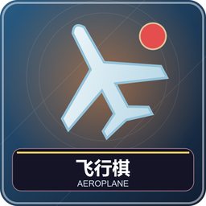
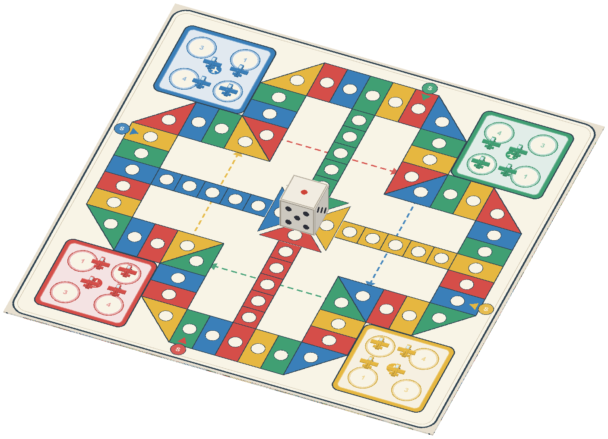
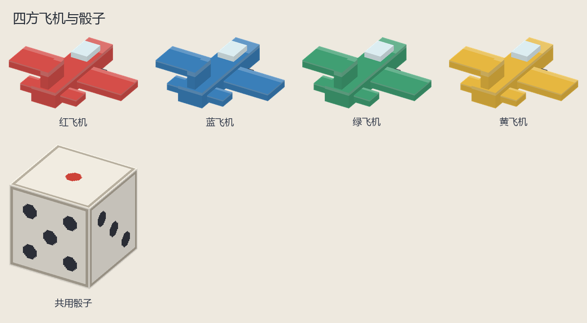
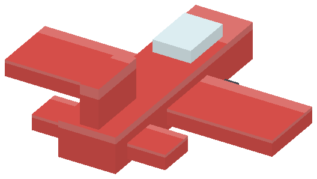
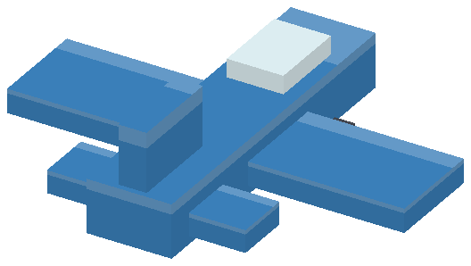
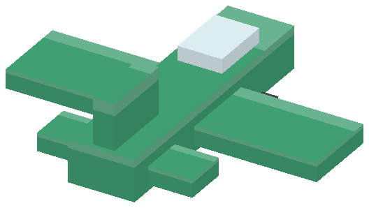
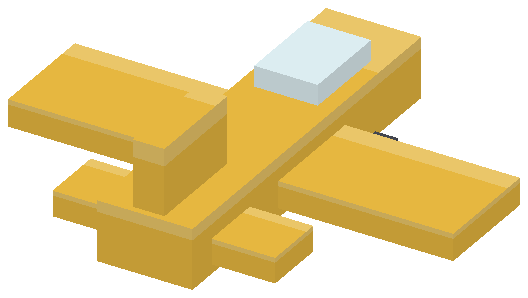
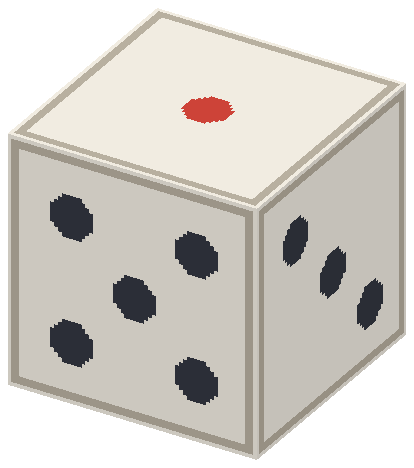

# 飞行棋：把四架飞机送回终点

1～4 名真人，2～4 方参赛，可补电脑；关闭电脑时至少两人。每色四架飞机从机场起飞，经公共跑道和本色终点航道，到齐终点获胜。默认首名即结束，也能继续排名。

## 认识棋盘和准备

腾空第 1、9 格。四色红蓝绿黄各四架机，外观和所属颜色对应。机场是未起飞和撞回的位置，起飞格是飞机入跑道的位置，外围格各方共用，本色航道只供自己进入，中央是终点。六面骰决定起飞机会或前进步数，不能把同一骰值同时用来起飞又前进。

默认红南、蓝西、绿北、黄东，棋盘方向可旋转，玩家随色调到对应侧。每人只控制一色；八座桌也不超过四名真人。

## 一回合完整操作

1. 轮到你，第 1 格拿到骰子。持骰 Q，或右键桌上骰子；等翻滚停稳，上面点数是本次结果。
2. 看合法飞机高亮。右键一架可行动飞机，或第 9 格 Q 按编号选择；同格叠放时用编号更准。无合法机自动过。
3. 移动、跳格、飞跃、撞机等效果顺序播放，等完成。骰值不能重投，菜单不提供悔棋。
4. 若六点追加开启且掷出 6，拿到骰子继续；否则轮下色。非自己回合没有投骰物。

## 起飞、跳格和撞机

默认掷 6 可选机库机移至起飞格，不再走六格；也可选在路上的机走六格。起飞后以后掷几走几。到本色格跳四格，到本方航线入口飞跃十二格；两者可连锁但每种一次，同一落点同时满足时先飞跃再查跳格。

普通移动最终格、跳格落点、飞跃落点撞到敌机，将该格全部敌机送回机场；途经敌机不撞。己机可同格但每次只移动选定的一架，不组成一起走的编队。

进本色终点通道后默认精确到终点，超出则反弹。例如离终点两格掷五，前进二到终点再反弹三；改为“无法移动”设置时该次不走这架，可能仍能选其他机。四架全部到达才完成一方。

## 设置带来的差异

| 项目 | 选项与默认 |
| --- | --- |
| 起飞 | 6（默认）、5～6、任意点数 |
| 六点追加 | 默认开 |
| 连三个六 | 默认无罚；可设第三次失效并结束，前两次已走保留 |
| 同色跳格／航线飞跃 | 分别开关，默认都开 |
| 超终点 | 默认反弹，可设无法移动 |
| 电脑 | 默认单人补一位，可关或补满四方 |
| 其他 | 首位随机／指定色、方向、提示、标准／快动画、按座位／随机色、首名结束／继续排名 |

## 新手判断和结束

不要只看离终点最近的机；能撞回对手、利用本色连跳或避免待在敌方易撞点也很关键。投出 6 不强制起新机，已起飞机常能更有效利用步数。某架无合法走法不代表整回合不能动，先查其他机。

第 9 格 Q 可确认认输。正常终局保留棋面，重开才重摆。离线暂停见[共同操作](00-新手入门与界面图例.md)，管理员中止：`/function aeroplane_chess:admin/abort`。

<!-- BEGIN COMPONENTS -->

## 组件实图与逐件图鉴

这些图片直接取自配套资源包，立体物件按实际 Java 模型渲染。卡牌展示真实正面，动画纹理取第一帧；皮肤头像、发光和粒子属于游戏内动态效果。

### 棋盘与棋子组合预览

国际象棋为标准开局；其他组合用于辨认组件与位置，具体初始布局由游戏自动摆放。配色不改变规则，不重复展开同模型换色图。

### 四方飞机与骰子

| 实图 | 名称 | 数量／所属 | 用途与区别 |
| --- | --- | --- | --- |
|  | 红飞机 | 4 | 同色 4 架分别行动；都到终点才能完成比赛。 |
|  | 蓝飞机 | 4 | 同色 4 架分别行动；都到终点才能完成比赛。 |
|  | 绿飞机 | 4 | 同色 4 架分别行动；都到终点才能完成比赛。 |
|  | 黄飞机 | 4 | 同色 4 架分别行动；都到终点才能完成比赛。 |
|  | 共用骰子 | 1 | 六面点数 1～6；只在本人可投骰时操作。 |

<!-- END COMPONENTS -->

[返回说明书目录](README.md)
