# 阿瓦隆：任务与隐藏身份

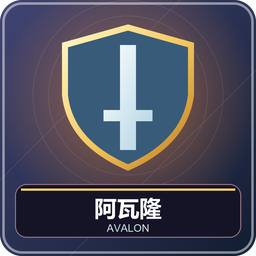

5～8 名真人，只用八座桌。好人争取三次成功任务，坏人争取三次失败，刺客还可通过刺中梅林让坏人获胜。身份和任务票秘密，讨论、组队票和任务结果公开。

## 准备与每种身份

腾空第 1、2、8 格。系统随机身份和初始队长，第 8 格是本人身份牌，Q 查看当前操作与私人信息。不能公开自己的身份牌图或读别人屏幕。

| 身份 | 阵营 | 开局知道什么 | 该怎样玩 |
| --- | --- | --- | --- |
| 梅林 | 好 | 全部坏人，包括奥伯伦 | 引导组队但隐藏情报来源，避免被刺中 |
| 派西维尔 | 好 | 梅林与莫甘娜两名候选，不知哪位真 | 结合任务找真梅林并保护 |
| 忠臣 | 好 | 无额外身份情报 | 从公开组队票与失败票推理 |
| 莫甘娜 | 坏 | 可互认的坏人队友 | 在派西维尔眼中冒充梅林 |
| 刺客 | 坏 | 可互认的坏人队友 | 寻找梅林，决定提前或最终刺杀 |
| 爪牙 | 坏 | 可互认的坏人队友 | 混进任务或伪装可信好人 |
| 奥伯伦 | 坏 | 不认识其他坏人，他们也不认识他 | 独立判断、制造任务失败 |

没有莫德雷德、兰斯洛特、湖中仙女。好人只能任务成功；坏人可成功或失败，成功票不能证明身份。

## 人数表和五次任务

| 人数 | 好人配置 | 坏人配置 | 五次任务各需几人 |
| --- | --- | --- | --- |
| 5 | 梅林、派西维尔、忠臣 | 莫甘娜、刺客 | 2／3／2／3／3 |
| 6 | 前两位＋忠臣×2 | 莫甘娜、刺客 | 2／3／4／3／4 |
| 7 | 前两位＋忠臣×2 | 莫甘娜、刺客、奥伯伦 | 2／3／3／4／4 |
| 8 | 前两位＋忠臣×3 | 莫甘娜、刺客、爪牙 | 3／4／4／5／5 |

## 每个任务的流程

1. **队长提名。**身份牌 Q 打开选择，选足人数后确认；大家先讨论候选是否可信。
2. **全员表决。**第 1／2 格绿／红染料 Q 代表同意／反对，秘密交齐后公布各人票。同意严格过半才过，平票不通过。
3. **否决则换队长。**不推进任务，重提名单。本包连续“人数−1”次否决后，第“人数”次提名强制通过；例如五人第 5 次、八人第 8 次，不使用固定五次否决坏人胜的规则。通过后清零。
4. **只有队员交任务票。**绿成功、红失败，Q 提交；好人的失败操作会拒绝。未入队的人等待，不能交任务票。
5. **洗开任务票。**只公开成功／失败数量，不公布对应玩家。一般一张失败就失败；7、8 人第 4 次任务至少两张失败才失败。
6. **计分、换队长。**好人成功 +1，坏人失败 +1，未到三分继续下个任务。

## 刺杀和结束

坏人三分直接胜。好人三分进入强制刺杀，刺客从身份牌菜单选目标并确认：梅林被刺中则坏人胜，刺错好人胜。刺客也可在此前提前翻牌刺杀，须二次确认，刺完同样立刻结束整场。

例如七人第四任务出现一张失败，本次仍成功，但不代表全队好人；出现两张才失败。不要把“投过赞成票的人”误认为“提交失败票的人”，两类票性质不同。

正常结束公开身份并翻牌展示，回大厅；投票中止不会公开秘密身份。没有独立玩法设置。管理员中止：`/function avalon:admin/abort`；离线暂停与重开窗口见[共同操作](00-新手入门与界面图例.md)。

<!-- BEGIN COMPONENTS -->

## 组件实图与逐件图鉴

这些图片直接取自配套资源包，立体物件按实际 Java 模型渲染。卡牌展示真实正面，动画纹理取第一帧；皮肤头像、发光和粒子属于游戏内动态效果。

### 七种身份牌

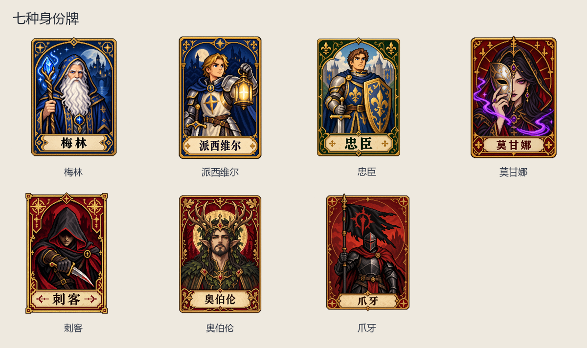

| 实图 | 名称 | 数量／所属 | 用途与区别 |
| --- | --- | --- | --- |
| 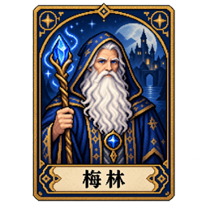 | 梅林 | 按人数表配置 | 好人；看见全部坏人，包括奥伯伦。 |
| 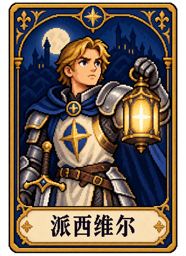 | 派西维尔 | 按人数表配置 | 好人；看见梅林与莫甘娜两名候选。 |
| 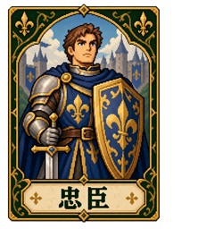 | 忠臣 | 按人数表配置 | 好人；没有额外情报。 |
| 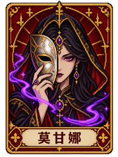 | 莫甘娜 | 按人数表配置 | 坏人；伪装成梅林，与可互认坏人互认。 |
| 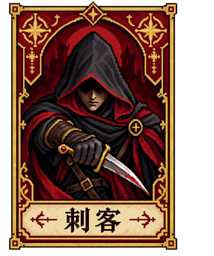 | 刺客 | 按人数表配置 | 坏人；可刺杀梅林。 |
| 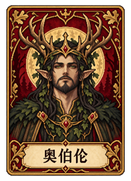 | 奥伯伦 | 按人数表配置 | 坏人；与其他坏人互不认识。 |
| 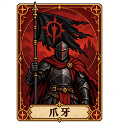 | 爪牙 | 按人数表配置 | 坏人；与非奥伯伦坏人互认。 |

### 任务路线

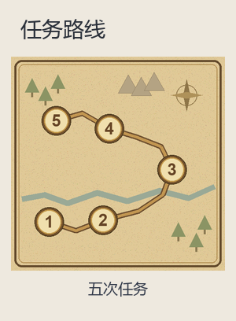

| 实图 | 名称 | 数量／所属 | 用途与区别 |
| --- | --- | --- | --- |
| 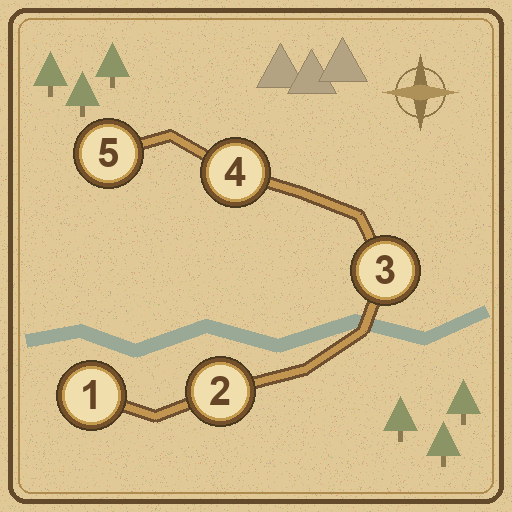 | 五次任务 | 1 | 成功、失败标记放在对应任务；否决不推进任务。 |

<!-- END COMPONENTS -->

[返回说明书目录](README.md)
