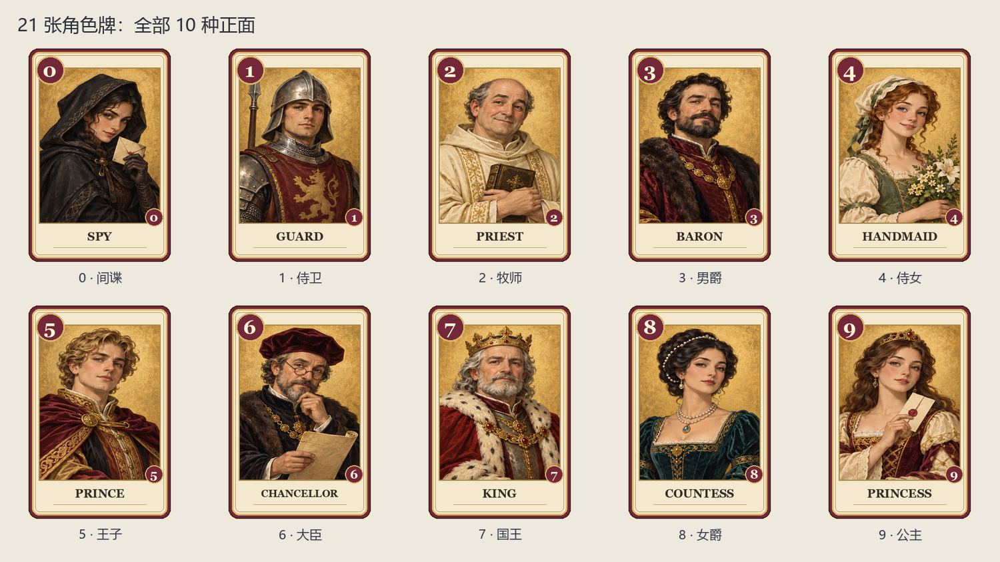
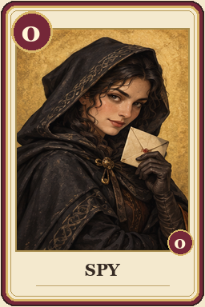
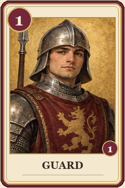
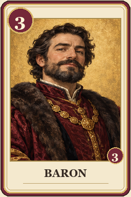
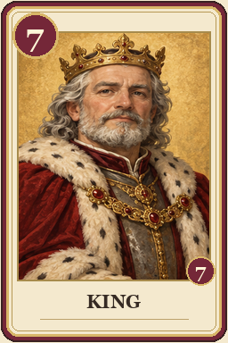
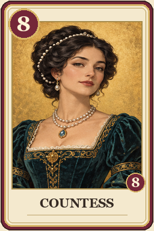
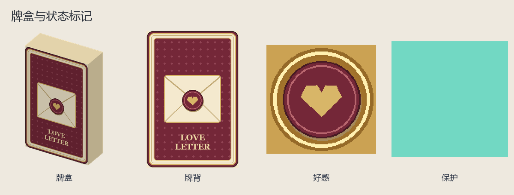

# 情书：摸一张，出一张，留下好感

2～6 人，21 张版。用角色探听、交换、保护或淘汰别人，每轮争取成为唯一存活者，或牌库抽空时持最高牌。小局赚好感，达到目标赢整场，可能多人同胜。

## 准备和一轮布置

默认腾空前两格，精准选人模式需要九格。洗 21 张，暗置一张备用；两人局另公开移出三张。每人先发一张，轮到时保护解除、从普通牌库摸一张，通常两张在手，选择打一张、留一张。牌盒上方数字是普通牌库实时余量，不含备用牌。

自己看真实手牌及牌名后的效果概括，第三人称不会透露正面；桌面弃牌、保护、好感公开。聊天记录谁对谁用了什么牌，窥视、比牌、交换得到的秘密只通知相关玩家。

## 出牌与两种选人方式

**默认朝向：**先看向目标，确认发光和 actionbar 姓名再持牌 Q。选中过的目标短暂保留三秒，朝向另一合法人立即更新；低头可切向自己（仅王子等允许自选的效果）。王子未选其他人时可选自己。侍女本来就保护自己，无需指定他人。

**精准头颅：**大厅设置改为头颅选人。持需要目标的牌 Q 后，快捷栏出现本桌合法玩家头颅，手持看 actionbar 姓名，Q 该头颅确认；末格可取消。受保护、出局或别桌玩家不在合法目标中。

侍卫选完目标再在必要窗口猜角色，大臣在必要窗口留牌和排牌堆底。关闭这两种窗口后，Q 任意当前手牌只会重开待办，不会把那张牌也打掉。未轮到时手牌 Q 可查看公开信息或确认本轮认输。

## 十种角色完整规则

| 点数 | 角色 | 张数 | 效果与必须知道的限制 |
| --- | --- | --- | --- |
| 0 | 间谍 | 2 | 本轮曾打出／弃掉间谍且最终存活，只有一位存活者符合时，该人额外 +1 好感；两张都用过也只 +1 |
| 1 | 侍卫 | 6 | 指另一合法玩家，猜除侍卫外的一种角色，正确则目标淘汰 |
| 2 | 牧师 | 2 | 私看目标剩余手牌，别在公开聊天读出 |
| 3 | 男爵 | 2 | 私比双方剩余手牌，低者淘汰，相同无事 |
| 4 | 侍女 | 2 | 自己受保护直到下回合开始摸牌前，期间别人不能指定你 |
| 5 | 王子 | 2 | 目标公开弃手牌后补一张，可对自己；弃公主立即淘汰不补 |
| 6 | 大臣 | 2 | 再摸最多两张，从手中留一张，其余按自选顺序放普通牌库底；牌不足就用现有候选 |
| 7 | 国王 | 1 | 与另一合法玩家交换剩余手牌，不公开双方牌面 |
| 8 | 女爵 | 1 | 无主动效果；同时持王子或国王必须出女爵，否则也可自愿出 |
| 9 | 公主 | 1 | 主动出或被迫弃掉都立刻自己淘汰，持到摊牌却是最高点 |

侍卫、牧师、男爵、国王不能对自己；王子可以。侍女不是让你选择要保护谁。所有别人都出局／受保护而无合法目标时，不能自选的牌可无效果打出；王子仍可自己。王子弃掉的牌不执行通常主动效果，但公主淘汰与间谍记录等规则仍处理。

## 什么时候摊牌和计分

剩一名存活者即轮胜。普通牌库耗尽时先完整结算本次角色，再让存活者公开比剩余牌点，最高共同赢；不比较弃牌总点。每位轮胜 +1 好感，再统一处理间谍奖励。只在最终摊牌亮出手中间谍不算用过间谍。

王子需补牌且普通库空才用备用；大臣不用备用。下轮从轮胜者中随机选先手，只拿间谍奖励不获得先手资格。全部好感结算后判断整场，默认二人 6、三人 5、四人 4、五六人 3；自定义可 1～10。达到目标者共同胜。

## 从公主＋侍卫开始的一回合

先选一位未保护玩家，持侍卫 Q，窗口猜如“国王”。猜中对方淘汰，猜错保留公主等待。若关了猜测窗口，Q 公主是重开猜测，不是主动弃公主。若你有女爵＋王子，Q 王子会在 actionbar 说明必须先出女爵，资源和手牌都不应被扣。

## 设置与排错

大厅可设首轮随机／按座位、自动／自定义好感、公开弃牌文字、行动不限时或 30／60／90／120 秒、两种选人方式。超时系统完成合法选择，动画时等发牌结束。瞄不准就看目标姓名或改精准模式；不发光先查侍女保护、出局、是否同桌。

本轮认输只淘汰本轮，下轮可再参加。管理员中止：`/function love_letter:admin/abort`；共同暂停说明见[这里](00-新手入门与界面图例.md)。

<!-- BEGIN COMPONENTS -->

## 组件实图与逐件图鉴

这些图片直接取自配套资源包，立体物件按实际 Java 模型渲染。卡牌展示真实正面，动画纹理取第一帧；皮肤头像、发光和粒子属于游戏内动态效果。

### 21 张角色牌：全部 10 种正面

| 实图 | 名称 | 数量／所属 | 用途与区别 |
| --- | --- | --- | --- |
|  | 0 · 间谍 | 2 | 曾用过间谍的唯一存活者额外 +1 好感。 |
|  | 1 · 侍卫 | 6 | 猜非侍卫身份，猜中淘汰。 |
|  | 2 · 牧师 | 2 | 私看目标手牌。 |
|  | 3 · 男爵 | 2 | 比剩余手牌，低者淘汰。 |
|  | 4 · 侍女 | 2 | 保护自己至下次摸牌前。 |
|  | 5 · 王子 | 2 | 目标弃牌重摸，可选自己。 |
|  | 6 · 大臣 | 2 | 再摸至多两张，从候选中留一张，其余放牌堆底。 |
|  | 7 · 国王 | 1 | 交换手牌。 |
|  | 8 · 女爵 | 1 | 持王子或国王时必须出女爵。 |
|  | 9 · 公主 | 1 | 打出或弃掉自己立即淘汰。 |

### 牌盒与状态标记

| 实图 | 名称 | 数量／所属 | 用途与区别 |
| --- | --- | --- | --- |
|  | 牌盒 | 1 | 上方数字是实时普通牌库余量。 |
|  | 牌背 | — | 秘密手牌不向其他人显示正面。 |
|  | 好感 | — | 小局胜者及合格间谍获得。 |
|  | 保护 | — | 该玩家暂时不能被角色效果指定。 |

<!-- END COMPONENTS -->

[返回说明书目录](README.md)
