# 掼蛋：对家合作，升级过 A

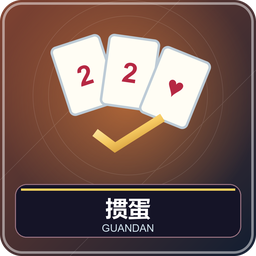

1～4 名真人，补齐四席人机。相对的两人一队，双副 108 张各发 27 张，尽快出完并帮助队友争高名次。完整比赛从当前级数一路升到 A，并满足过 A 条件获胜；也可固定副数比级数。

## 准备、级牌和逢人配

腾空第 1、9 格。随机分队默认开启并调到对应方向，也可按座位自选，对座是队友。两副标准扑克，所以图鉴每种牌面各两张，大王两、小王两。

本副级数如 5，那么四种花色 5 都是级牌，普通点数大小为大王＞小王＞级牌＞A＞K…＞2。两张红桃级牌叫逢人配，可以补普通牌点和同花顺花色，不能当大小王；单独打仍是级牌。图标上的金星帮助识别级牌，不是新的一张牌。

## 选牌、出牌和一墩

本人出牌、进贡、还牌时第 1 格 Q 开手牌，逐张点实卡选／取消，金框表示选中，点出牌提交。逢人配构成多种合法解释时要选清楚具体牌型，系统不会替你猜意图。窗口可关后再开，失败不扣牌。

首副随机先出，之后按贡还结果。领出可任意合法牌，跟牌须同型同张数且更大，或更强炸弹；可不出，下一次轮到仍能跟。一圈其余存活出牌者都不出，最后出者重新领出；若该人已出完，由搭档接风。顺序逆时针，已出完者跳过。第 9 格 Q 常驻菜单可查看手牌、贡还和规则。

## 全部牌型与大小

| 牌型 | 组成 | 比较 |
| --- | --- | --- |
| 单张／对子／三张 | 一／二／三张同点 | 比普通点数大小，级牌提升 |
| 三带二 | 三同点＋另一点一对 | 比三张主体 |
| 顺子 | 固定五个连续点数 | 比最高，A2345 可，10JQKA 可，不绕接 JQKA2 |
| 三连对 | 固定三个连续对子 | AA2233 可作低端，QQKKAA 可作高端 |
| 钢板 | 固定两组连续三张 | AAA222 可作低端，KKKAAA 可作高端 |
| 炸弹 | 4～10 张同点，可用逢人配补足 | 先比张数，再点数 |
| 同花顺 | 同花五张连续 | 比最高点，天然同花连续五张按此型 |
| 四王 | 两大王＋两小王 | 最大 |

总序：四王＞10～6 张炸弹＞同花顺＞5 张炸弹＞4 张炸弹＞普通。级牌在连续牌里按原数字位置，不插入 A 后新位置。不能拿六张顺子当合法顺子，也没有斗地主的三带一或任意长飞机。

## 名次、升级和过 A

第一个出完为头游，之后二游、三游、末游。头游队获胜，搭档二游升 3 级，三游升 2，末游升 1。两队分别保留级数，下一副打本副胜方的新级。

在打 A 的一副拿头游，且搭档不是末游，才过 A 赢完整赛。没过停在 A，没有三次失败退 2。固定副数结算比较双方级数，相同平局；过 A 可提前结束。

## 进贡、还牌与抗贡

首副不贡。单下由末游贡给头游；双下即前两名同队，由另队两人各贡一张，大贡给头游、小贡给二游，同大按头游顺时针邻座分配。贡牌是手里最大牌，红桃级牌除外。

接贡者还一张原点数不大于 10 的牌；如果全手都大于 10，必须还最小。低点级牌仍可还。单下者有两大王，或双下方合有两大王，自动抗贡，免交换，由上副头游首出。否则较大贡牌的进贡者首出，同大按分配顺序。提交前请区分“贡给对方”与“还给进贡者”。

## 一个百搭例子

打 2 时你有 3、4、红桃2、6、7，可把红桃2当 5 解释成 34567；其真实外观仍是红桃2，公开记录会注明代替。若同花且满足同花顺，也可能出现不同解释，请按期望选。不能把红桃2解释成王。

## 设置、超时和辅助

大厅可设搭档分配、起始 2～A、完整赛／固定 1、2、3、5、8、10、16、32 副、余牌数、音乐、每步不限时／30／60／90／120 秒。超时跟牌过，领出最小单，贡还自动合法选择，动画不计。人机用于补位练习，可能漏最佳配牌。

BetterTitle 按相对上家、队友、自己、下家显示，本人手牌私密，桌边只摆公开出牌。管理员中止：`/function guandan:admin/abort`；离线见[共同操作](00-新手入门与界面图例.md)。

<!-- BEGIN COMPONENTS -->

## 组件实图与逐件图鉴

这些图片直接取自配套资源包，立体物件按实际 Java 模型渲染。卡牌展示真实正面，动画纹理取第一帧；皮肤头像、发光和粒子属于游戏内动态效果。

### 扑克牌面示例与完整牌库清单

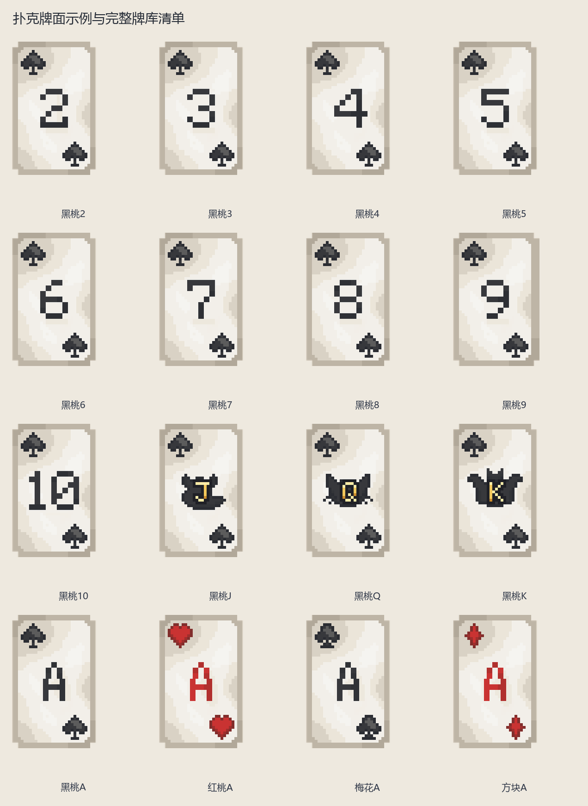

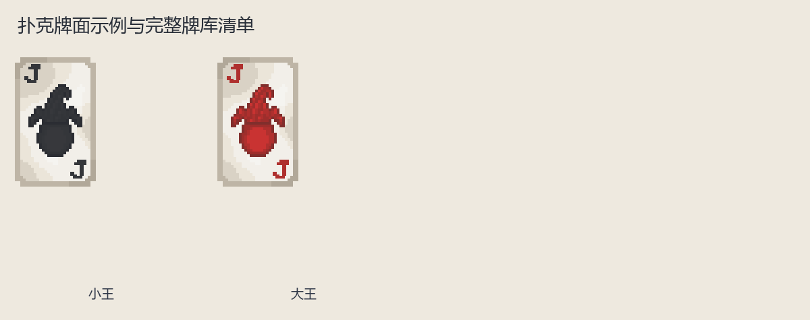

| 实图 | 名称 | 数量／所属 | 用途与区别 |
| --- | --- | --- | --- |
| 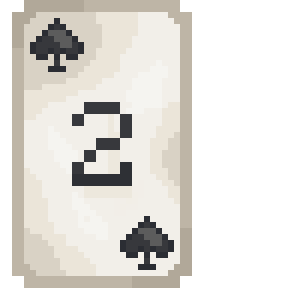 | 黑桃2 | 1 | 点数和花色见牌角；不同游戏的大小关系及连续牌规则分别说明。 |
| 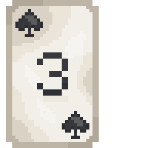 | 黑桃3 | 1 | 点数和花色见牌角；不同游戏的大小关系及连续牌规则分别说明。 |
| 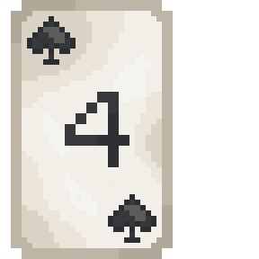 | 黑桃4 | 1 | 点数和花色见牌角；不同游戏的大小关系及连续牌规则分别说明。 |
| 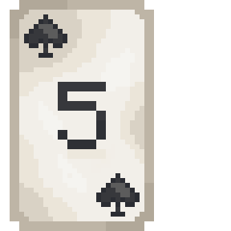 | 黑桃5 | 1 | 点数和花色见牌角；不同游戏的大小关系及连续牌规则分别说明。 |
| 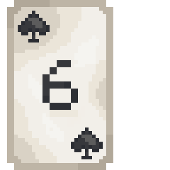 | 黑桃6 | 1 | 点数和花色见牌角；不同游戏的大小关系及连续牌规则分别说明。 |
| 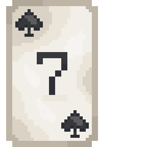 | 黑桃7 | 1 | 点数和花色见牌角；不同游戏的大小关系及连续牌规则分别说明。 |
| 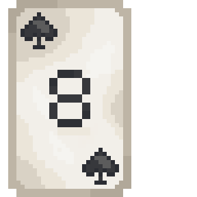 | 黑桃8 | 1 | 点数和花色见牌角；不同游戏的大小关系及连续牌规则分别说明。 |
| 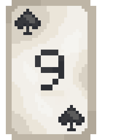 | 黑桃9 | 1 | 点数和花色见牌角；不同游戏的大小关系及连续牌规则分别说明。 |
| 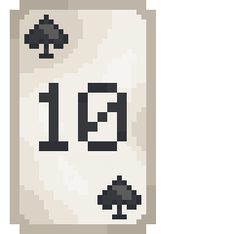 | 黑桃10 | 1 | 点数和花色见牌角；不同游戏的大小关系及连续牌规则分别说明。 |
| 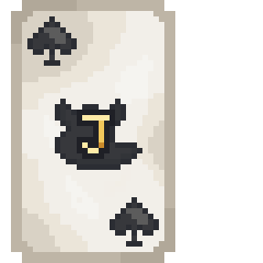 | 黑桃J | 1 | 点数和花色见牌角；不同游戏的大小关系及连续牌规则分别说明。 |
| 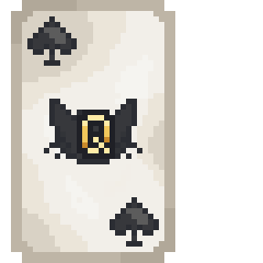 | 黑桃Q | 1 | 点数和花色见牌角；不同游戏的大小关系及连续牌规则分别说明。 |
| 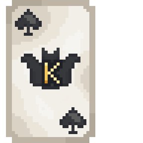 | 黑桃K | 1 | 点数和花色见牌角；不同游戏的大小关系及连续牌规则分别说明。 |
| 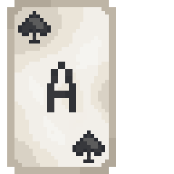 | 黑桃A | 1 | 点数和花色见牌角；不同游戏的大小关系及连续牌规则分别说明。 |
| 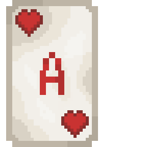 | 红桃A | 1 | 点数和花色见牌角；不同游戏的大小关系及连续牌规则分别说明。 |
| 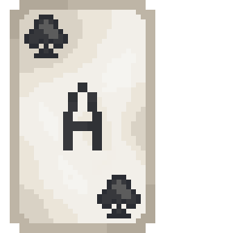 | 梅花A | 1 | 点数和花色见牌角；不同游戏的大小关系及连续牌规则分别说明。 |
| 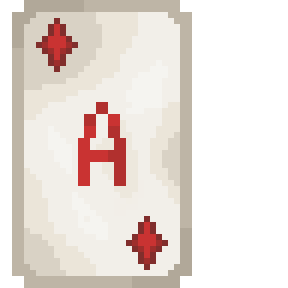 | 方块A | 1 | 点数和花色见牌角；不同游戏的大小关系及连续牌规则分别说明。 |
| 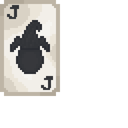 | 小王 | 1 | 专用特殊牌；是否使用见该游戏牌库。 |
| 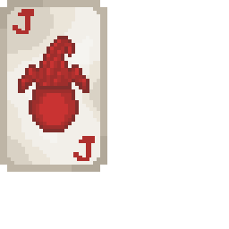 | 大王 | 1 | 专用特殊牌；是否使用见该游戏牌库。 |

花色与点数只改变牌角和花色图案，省略重复的大图。下表列出实际全部牌面：

| 花色 | 全部点数 | 各牌面张数 |
| --- | --- | --- |
| 黑桃 | 2、3、4、5、6、7、8、9、10、J、Q、K、A | 2 |
| 红桃 | 2、3、4、5、6、7、8、9、10、J、Q、K、A | 2 |
| 梅花 | 2、3、4、5、6、7、8、9、10、J、Q、K、A | 2 |
| 方块 | 2、3、4、5、6、7、8、9、10、J、Q、K、A | 2 |
| 王 | 小王、大王 | 2 |

### 牌盒

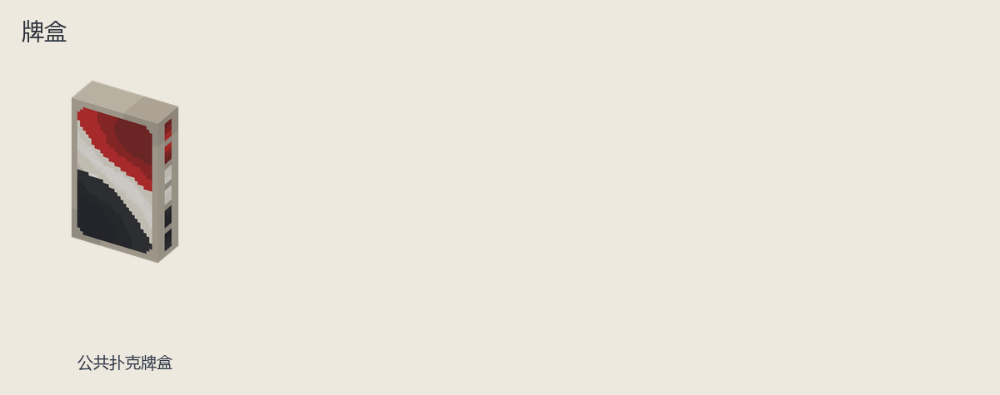

| 实图 | 名称 | 数量／所属 | 用途与区别 |
| --- | --- | --- | --- |
| 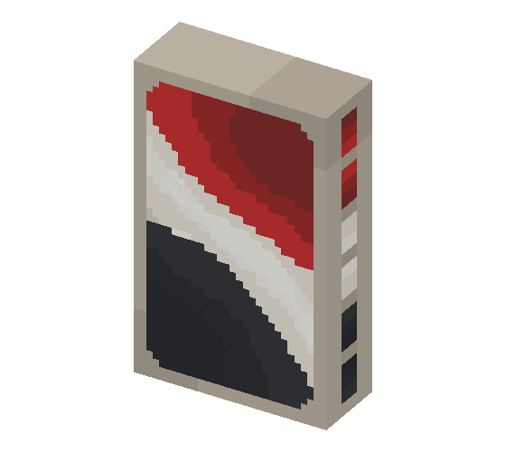 | 公共扑克牌盒 | 1 | 仅用于发牌、收牌展示，不是可带走的手牌。 |

<!-- END COMPONENTS -->

[返回说明书目录](README.md)
