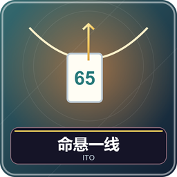
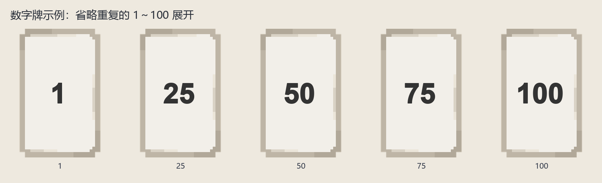
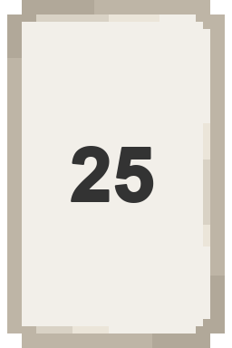
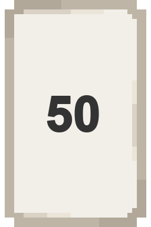
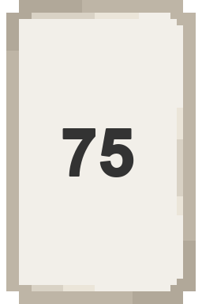
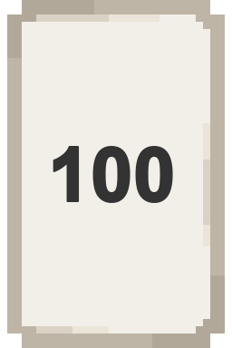

# 命悬一线：用描述比较数字

2～8 人，两种玩法。蛛丝是全员合作从小到大打数字，红线是两两配对争取合计接近 100。共同规则是不能说出自己的准确数字，只能根据主题表达程度。

## 准备和数字牌

腾空第 1～6、9 格，默认蛛丝与书本输入，普通玩家无需 OP；文字对话框提交需要 OP。数字牌为 1～100 各一张，图鉴只示少量例子，所有数字外观格式和用法一样。主题库共 140 道，每题给出 1、100 两端参考，不需要背题。

例如题目两端是“最不想遇到→最想遇到的生物”。12 可说“凋灵”，87 可说“给我好交易的村民”。这些是主观程度，不要求全桌价值观一致，但描述要帮助比较。

## 先交描述，再出牌／配对

书模式：对应手牌的描述书会显示自己的秘密数字，在第一页填 1～48 字，点完成后 Q 提交，可修改重交。不要签名。对话框模式：第 9 格紫色 Q 手动打开，查看数字并填描述，不自动弹窗。

所有未出手牌描述交齐才开放行动。讨论可解释主题理解，不能说“我是 80”“比你高 3”，也不能用数量、暗号精确传数。系统不会替桌友裁定口头暗号，大家需共同遵守。

## 蛛丝：三关合作

全队共享三生命，三关每人分别拿一、二、三张。第三关额外有公共参照牌帮助排序。讨论后按认为从小到大的次序，由持有人选该数字牌 Q 打出，不是轮流必须每人出一张。

若你先打 60，而还有 45、52 未出，这两张被揭示并移除，每张扣一生命，总扣二。其余人别再试图打已经移除的牌。全关牌处理完过关，恢复一生命，上限三；二人局不回血。生命归零失败，通过第三关全员胜，短暂计分后回大厅。

同一人有多张时，每张各有描述，自己的 20、80 应分别在不同时间出，不能因为轮到自己就一起按 Q。

## 红线：互选搭档

每轮每人一张，描述交齐后数字牌 Q 选搭档。双方互选才锁定并同时亮牌，单方面邀请不算完成，可更改；已亮不能换。可选单飞，亮牌且本轮零分。

| 亮牌结果                | 得分／结束                           |
| ----------------------- | ------------------------------------ |
| 一组总和恰好 100        | 该搭档立即赢整场，优先于此前登船资格 |
| 小于 100 的组中总和最高 | 两人各 2 分                          |
| 小于 100 的组中第二名   | 两人各 1 分                          |
| 超过 100、单飞          | 0                                    |

不足 100 的并列占名次：两组并列第一各 2 分，后面下一组第三；并列第二各 1。全员亮后结算，再下一轮。个人到 5 分叫登船，只有一人到仍继续；至少两人登船则整场结束，取最高两人，同分争末席按实际座号小者。合计 100 可直接覆盖此前登船结果。

## 比较描述的例子和常见错误

“小僵尸”和“凋灵”谁更低，可以讨论害怕程度，但持牌人不能直接报数。觉得全桌把自己的描述误解了可以公开澄清观点，不能用数字校准。蛛丝不用找和为 100，红线不用排全场从小到大。

关窗口不代表已提交，未交齐描述时 Q 数字牌会返还。开局前在大厅选模式和输入方式，开局后固定。管理员中止：`/function ito:admin/abort`，暂停等见[共同操作](00-新手入门与界面图例.md)。

<!-- BEGIN COMPONENTS -->

## 组件实图与逐件图鉴

这些图片直接取自配套资源包，立体物件按实际 Java 模型渲染。卡牌展示真实正面，动画纹理取第一帧；皮肤头像、发光和粒子属于游戏内动态效果。

### 数字牌示例：省略重复的 1～100 展开

| 实图 | 名称 | 数量／所属 | 用途与区别 |
| --- | --- | --- | --- |
|  | 1 | 1 | 仅持有人知道数值；用主题描述相对程度，不可直接说数字。 |
|  | 25 | 1 | 仅持有人知道数值；用主题描述相对程度，不可直接说数字。 |
|  | 50 | 1 | 仅持有人知道数值；用主题描述相对程度，不可直接说数字。 |
|  | 75 | 1 | 仅持有人知道数值；用主题描述相对程度，不可直接说数字。 |
|  | 100 | 1 | 仅持有人知道数值；用主题描述相对程度，不可直接说数字。 |

牌库是整数 1～100，各一张。它们的规则相同，只是数字不同，因此不再逐张铺图。全部牌的用法均为：根据所发主题描述相对程度，按对应模式出牌或配对。

<!-- END COMPONENTS -->

[返回说明书目录](README.md)
