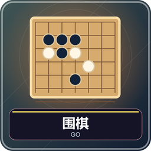
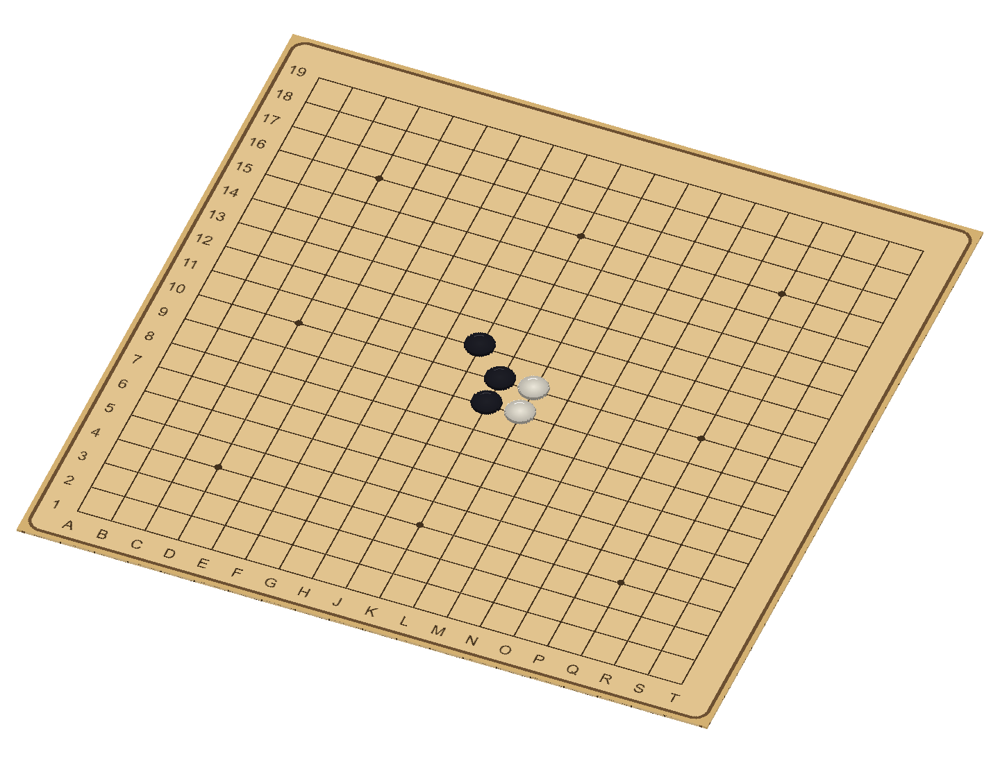
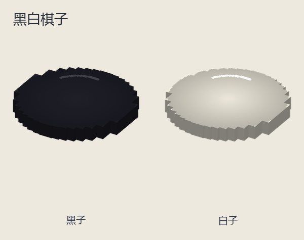
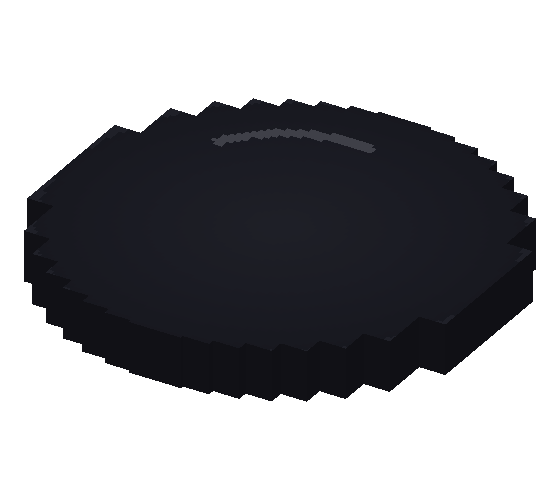
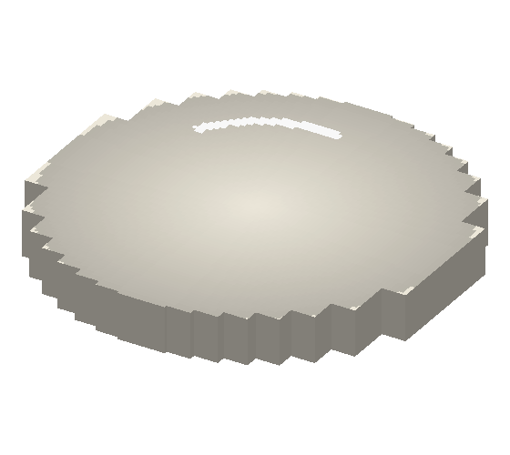

# 围棋：气、提子和围地

1～2 人，单人对基础人机。黑先，双方在交点放子，通过连接、包围和提子取得更大面积。最后比较活子与围空，白方再加贴目，较高者胜。

## 准备与读棋盘

腾空第 9 格，默认 19 路，可选 13、15；初学推荐 13。棋子使用黑白圆子，与五子棋同模型，但没有连五规则。坐标不使用字母 I：13 路 A～N，15 路 A～P，19 路 A～T；数字从黑方近侧向对面递增。

默认按座位选边，黑南白北或设置黑西白东；可随机分边自动调座。落子后不能任意搬动已放子，也不在方格中央放。

## 先学四条基础规则

**连接：**上下左右相连的同色棋子是一串，共享气；斜线靠着不算连。同色串变大也可能整体被提，不是子多就安全。

**气：**棋串上下左右邻接的空交点就是气。同一个空点无论贴着几枚己子也只算一个气。敌子占去最后一口气，整串被提走。

**落子和提子：**落空点后先提邻近无气敌串，再检查自己有没有气；若既不能提敌获得气、自己又无气，是自杀，系统拒绝。能提敌才可能合法落进看似无气处。

**超级劫：**不允许一次落子让整盘棋形重复当前分支曾出现的棋形；停一手不受限。经典单劫也因此不能马上提回，先到别处下，且仍须符合全局历史。

## 每回合怎么操作

右键空交点落子，或开“同点两次确认”先预选再确认。密集棋盘用第 9 格 Q 的坐标落子。聊天记录坐标，最新落子有小标记，提子自动移除。

不想落子可 Q 菜单“停一手”。还有查看／关闭占地、悔棋、认输；双人悔棋须对方同意，人机撤回到真人上一手之前，电脑应手也退。占地是中途保守估算，不自动识别死活，不等于最后分数，新落子会清除估算标记。

## 一个提子例子

白子上下左三面被黑占住，只剩右侧空点一口气。黑在右侧落子，白子无气被提。若白上方另连一枚白，那要一起数整个白串所有外部空点，不能只看原单子的四邻。两处互不相通的真眼常能保证存活，但本游戏终局仍由双方确认死子，不自动替你判断所有棋形。

## 双方连续停手后的计分

1. 双方连续停一手，进入终局，棋钟暂停。
2. 右键认为已死的棋，整串标红；再点取消。实际子暂不删除，便于双方讨论。
3. 每次改死子清除双方确认。双方在菜单确认才结算；单人由真人确认。
4. 有争议选继续下棋，移除计分标记，恢复原棋形、行棋方和棋钟，通过实战解决。

面积＝盘上活子＋只接触己方颜色的连通空域。两色都接触的空域中立；标死子按空点重新算归属。白另加贴目，默认 7½，可选 0、5½、6½、8½。**提子数只作记录，不重复加分**。

超时／认输判负。终局回大厅保留棋面，原参与者第 9 格 Q 可复盘首手、前后手、末手、自动播放；关闭恢复终局。新开局、换游戏或棋盘大小清棋谱。

## 设置和练习建议

大厅可设大小、经典／木色、方向、分边、时限无限制／5～30 分钟（默认 10）、贴目、人机三档、坐标／最后一手、两击确认、是否允许估算。只扣行动方，动画、终局确认和复盘暂停钟。

新手先练连接与气，别急着争每个空点；估算不判死活，不能拿估算逼对方认输。管理员中止：`/function weiqi:admin/abort`；离线见[共同操作](00-新手入门与界面图例.md)。

<!-- BEGIN COMPONENTS -->

## 组件实图与逐件图鉴

这些图片直接取自配套资源包，立体物件按实际 Java 模型渲染。卡牌展示真实正面，动画纹理取第一帧；皮肤头像、发光和粒子属于游戏内动态效果。

### 棋盘与棋子组合预览

国际象棋为标准开局；其他组合用于辨认组件与位置，具体初始布局由游戏自动摆放。配色不改变规则，不重复展开同模型换色图。

### 黑白棋子

| 实图 | 名称 | 数量／所属 | 用途与区别 |
| --- | --- | --- | --- |
|  | 黑子 | — | 置于交点；颜色代表行棋方。 |
|  | 白子 | — | 置于交点；颜色代表行棋方。 |

<!-- END COMPONENTS -->

[返回说明书目录](README.md)
