# 卡坦岛：从两个村庄建设到十分

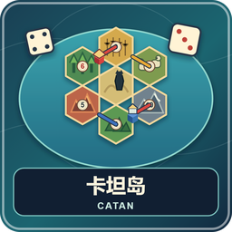

2～4 名真人，无人机。靠骰子生产资源，和银行、玩家交易，修路、建村、升级城市与购买开发牌。在 **自己回合** 达到 10 分获胜。两人沿用同一地图、库存和规则，没有额外中立玩家。

## 先认识这座岛

19 块陆地：森林、牧场、麦田各四，丘陵、矿山各三，沙漠一。分别生产木材、羊毛、粮食、砖块、矿石；沙漠不产。圆片数字是两骰总和，骰值相同的地块生产，6、8 较易出现、2、12 较少。强盗所在格停产。

村庄／城市建在地块 **交点**，道路在两交点之间的 **边**，强盗放 **地块中央**。港口在海岸，自己建筑位于其相邻港口交点才有优惠，仅把路修过去不算。图鉴逐一展示地形、五类资源、四色建筑、港口、数字、骰子、强盗与五种开发牌。

## 准备与界面

清空九格快捷栏，背包留空格放资源与开发牌。大厅选推荐／随机岛、默认／旋转 90°、首位随机／按座位、音乐开关。四座八座只改变显示尺寸，最多四人。每方道路 15、村庄 5、城市 4，银行五类资源各 19，开发牌 25。

BetterTitle 左右列每人姓名、公开分数、资源总数、开发牌总数、道路／军队；红蓝白橙姓名与建筑对应，右侧箭头指行动者。**只有本人看到自己五类资源详情、未出开发牌、包含秘密胜利点的分数**。别人资源种类不是公开手牌，仍可根据生产和公开行为推理。

| 快捷格 | 做什么 |
| --- | --- |
| 1 村庄、2 道路、3 城市 | 持对应物瞄准交点／边／己村，右键或 Q 预览，再一次确认 |
| 4 开发牌 | Q 一次购买；背包旧开发牌 Q 一次使用 |
| 5 银行 | Q 一次进入，之后资源 Q 选支付种类，再选取得种类 |
| 6 玩家交易 | 选对象，设置给出与索取，必要时开多项报价窗口 |
| 7 结束回合 | Q 一次结束；免费路阶段可放弃剩余机会 |
| 8 骰子 | 待投骰 Q 一次；偷取阶段瞄准对手 Q 一次 |
| 9 取消 | 取消当前预选；桌面左键也能取消 |

错误会在 actionbar 解释，例如缺矿石、不是己村、位置过近。远端超出右键距离可持建筑 Q 瞄准。建筑变灰提示费用不足，仍以最终规则检查为准。

## 第一步：免费放两组村庄与道路

按行动顺序 A→B→C→D 各放一村一路，再 D→C→B→A 放第二组。二人是 A→B→B→A。每村必须距所有村／城至少两条边，即中间至少空一个交点；初始道路紧邻刚放的村庄。

只有第二个村庄领取相邻地块资源，每非沙漠地块一张，不看数字是否刚掷出。初始布置免费，不扣资源。选址要兼顾数字概率和资源种类，别只占两块同资源而缺修路材料。

## 正式回合的顺序

1. 可先用一张旧行动开发牌，或直接 Q 骰子掷两骰。
2. 不是 7：全部玩家按相邻建筑生产，村庄每地一、城市每地二，强盗格除外。不是只有投骰者拿资源。
3. 是 7：完成所有弃半、移动强盗与偷资源，见下段。
4. 进入自由行动，可反复交易、建造、买开发牌；旧行动牌每回合合计最多一张，掷骰前用过则之后不能再用。
5. 完成后第 7 格 Q 一次结束，轮下家。没有强制建造，能拿着资源过回合。

银行不足按资源分别处理：多人应领同资源而不够，则该资源全不发；若只有一人应领，可拿剩余库存。其他资源照常生产。骰值先保存、动画后表现，重载不重投。

## 建造费用、连接和得分

| 建造 | 支付 | 规则 | 得分 |
| --- | --- | --- | --- |
| 道路 | 木材1＋砖1 | 接己方路或建筑，不穿对手建筑延伸 | 本身 0 |
| 村庄 | 木材1＋砖1＋羊毛1＋粮食1 | 除初始外接己路，并遵守两边间距 | 1 |
| 城市 | 粮食2＋矿石3 | 升级自己村庄，归还村庄库存 | 总计 2，不是另加 2 |
| 开发牌 | 羊毛1＋粮食1＋矿石1 | 从尚有牌的牌堆秘密抽一张 | 可能是秘密胜利点 |

最长路连续至少五段，最多路者得 2 分；同一段不能重复用，可绕环或重复经过交点，对手建筑阻断穿行。最大军队至少三张已用骑士，最多者 2 分。并列原持有者保留；原持有者失格且其他人并列则回银行。手中骑士不算已用。

自己回合总分达 10 即胜，秘密胜利点也计。对手回合因奖项变化到 10，要等自己回合才获胜。

## 银行、港口与玩家交易

银行通常同资源四张换任一资源一张；通用港三换一，对应专港两换一。新建港当回合就有效，优惠只作用该玩家。Q 银行后 Q 支付资源，再 Q 想取得资源，actionbar 给实际比率和拒绝原因。羊毛不够兑换时不会悄悄无响应。

辨认专港时看 `2:1` 下的大图案：**红砖堆、红边框＝砖块港；浅色毛线团、绿边框＝羊毛港**。它们与物品栏资源牌采用同一图案，不能把砖块港当矿石港。只看颜色不确定时，以砖块的长方形砖缝、羊毛的圆形绕线纹路区分。

玩家交易双方之一必须是当前行动者，可按五类资源分别设给／要多少；只能换资源，不能赠送、同种互换或换开发牌。对方非其回合也可第 6 格 Q 看报价、接受／拒绝；发起人可撤销。报价详细内容只给双方看，同桌一次一份报价，接受时重新核库存，过期报价无效。

## 骰出 7 与强盗

资源总数超过七的 **每位玩家** 弃一半，向下取整，不数开发牌。例如九张弃四、八张弃四、七张不用弃。用资源牌逐张 Q 加入弃牌选择，够数才统一扣，等所有需要者完成。

当前玩家再选另一个陆地移强盗，原格不能原地放。选新格相邻有资源的对手，瞄准 Q 随机偷其一张资源；无法偷则跳过。强盗停产但不阻止旁边修路、建村或港口交易。骑士移动强盗不触发全体弃半。

## 全部开发牌

| 名称 | 张数 | 怎样操作与结算 |
| --- | --- | --- |
| 骑士 | 14 | Q 使用后移强盗、选人偷；计入最大军队 |
| 修路 | 2 | 免费放至多两段，仍须连接合法且有库存；可放弃剩余路 |
| 垄断 | 2 | 选一类，取得所有对手这类全部资源 |
| 丰收／发明 | 2 | 从银行选两张，可同类，库存须够 |
| 胜利点 | 5 | 自动秘密 +1 分，不需要主动 Q 使用 |

本回合买的行动牌是新牌，必须等以后自己回合；每回合最多一张非胜利点行动牌。胜利点虽刚买也立即计胜负，不用等一回合。发展牌在第三人称用中性外观避免泄密。

## 新手常见卡点

建不了村先查是不是交点、接己路、离任何建筑够远、还有村庄库存；升城只点自己村且需粮2矿3。城替村不是另占一个交点。别把港口图标当能直接点击领取资源的按钮。掷 7 必须先等全体弃完，之后才移动强盗和自由交易。

结束回大厅保留公开棋面，重开再重置。管理员中止：`/function catan:admin/abort`；离线暂停见[共同操作](00-新手入门与界面图例.md)。

<!-- BEGIN COMPONENTS -->

## 组件实图与逐件图鉴

这些图片直接取自配套资源包，立体物件按实际 Java 模型渲染。卡牌展示真实正面，动画纹理取第一帧；皮肤头像、发光和粒子属于游戏内动态效果。

### 完整立体棋盘

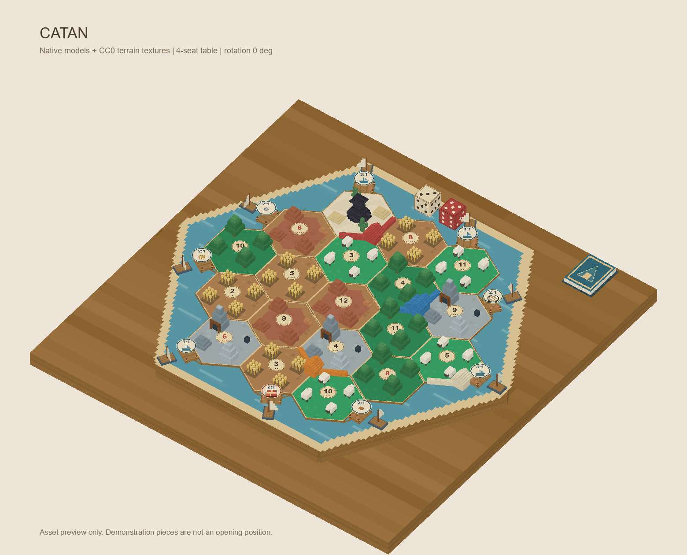

展示用建筑用于辨认组件，不代表初始布置。另可查看[四座旋转](images/boards/catan-board_preview_c4o1.png)、[八座默认](images/boards/catan-board_preview_c8o0.png)、[八座旋转](images/boards/catan-board_preview_c8o1.png)。

### 19 块立体地形

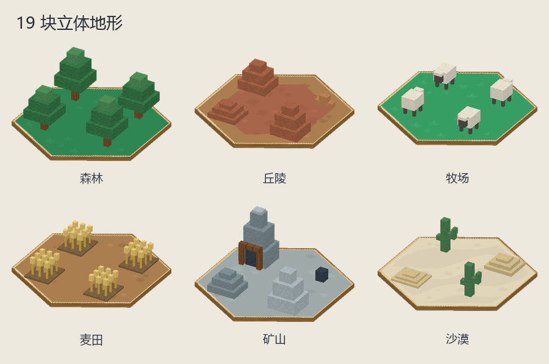

| 实图 | 名称 | 数量／所属 | 用途与区别 |
| --- | --- | --- | --- |
| 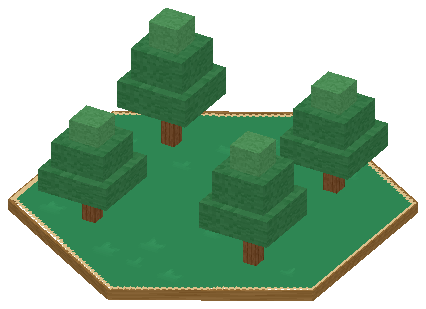 | 森林 | 4 | 产木材，建路与村庄使用。 |
| 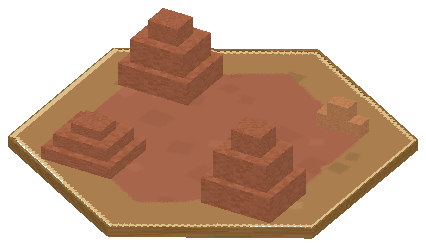 | 丘陵 | 3 | 产砖块，建路与村庄使用。 |
| 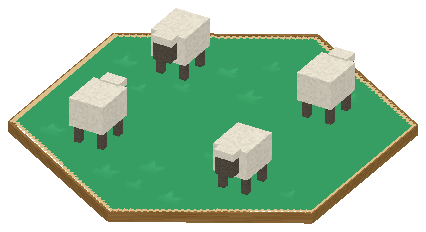 | 牧场 | 4 | 产羊毛，建村庄与买开发牌使用。 |
| 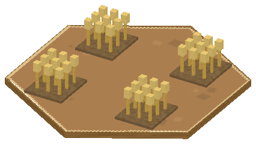 | 麦田 | 4 | 产粮食，建村庄、城市与开发牌使用。 |
| 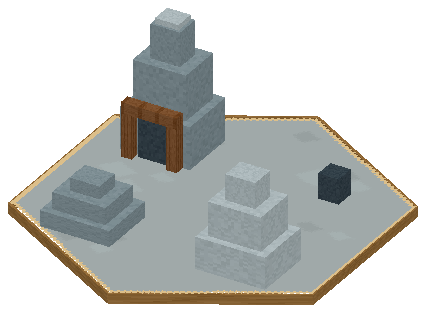 | 矿山 | 3 | 产矿石，建城市与开发牌使用。 |
| 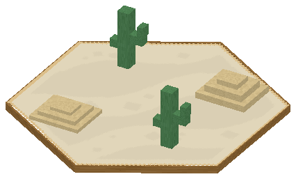 | 沙漠 | 1 | 不生产；开局强盗在此。 |

### 95 张资源牌：五种各 19 张

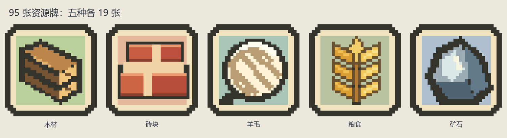

| 实图 | 名称 | 数量／所属 | 用途与区别 |
| --- | --- | --- | --- |
| 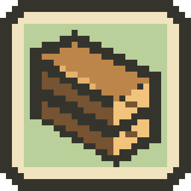 | 木材 | 19 | 资源是秘密手牌；用于支付费用和交易。 |
|  | 砖块 | 19 | 资源是秘密手牌；用于支付费用和交易。 |
|  | 羊毛 | 19 | 资源是秘密手牌；用于支付费用和交易。 |
|  | 粮食 | 19 | 资源是秘密手牌；用于支付费用和交易。 |
|  | 矿石 | 19 | 资源是秘密手牌；用于支付费用和交易。 |

### 四色建筑、强盗与开发牌堆

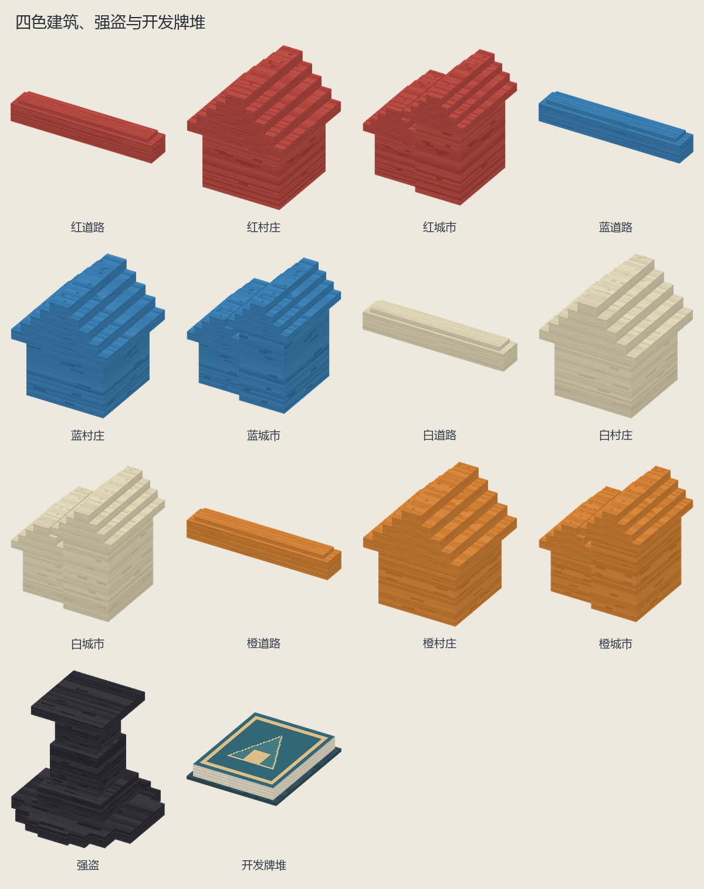

| 实图 | 名称 | 数量／所属 | 用途与区别 |
| --- | --- | --- | --- |
| 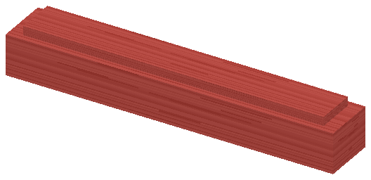 | 红道路 | 每方 15 | 连接己方网络，不直接计分。 |
| 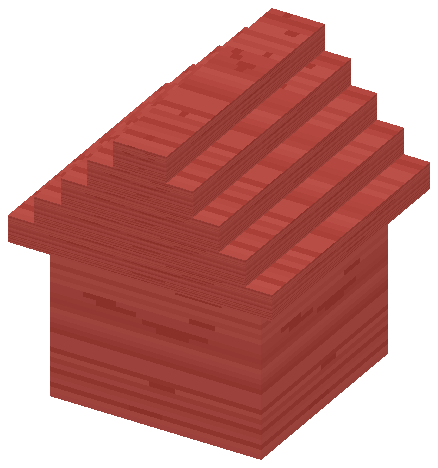 | 红村庄 | 每方 5 | 1 分，每次邻格生产领 1。 |
| 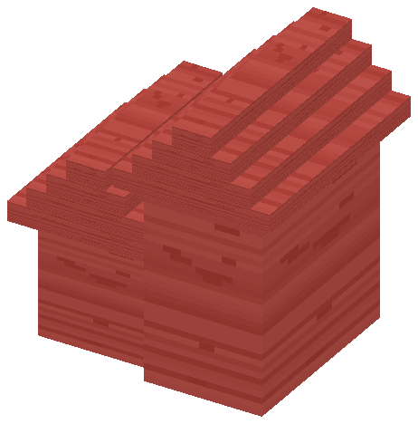 | 红城市 | 每方 4 | 升级村庄，总计 2 分，每次邻格生产领 2。 |
|  | 蓝道路 | 每方 15 | 连接己方网络，不直接计分。 |
| 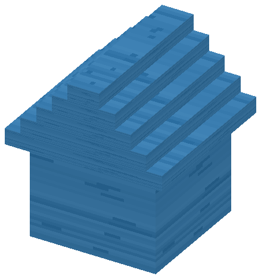 | 蓝村庄 | 每方 5 | 1 分，每次邻格生产领 1。 |
| 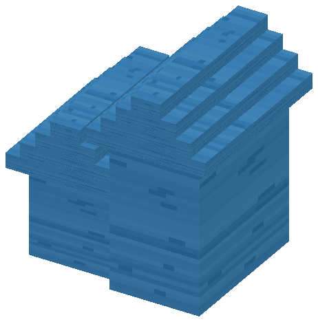 | 蓝城市 | 每方 4 | 升级村庄，总计 2 分，每次邻格生产领 2。 |
| 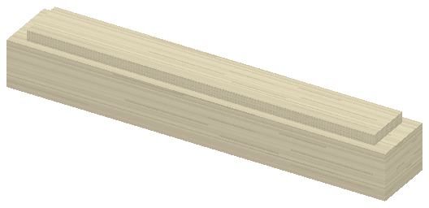 | 白道路 | 每方 15 | 连接己方网络，不直接计分。 |
| 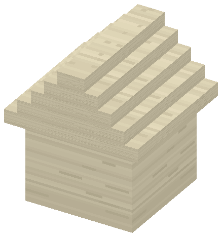 | 白村庄 | 每方 5 | 1 分，每次邻格生产领 1。 |
| 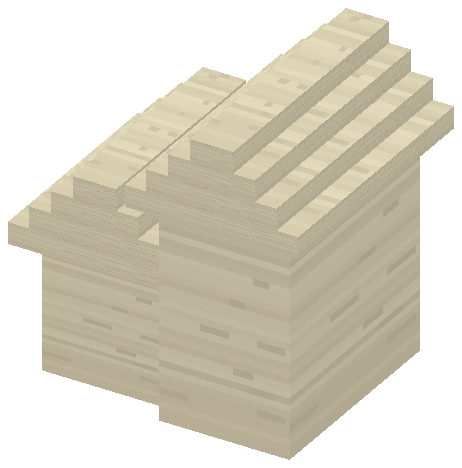 | 白城市 | 每方 4 | 升级村庄，总计 2 分，每次邻格生产领 2。 |
| 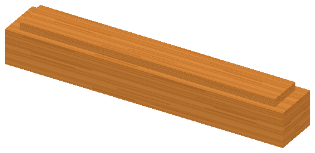 | 橙道路 | 每方 15 | 连接己方网络，不直接计分。 |
| 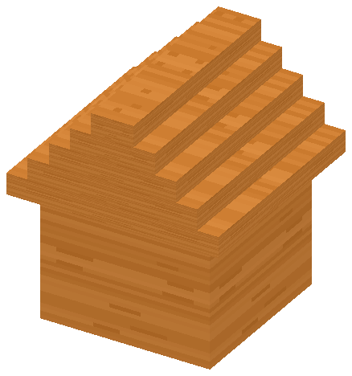 | 橙村庄 | 每方 5 | 1 分，每次邻格生产领 1。 |
| 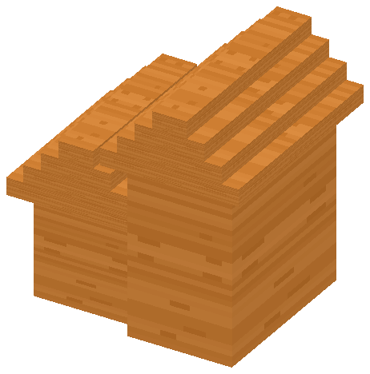 | 橙城市 | 每方 4 | 升级村庄，总计 2 分，每次邻格生产领 2。 |
| 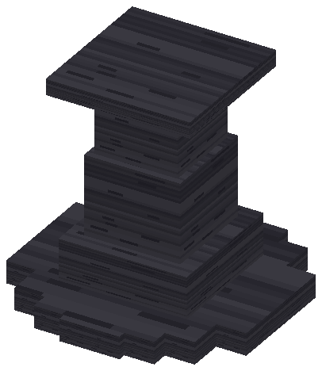 | 强盗 | 1 | 所在地块不生产；移动后可偷相邻对手资源。 |
|  | 开发牌堆 | 1 | 25 张；余量显示在牌堆上。 |

### 9 个港口的全部类型

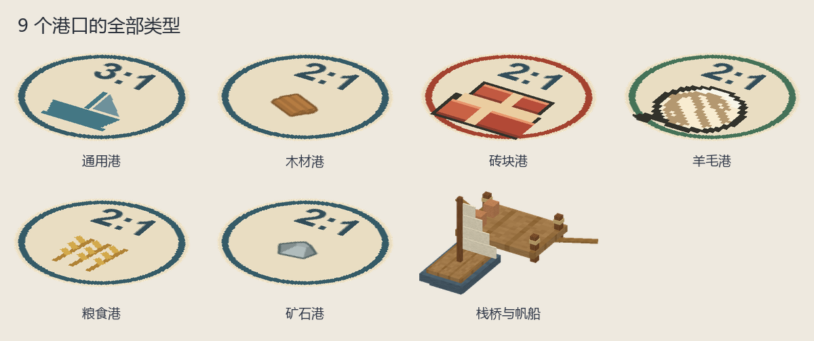

| 实图 | 名称 | 数量／所属 | 用途与区别 |
| --- | --- | --- | --- |
| 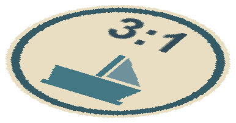 | 通用港 | 4 | 任一资源 3:1。 |
| 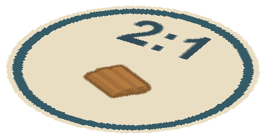 | 木材港 | 1 | 木材 2:1。 |
|  | 砖块港 | 1 | 红边框的大幅红砖堆；砖块 2:1。 |
| 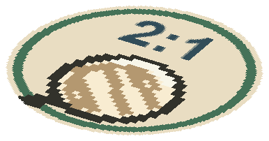 | 羊毛港 | 1 | 绿边框的浅色毛线团；羊毛 2:1。 |
| 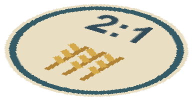 | 粮食港 | 1 | 粮食 2:1。 |
| 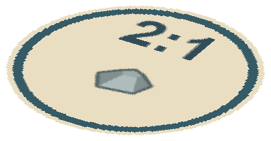 | 矿石港 | 1 | 矿石 2:1。 |
| 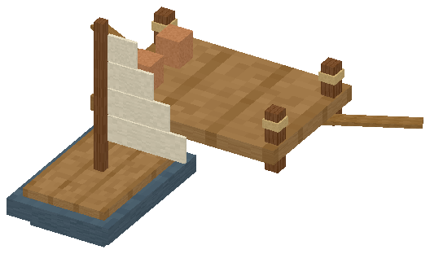 | 栈桥与帆船 | 9 | 相邻交点有自己的建筑才拥有港口。 |

### 数字标记示例与双骰

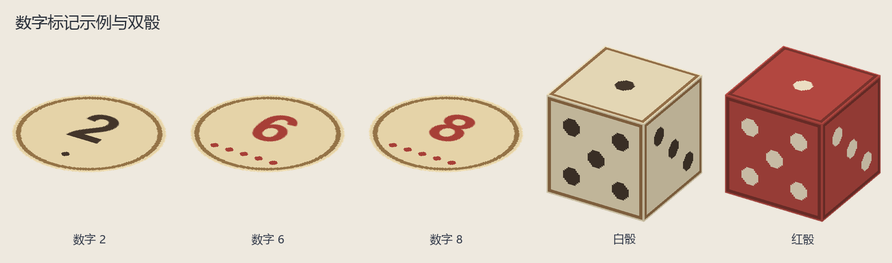

| 实图 | 名称 | 数量／所属 | 用途与区别 |
| --- | --- | --- | --- |
|  | 数字 2 | 见正文 | 两骰之和为该数时生产；6、8 红色标注。 |
|  | 数字 6 | 见正文 | 两骰之和为该数时生产；6、8 红色标注。 |
| 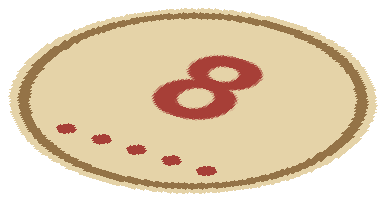 | 数字 8 | 见正文 | 两骰之和为该数时生产；6、8 红色标注。 |
| 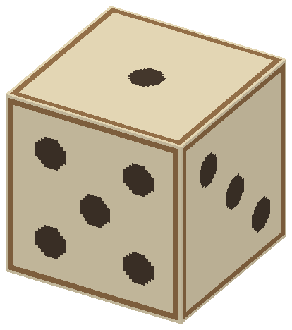 | 白骰 | 1 | 两枚点数相加；7 不生产，改处理强盗。 |
| 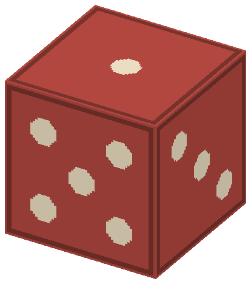 | 红骰 | 1 | 两枚点数相加；7 不生产，改处理强盗。 |

数字全表：2、12 各一枚；3、4、5、6、8、9、10、11 各两枚，共十八枚。没有 7 标记；沙漠不放数字。相同数字版式省略重复展示。

### 25 张开发牌：五种道具外观

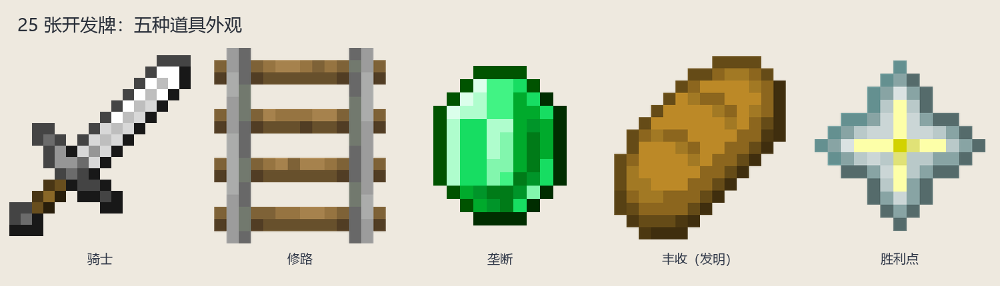

| 实图 | 名称 | 数量／所属 | 用途与区别 |
| --- | --- | --- | --- |
|  | 骑士 | 14 | 移动强盗、偷资源，计入军队。 |
| 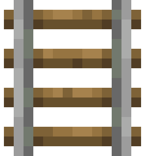 | 修路 | 2 | 免费修至多两段合法道路。 |
|  | 垄断 | 2 | 取得全部对手所选资源。 |
|  | 丰收（发明） | 2 | 从银行选两张资源，可同种。 |
|  | 胜利点 | 5 | 秘密 +1 分；无需打出。 |

<!-- END COMPONENTS -->

[返回说明书目录](README.md)
