# 璀璨宝石：用折扣建立宝石生意

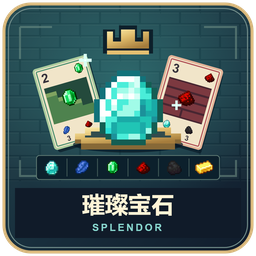

2～4 人，无人机。拿宝石购买发展卡，发展卡给永久折扣和声望，折扣又吸引贵族。有人回合末到 15 分触发最后一轮，等行动次数相同后比较分数，触发者不一定赢。

## 准备和六种宝石

腾空快捷栏，并留背包空位。前六格显示钻石（白）、蓝宝石（蓝）、祖母绿（绿）、红宝石（红）、缟玛瑙（黑）、黄金（万能）；后三格放最多三张预定牌。已购发展卡与贵族进入背包，不受三格限制。物品是实际资产的映射，别拖走销毁。

| 人数 | 银行每色普通宝石 | 黄金 | 本局贵族 |
| --- | --- | --- | --- |
| 2 | 4 | 5 | 3 |
| 3 | 5 | 5 | 4 |
| 4 | 7 | 5 | 5 |

90 张发展卡分三级：一级40、二级30、三级20，各级随机翻四张，余牌为牌堆。贵族从十张随机取人数＋一。牌堆上数字是剩余数，不是购买费用。棋盘随回合转向当前行动者；BetterTitle 本人左上，公开每人宝石、折扣、声望、预定和贵族。

## 怎么读一张牌

左上数字是买到后加的声望，0 分也有价值；右上宝石是该卡永久提供的 **一种折扣**；底部各色数字才是购买费用。牌图画了什么只是便于辨认，不能当额外能力。所有卡都只提供一枚相应折扣，三级不提供三枚。

贵族下方显示要求的 **发展卡折扣数量**，不是要支付的手中宝石。等级没有购买门槛，有支付能力就能买高阶。

## 你的回合：四种主行动只做一种

| 行动 | 桌面操作 | 条件 |
| --- | --- | --- |
| 拿三色各一 | 依次右键三种，选中发光，第三种选完自动拿 | 普通宝石，不能直接拿黄金 |
| 拿同色两颗 | 同一种右键两次 | 取前银行该色至少四颗 |
| 购买一卡 | 第一次右键选中，第二次支付获得 | 能付折扣后费用；可免费买 |
| 预定一卡 | 潜行右键选中并显示预约提示，再潜行右键同一张确认；或买不起的明牌第三次普通右键；牌堆两次右键盲预定 | 预定不超过三张，有黄金则同时得一颗 |

左键取消当前预选。银行只剩一／两种普通色时可拿剩余种类各一；不能明明有三色却随意只拿一色一颗作为完整行动。买不起第二次会提示“再次右键可预定”，此时第三次才预定。

想保留一张买得起的牌也可以预约：**Shift＋右键两次**。第一下 actionbar 会写“预约发展卡”，并让该牌发光；第二下保持 Shift，右键同一张才会预约。切换到另一张牌要重新确认，左键可取消。若之前普通右键选的是购买，第一次 Shift＋右键只会切到预约；若松开 Shift 普通右键，则重新选择购买，避免误操作。

明牌买／预定后同级立即补，堆空则空着。预定以后不能丢掉，只能买，未买不提供折扣／分；即使黄金用尽仍能预定。自己的预定牌持快捷格 Q 两次购买。所有日常操作不需要市场菜单。

## 折扣怎样支付：最重要的例子

每次买卡，先对每色费用减同色永久折扣，最低零，再付普通宝石，缺额用黄金。折扣不消失，普通宝石和黄金回银行。

一张绿折扣、0 分卡印着钻石1、蓝宝石1、祖母绿1，你若无折扣，需三类各一；手里三颗蓝不代表付三蓝。如果已有钻石1和绿1折扣，只付蓝1。系统按实际五色分别算，不会把费用数字当宝石总数。折扣覆盖全部时牌上显示“免费”，仍需用本回合主行动两次右键买。

牌外细绿光是当前买得起的提示，不覆盖牌面；选中发光只是预览，不是已经买下。黄金可补任一缺色，但不能拿黄金当永久折扣。

## 超过十颗和贵族来访

主行动后包括黄金超过十颗，进入退珠：右键桌上对应宝石选择退回，左键撤销，恰好退到十自动完成。可以退刚拿的，不可在不超限时任意退。永久折扣、卡和贵族不算十颗。

回合末检查贵族要求，只看永久折扣，不消费它们也不付宝石。每位贵族三分，一回合最多一位，不占主行动。符合一位自动来访，多位时需选其中一位，其余留桌等待以后。

## 末轮、平局和设置

回合末有人至少 15 分后，继续到本轮最后行动者，确保每人回合数相同。比声望，高者胜；相同则 **已购买发展卡更少者** 胜，仍同共享胜利。预定牌不算已购张数。最后一轮仍可购买、预定和吸引贵族，可能反超。

大厅可选按座位／随机行动顺序、音乐，默认按座位且音乐开；随机不改变座位。没有追加扩展牌或双人对决规则。新手先看贵族需色，积累便宜折扣，别为黄金把三个预定位全堵死。

管理员中止：`/function splendor:admin/abort`；暂停和资源包重载见[共同操作](00-新手入门与界面图例.md)。

<!-- BEGIN COMPONENTS -->

## 组件实图与逐件图鉴

这些图片直接取自配套资源包，立体物件按实际 Java 模型渲染。卡牌展示真实正面，动画纹理取第一帧；皮肤头像、发光和粒子属于游戏内动态效果。

### 六种筹码

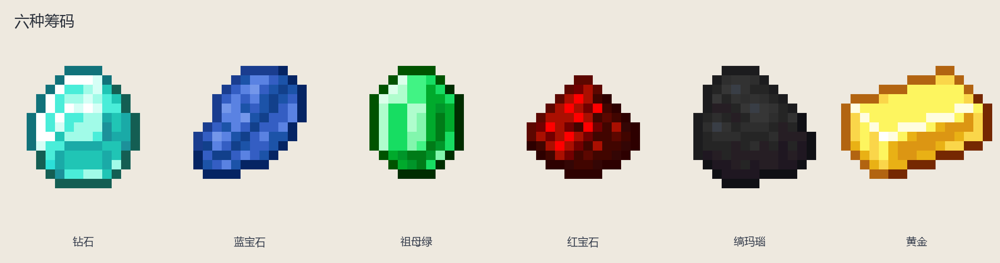

| 实图 | 名称 | 数量／所属 | 用途与区别 |
| --- | --- | --- | --- |
| 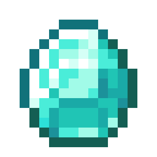 | 钻石 | 按人数表 | 白色普通宝石。 |
| 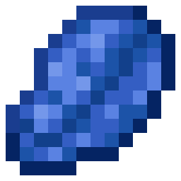 | 蓝宝石 | 按人数表 | 蓝色普通宝石。 |
| 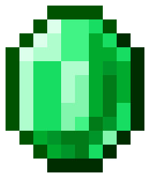 | 祖母绿 | 按人数表 | 绿色普通宝石。 |
| 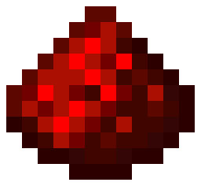 | 红宝石 | 按人数表 | 红色普通宝石。 |
| 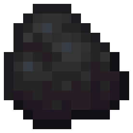 | 缟玛瑙 | 按人数表 | 黑色普通宝石。 |
| 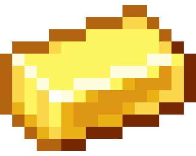 | 黄金 | 按人数表 | 万能支付，只能随预定领取，不能直接拿。 |

### 市场底板

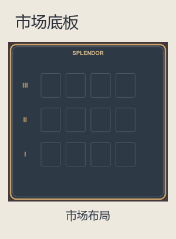

| 实图 | 名称 | 数量／所属 | 用途与区别 |
| --- | --- | --- | --- |
| 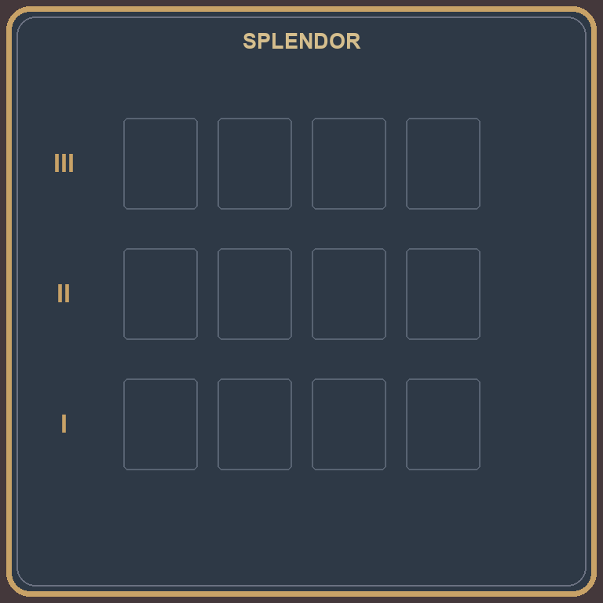 | 市场布局 | 1 | 三层各四牌、左侧牌堆、上方贵族、下方六色银行。 |

### 1 级发展卡：40 张逐张图鉴

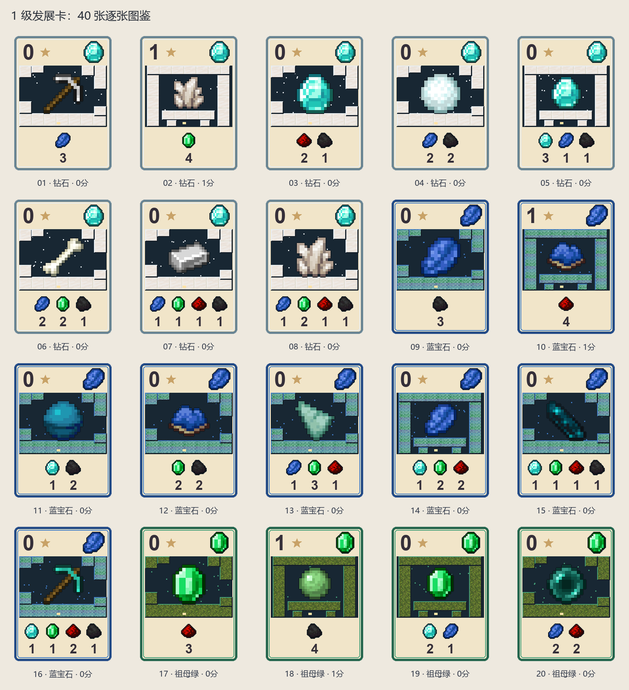

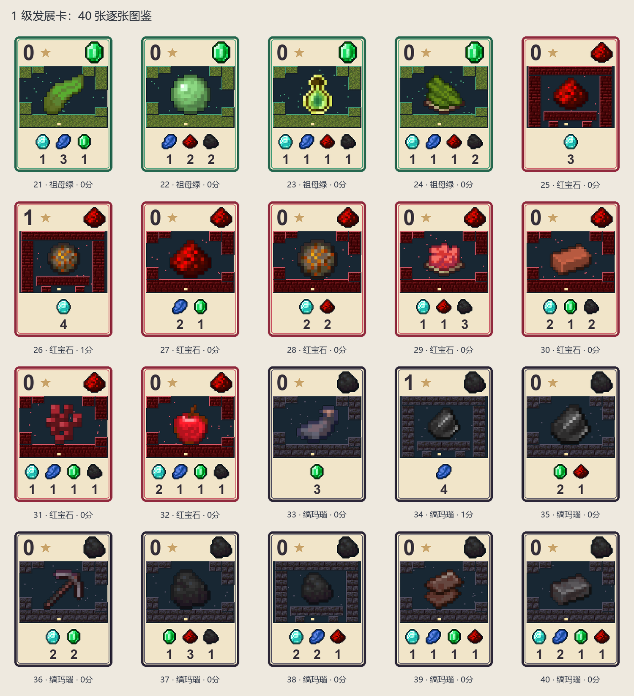

| 实图 | 名称 | 数量／所属 | 用途与区别 |
| --- | --- | --- | --- |
| 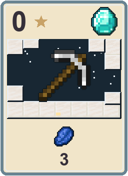 | 01 · 钻石 · 0分 | 1 | 购买费用：蓝宝石3。购买后永久提供 1 钻石折扣；得 0 分。 |
| 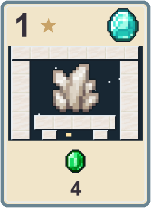 | 02 · 钻石 · 1分 | 1 | 购买费用：祖母绿4。购买后永久提供 1 钻石折扣；得 1 分。 |
| 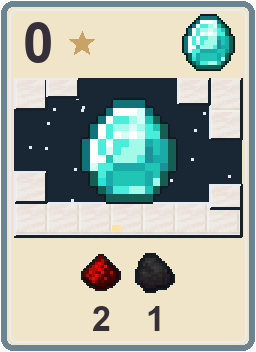 | 03 · 钻石 · 0分 | 1 | 购买费用：红宝石2＋缟玛瑙1。购买后永久提供 1 钻石折扣；得 0 分。 |
| 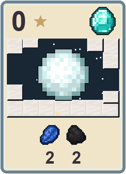 | 04 · 钻石 · 0分 | 1 | 购买费用：蓝宝石2＋缟玛瑙2。购买后永久提供 1 钻石折扣；得 0 分。 |
| 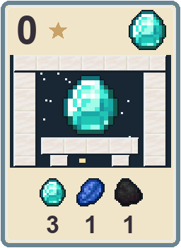 | 05 · 钻石 · 0分 | 1 | 购买费用：钻石3＋蓝宝石1＋缟玛瑙1。购买后永久提供 1 钻石折扣；得 0 分。 |
| 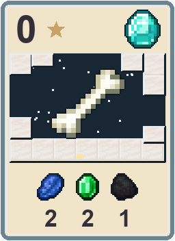 | 06 · 钻石 · 0分 | 1 | 购买费用：蓝宝石2＋祖母绿2＋缟玛瑙1。购买后永久提供 1 钻石折扣；得 0 分。 |
| 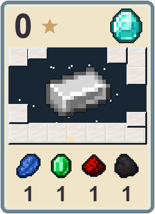 | 07 · 钻石 · 0分 | 1 | 购买费用：蓝宝石1＋祖母绿1＋红宝石1＋缟玛瑙1。购买后永久提供 1 钻石折扣；得 0 分。 |
| 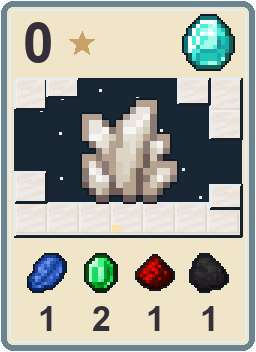 | 08 · 钻石 · 0分 | 1 | 购买费用：蓝宝石1＋祖母绿2＋红宝石1＋缟玛瑙1。购买后永久提供 1 钻石折扣；得 0 分。 |
| 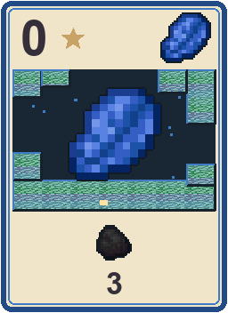 | 09 · 蓝宝石 · 0分 | 1 | 购买费用：缟玛瑙3。购买后永久提供 1 蓝宝石折扣；得 0 分。 |
| 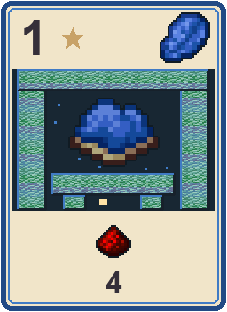 | 10 · 蓝宝石 · 1分 | 1 | 购买费用：红宝石4。购买后永久提供 1 蓝宝石折扣；得 1 分。 |
| 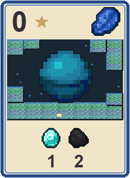 | 11 · 蓝宝石 · 0分 | 1 | 购买费用：钻石1＋缟玛瑙2。购买后永久提供 1 蓝宝石折扣；得 0 分。 |
| 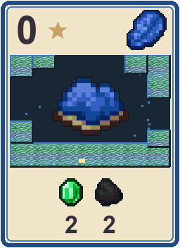 | 12 · 蓝宝石 · 0分 | 1 | 购买费用：祖母绿2＋缟玛瑙2。购买后永久提供 1 蓝宝石折扣；得 0 分。 |
| 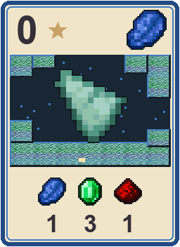 | 13 · 蓝宝石 · 0分 | 1 | 购买费用：蓝宝石1＋祖母绿3＋红宝石1。购买后永久提供 1 蓝宝石折扣；得 0 分。 |
| 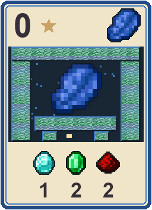 | 14 · 蓝宝石 · 0分 | 1 | 购买费用：钻石1＋祖母绿2＋红宝石2。购买后永久提供 1 蓝宝石折扣；得 0 分。 |
| 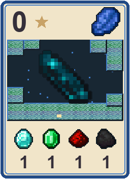 | 15 · 蓝宝石 · 0分 | 1 | 购买费用：钻石1＋祖母绿1＋红宝石1＋缟玛瑙1。购买后永久提供 1 蓝宝石折扣；得 0 分。 |
| 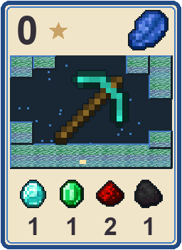 | 16 · 蓝宝石 · 0分 | 1 | 购买费用：钻石1＋祖母绿1＋红宝石2＋缟玛瑙1。购买后永久提供 1 蓝宝石折扣；得 0 分。 |
| 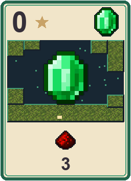 | 17 · 祖母绿 · 0分 | 1 | 购买费用：红宝石3。购买后永久提供 1 祖母绿折扣；得 0 分。 |
| 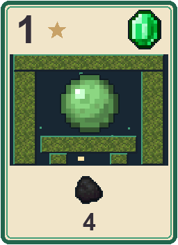 | 18 · 祖母绿 · 1分 | 1 | 购买费用：缟玛瑙4。购买后永久提供 1 祖母绿折扣；得 1 分。 |
| 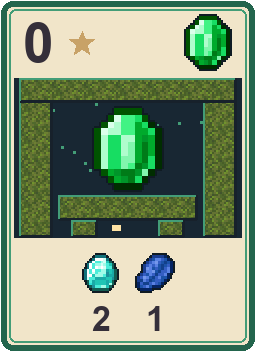 | 19 · 祖母绿 · 0分 | 1 | 购买费用：钻石2＋蓝宝石1。购买后永久提供 1 祖母绿折扣；得 0 分。 |
| 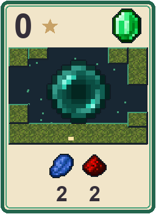 | 20 · 祖母绿 · 0分 | 1 | 购买费用：蓝宝石2＋红宝石2。购买后永久提供 1 祖母绿折扣；得 0 分。 |
| 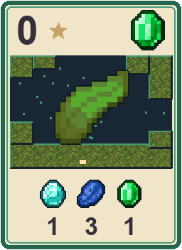 | 21 · 祖母绿 · 0分 | 1 | 购买费用：钻石1＋蓝宝石3＋祖母绿1。购买后永久提供 1 祖母绿折扣；得 0 分。 |
| 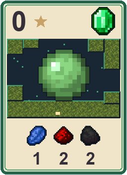 | 22 · 祖母绿 · 0分 | 1 | 购买费用：蓝宝石1＋红宝石2＋缟玛瑙2。购买后永久提供 1 祖母绿折扣；得 0 分。 |
| 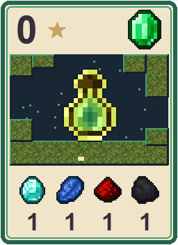 | 23 · 祖母绿 · 0分 | 1 | 购买费用：钻石1＋蓝宝石1＋红宝石1＋缟玛瑙1。购买后永久提供 1 祖母绿折扣；得 0 分。 |
| 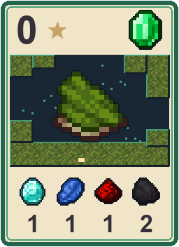 | 24 · 祖母绿 · 0分 | 1 | 购买费用：钻石1＋蓝宝石1＋红宝石1＋缟玛瑙2。购买后永久提供 1 祖母绿折扣；得 0 分。 |
| 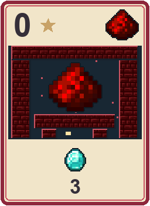 | 25 · 红宝石 · 0分 | 1 | 购买费用：钻石3。购买后永久提供 1 红宝石折扣；得 0 分。 |
| 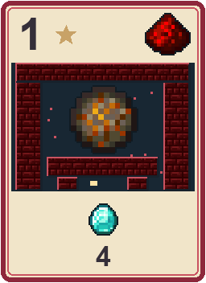 | 26 · 红宝石 · 1分 | 1 | 购买费用：钻石4。购买后永久提供 1 红宝石折扣；得 1 分。 |
| 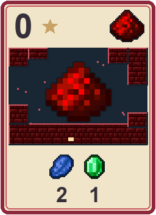 | 27 · 红宝石 · 0分 | 1 | 购买费用：蓝宝石2＋祖母绿1。购买后永久提供 1 红宝石折扣；得 0 分。 |
| 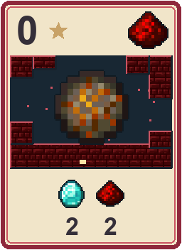 | 28 · 红宝石 · 0分 | 1 | 购买费用：钻石2＋红宝石2。购买后永久提供 1 红宝石折扣；得 0 分。 |
| 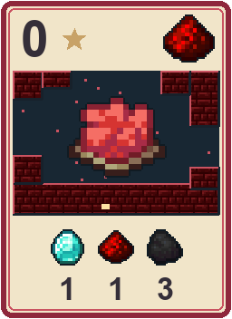 | 29 · 红宝石 · 0分 | 1 | 购买费用：钻石1＋红宝石1＋缟玛瑙3。购买后永久提供 1 红宝石折扣；得 0 分。 |
| 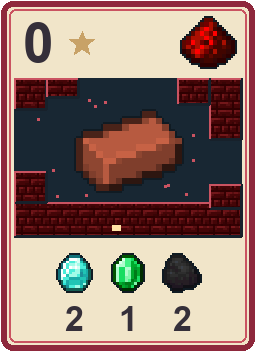 | 30 · 红宝石 · 0分 | 1 | 购买费用：钻石2＋祖母绿1＋缟玛瑙2。购买后永久提供 1 红宝石折扣；得 0 分。 |
| 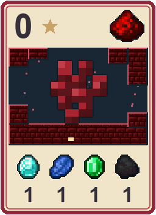 | 31 · 红宝石 · 0分 | 1 | 购买费用：钻石1＋蓝宝石1＋祖母绿1＋缟玛瑙1。购买后永久提供 1 红宝石折扣；得 0 分。 |
| 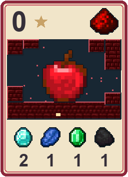 | 32 · 红宝石 · 0分 | 1 | 购买费用：钻石2＋蓝宝石1＋祖母绿1＋缟玛瑙1。购买后永久提供 1 红宝石折扣；得 0 分。 |
| 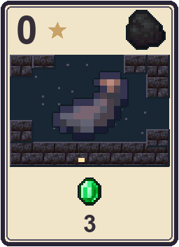 | 33 · 缟玛瑙 · 0分 | 1 | 购买费用：祖母绿3。购买后永久提供 1 缟玛瑙折扣；得 0 分。 |
| 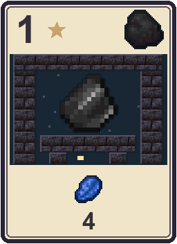 | 34 · 缟玛瑙 · 1分 | 1 | 购买费用：蓝宝石4。购买后永久提供 1 缟玛瑙折扣；得 1 分。 |
| 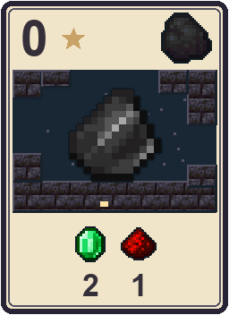 | 35 · 缟玛瑙 · 0分 | 1 | 购买费用：祖母绿2＋红宝石1。购买后永久提供 1 缟玛瑙折扣；得 0 分。 |
| 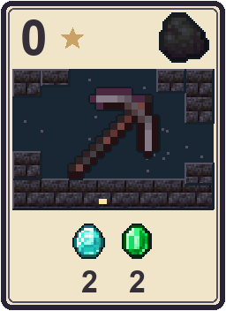 | 36 · 缟玛瑙 · 0分 | 1 | 购买费用：钻石2＋祖母绿2。购买后永久提供 1 缟玛瑙折扣；得 0 分。 |
| 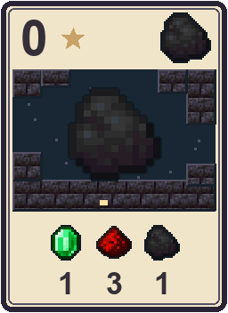 | 37 · 缟玛瑙 · 0分 | 1 | 购买费用：祖母绿1＋红宝石3＋缟玛瑙1。购买后永久提供 1 缟玛瑙折扣；得 0 分。 |
| 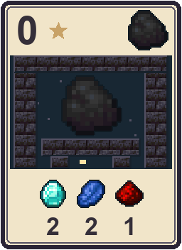 | 38 · 缟玛瑙 · 0分 | 1 | 购买费用：钻石2＋蓝宝石2＋红宝石1。购买后永久提供 1 缟玛瑙折扣；得 0 分。 |
|  | 39 · 缟玛瑙 · 0分 | 1 | 购买费用：钻石1＋蓝宝石1＋祖母绿1＋红宝石1。购买后永久提供 1 缟玛瑙折扣；得 0 分。 |
|  | 40 · 缟玛瑙 · 0分 | 1 | 购买费用：钻石1＋蓝宝石2＋祖母绿1＋红宝石1。购买后永久提供 1 缟玛瑙折扣；得 0 分。 |

### 2 级发展卡：30 张逐张图鉴

| 实图 | 名称 | 数量／所属 | 用途与区别 |
| --- | --- | --- | --- |
|  | 41 · 钻石 · 2分 | 1 | 购买费用：红宝石5。购买后永久提供 1 钻石折扣；得 2 分。 |
|  | 42 · 钻石 · 3分 | 1 | 购买费用：钻石6。购买后永久提供 1 钻石折扣；得 3 分。 |
|  | 43 · 钻石 · 2分 | 1 | 购买费用：红宝石5＋缟玛瑙3。购买后永久提供 1 钻石折扣；得 2 分。 |
|  | 44 · 钻石 · 2分 | 1 | 购买费用：祖母绿1＋红宝石4＋缟玛瑙2。购买后永久提供 1 钻石折扣；得 2 分。 |
|  | 45 · 钻石 · 1分 | 1 | 购买费用：祖母绿3＋红宝石2＋缟玛瑙2。购买后永久提供 1 钻石折扣；得 1 分。 |
|  | 46 · 钻石 · 1分 | 1 | 购买费用：钻石2＋蓝宝石3＋红宝石3。购买后永久提供 1 钻石折扣；得 1 分。 |
|  | 47 · 蓝宝石 · 2分 | 1 | 购买费用：蓝宝石5。购买后永久提供 1 蓝宝石折扣；得 2 分。 |
|  | 48 · 蓝宝石 · 3分 | 1 | 购买费用：蓝宝石6。购买后永久提供 1 蓝宝石折扣；得 3 分。 |
|  | 49 · 蓝宝石 · 2分 | 1 | 购买费用：钻石5＋蓝宝石3。购买后永久提供 1 蓝宝石折扣；得 2 分。 |
|  | 50 · 蓝宝石 · 2分 | 1 | 购买费用：钻石2＋红宝石1＋缟玛瑙4。购买后永久提供 1 蓝宝石折扣；得 2 分。 |
|  | 51 · 蓝宝石 · 1分 | 1 | 购买费用：蓝宝石2＋祖母绿2＋红宝石3。购买后永久提供 1 蓝宝石折扣；得 1 分。 |
|  | 52 · 蓝宝石 · 1分 | 1 | 购买费用：蓝宝石2＋祖母绿3＋缟玛瑙3。购买后永久提供 1 蓝宝石折扣；得 1 分。 |
|  | 53 · 祖母绿 · 2分 | 1 | 购买费用：祖母绿5。购买后永久提供 1 祖母绿折扣；得 2 分。 |
|  | 54 · 祖母绿 · 3分 | 1 | 购买费用：祖母绿6。购买后永久提供 1 祖母绿折扣；得 3 分。 |
|  | 55 · 祖母绿 · 2分 | 1 | 购买费用：蓝宝石5＋祖母绿3。购买后永久提供 1 祖母绿折扣；得 2 分。 |
|  | 56 · 祖母绿 · 2分 | 1 | 购买费用：钻石4＋蓝宝石2＋缟玛瑙1。购买后永久提供 1 祖母绿折扣；得 2 分。 |
|  | 57 · 祖母绿 · 1分 | 1 | 购买费用：钻石2＋蓝宝石3＋缟玛瑙2。购买后永久提供 1 祖母绿折扣；得 1 分。 |
|  | 58 · 祖母绿 · 1分 | 1 | 购买费用：钻石3＋祖母绿2＋红宝石3。购买后永久提供 1 祖母绿折扣；得 1 分。 |
|  | 59 · 红宝石 · 2分 | 1 | 购买费用：缟玛瑙5。购买后永久提供 1 红宝石折扣；得 2 分。 |
|  | 60 · 红宝石 · 3分 | 1 | 购买费用：红宝石6。购买后永久提供 1 红宝石折扣；得 3 分。 |
|  | 61 · 红宝石 · 2分 | 1 | 购买费用：钻石3＋缟玛瑙5。购买后永久提供 1 红宝石折扣；得 2 分。 |
|  | 62 · 红宝石 · 2分 | 1 | 购买费用：钻石1＋蓝宝石4＋祖母绿2。购买后永久提供 1 红宝石折扣；得 2 分。 |
|  | 63 · 红宝石 · 1分 | 1 | 购买费用：钻石2＋红宝石2＋缟玛瑙3。购买后永久提供 1 红宝石折扣；得 1 分。 |
|  | 64 · 红宝石 · 1分 | 1 | 购买费用：蓝宝石3＋红宝石2＋缟玛瑙3。购买后永久提供 1 红宝石折扣；得 1 分。 |
|  | 65 · 缟玛瑙 · 2分 | 1 | 购买费用：钻石5。购买后永久提供 1 缟玛瑙折扣；得 2 分。 |
|  | 66 · 缟玛瑙 · 3分 | 1 | 购买费用：缟玛瑙6。购买后永久提供 1 缟玛瑙折扣；得 3 分。 |
|  | 67 · 缟玛瑙 · 2分 | 1 | 购买费用：祖母绿5＋红宝石3。购买后永久提供 1 缟玛瑙折扣；得 2 分。 |
|  | 68 · 缟玛瑙 · 2分 | 1 | 购买费用：蓝宝石1＋祖母绿4＋红宝石2。购买后永久提供 1 缟玛瑙折扣；得 2 分。 |
|  | 69 · 缟玛瑙 · 1分 | 1 | 购买费用：钻石3＋蓝宝石2＋祖母绿2。购买后永久提供 1 缟玛瑙折扣；得 1 分。 |
|  | 70 · 缟玛瑙 · 1分 | 1 | 购买费用：钻石3＋祖母绿3＋缟玛瑙2。购买后永久提供 1 缟玛瑙折扣；得 1 分。 |

### 3 级发展卡：20 张逐张图鉴

| 实图 | 名称 | 数量／所属 | 用途与区别 |
| --- | --- | --- | --- |
|  | 71 · 钻石 · 4分 | 1 | 购买费用：缟玛瑙7。购买后永久提供 1 钻石折扣；得 4 分。 |
|  | 72 · 钻石 · 4分 | 1 | 购买费用：钻石3＋红宝石3＋缟玛瑙6。购买后永久提供 1 钻石折扣；得 4 分。 |
|  | 73 · 钻石 · 3分 | 1 | 购买费用：蓝宝石3＋祖母绿3＋红宝石5＋缟玛瑙3。购买后永久提供 1 钻石折扣；得 3 分。 |
|  | 74 · 钻石 · 5分 | 1 | 购买费用：钻石3＋缟玛瑙7。购买后永久提供 1 钻石折扣；得 5 分。 |
|  | 75 · 蓝宝石 · 4分 | 1 | 购买费用：钻石7。购买后永久提供 1 蓝宝石折扣；得 4 分。 |
|  | 76 · 蓝宝石 · 4分 | 1 | 购买费用：钻石6＋蓝宝石3＋缟玛瑙3。购买后永久提供 1 蓝宝石折扣；得 4 分。 |
|  | 77 · 蓝宝石 · 3分 | 1 | 购买费用：钻石3＋祖母绿3＋红宝石3＋缟玛瑙5。购买后永久提供 1 蓝宝石折扣；得 3 分。 |
|  | 78 · 蓝宝石 · 5分 | 1 | 购买费用：钻石7＋蓝宝石3。购买后永久提供 1 蓝宝石折扣；得 5 分。 |
|  | 79 · 祖母绿 · 4分 | 1 | 购买费用：蓝宝石7。购买后永久提供 1 祖母绿折扣；得 4 分。 |
|  | 80 · 祖母绿 · 4分 | 1 | 购买费用：钻石3＋蓝宝石6＋祖母绿3。购买后永久提供 1 祖母绿折扣；得 4 分。 |
|  | 81 · 祖母绿 · 3分 | 1 | 购买费用：钻石5＋蓝宝石3＋红宝石3＋缟玛瑙3。购买后永久提供 1 祖母绿折扣；得 3 分。 |
|  | 82 · 祖母绿 · 5分 | 1 | 购买费用：蓝宝石7＋祖母绿3。购买后永久提供 1 祖母绿折扣；得 5 分。 |
|  | 83 · 红宝石 · 4分 | 1 | 购买费用：祖母绿7。购买后永久提供 1 红宝石折扣；得 4 分。 |
|  | 84 · 红宝石 · 4分 | 1 | 购买费用：蓝宝石3＋祖母绿6＋红宝石3。购买后永久提供 1 红宝石折扣；得 4 分。 |
|  | 85 · 红宝石 · 3分 | 1 | 购买费用：钻石3＋蓝宝石5＋祖母绿3＋缟玛瑙3。购买后永久提供 1 红宝石折扣；得 3 分。 |
|  | 86 · 红宝石 · 5分 | 1 | 购买费用：祖母绿7＋红宝石3。购买后永久提供 1 红宝石折扣；得 5 分。 |
|  | 87 · 缟玛瑙 · 4分 | 1 | 购买费用：红宝石7。购买后永久提供 1 缟玛瑙折扣；得 4 分。 |
|  | 88 · 缟玛瑙 · 4分 | 1 | 购买费用：祖母绿3＋红宝石6＋缟玛瑙3。购买后永久提供 1 缟玛瑙折扣；得 4 分。 |
|  | 89 · 缟玛瑙 · 3分 | 1 | 购买费用：钻石3＋蓝宝石3＋祖母绿5＋红宝石3。购买后永久提供 1 缟玛瑙折扣；得 3 分。 |
|  | 90 · 缟玛瑙 · 5分 | 1 | 购买费用：红宝石7＋缟玛瑙3。购买后永久提供 1 缟玛瑙折扣；得 5 分。 |

### 10 位贵族逐张需求

| 实图 | 名称 | 数量／所属 | 用途与区别 |
| --- | --- | --- | --- |
|  | 贵族 1 | 1 | 需要永久折扣：钻石4＋蓝宝石4；来访 +3 分。 |
|  | 贵族 2 | 1 | 需要永久折扣：蓝宝石4＋祖母绿4；来访 +3 分。 |
|  | 贵族 3 | 1 | 需要永久折扣：祖母绿4＋红宝石4；来访 +3 分。 |
|  | 贵族 4 | 1 | 需要永久折扣：红宝石4＋缟玛瑙4；来访 +3 分。 |
|  | 贵族 5 | 1 | 需要永久折扣：钻石4＋缟玛瑙4；来访 +3 分。 |
|  | 贵族 6 | 1 | 需要永久折扣：钻石3＋蓝宝石3＋祖母绿3；来访 +3 分。 |
|  | 贵族 7 | 1 | 需要永久折扣：蓝宝石3＋祖母绿3＋红宝石3；来访 +3 分。 |
|  | 贵族 8 | 1 | 需要永久折扣：祖母绿3＋红宝石3＋缟玛瑙3；来访 +3 分。 |
|  | 贵族 9 | 1 | 需要永久折扣：钻石3＋红宝石3＋缟玛瑙3；来访 +3 分。 |
|  | 贵族 10 | 1 | 需要永久折扣：钻石3＋蓝宝石3＋缟玛瑙3；来访 +3 分。 |

<!-- END COMPONENTS -->

[返回说明书目录](README.md)
