# 胡闹运动会：36 位选手，四场比赛

2～6 人。先招募一支队伍，四场分别派未用选手竞速。每位角色有不同能力，跑得最快未必总分最高；四场加上能力、赛道获得的全部分数后，总分最高者赢，平分共同胜。

采用 36 角色现代版玩法；两人规则、共同到达和多角色顺序按本包当前实现。没有旧版拍卖选角。

## 准备和组件

清空九格快捷栏，背包留四格保存队伍棋子，两人局留八格。桌面招募、背包队伍、秘密出场和技能目标统一使用对应的立体棋子，棋子名字后可读能力概括。赛道起点 0、终点 30，可多人同格，系统错开模型；玩家头像用于标明棋子归属。

普通赛道是暖色昼间体育场，狂野赛道是紫色夜场。外围有阶梯看台、护栏和灯架；路线箭头沿 0→30 指向前进方向。狂野格用金色星星、摔倒图案、带正负数的箭头区分效果，数字与棋子仍位于同一组格心。

棋盘上方显示玩家名、角色名、累计分，姓名右侧箭头为当前行动者；聊天记录投骰、前进或后退、谁的哪个选手对谁发动能力。只有当前可投骰玩家拿到第 8 格骰子。不是自己掷骰，也可能要为被动技能作选择，请看 actionbar 和字幕。

## 第一阶段：招募队伍

默认蛇形招募，先投骰确定起选者。亮出人数两倍角色，顺序各选一次，再逆序各选一次；换从原起选左邻开始，亮出新组再来一轮，每人最终四名。骰子争先并列时按规则寻找下一位单独最高者，全部并列重投。

右键候选棋子先选中、再右键招募，左键取消；持棋子 Q 两次也能确认。看棋子名字后的能力概括，不需要先背 36 技能。大厅也可选随机发队，第一次玩想快开可用。

## 四场赛程与上场

默认普通→狂野→普通→狂野，每场秘密选一名尚未用角色，持角色 Q 两次提交，全员选完才公开，已用角色不再上场。第一场投骰决定先行动者，以后通常由上一场最落后／最早淘汰者的玩家开始。

| 第几场 | 冠军 | 亚军 |
| --- | --- | --- |
| 1 | 3 分 | 1 分 |
| 2 | 4 分 | 2 分 |
| 3 | 5 分 | 3 分 |
| 4 | 6 分 | 4 分 |

到达／越过第 30 格冲线，若有较真怪在场，对其他选手的超终点移动整次取消。第二名产生就立即结束该场，不继续处理别人的剩余行动。已冲线／淘汰者通常不再触发被动，角色明确例外时按规则执行。

## 两人局怎样不同

每人八名，每场各派两名，共四选手在场。两次各亮八张，招募顺序分别 ABBAABBA、BAABBAAB。随机发队也每人八名。

每场选出两名的 **提交先后决定固定选手行动顺序**，不是每轮临时挑先动哪位。按提示明确当前轮到自己哪名。技能“其他选手”也包括自己的另一名。第二场起上场得分少的玩家先，平分投骰。

## 比赛中一个回合

1. 先解决回合开始和主移动前能力：预测、传送、固定步数等。要求你选时才选；可跳过的能力用“跳过”物。
2. 轮到普通投骰，第 8 格骰 Q 一次。结果锁定后播放翻滚；重掷角色按提示决定是否重掷，最终采用骰值才触发掷 1／6 等能力。
3. 确定主移动距离，处理相关加减，棋子逐格移动；等动画和连锁完成，不连续乱按。
4. 移动后依次处理赛道、行动者能力、其他选手能力。新产生的移动又可触发后续效果。
5. 回合结束，下一名开始。被绊倒者跳过其下一次主移动，但被动技能和别人造成的移动仍可能生效。

技能二选一、猜点、合法目标、跳过通常临时物 Q 一次即执行。需要选其他选手时，快捷栏直接显示目标的立体棋子，选中想要的棋子 Q 一次；蛋蛋、双胞胎的候选能力也用相应棋子表示。需要桌面确认的目标或落点右键两次；第 9 格取消。

天才预测骰值时，快捷栏第 1～6 格依次显示 1～6 点的独立骰面，选一格 Q 一次确认，不用翻页；第 7 格是“不预测”。其他大量候选才使用第 7 格翻页，双胞胎还可主动打开全部候选窗口。

## 六个词必须分清

| 词 | 含义 | 例子 |
| --- | --- | --- |
| 主移动 | 自己回合投骰后那次移动 | 魔术师重掷后走最终骰数 |
| 额外移动 | 能力／赛道推动产生，单独结算 | 跟班因别人掷 6 先走二 |
| 经过／超越 | 开始在别人后，结束到了其前 | 半人马才可能推退被超过者 |
| 停在同格 | 完成一次移动／传送后同格 | 芭芭雅嘎可绊倒后来或先在者 |
| 传送／放置 | 直接改位置，不是移动或经过 | 催眠师拉人、巨婴挤人 |
| 绊倒 | 本次继续完成，跳过下一次主移动 | 火箭翻倍走完才绊倒 |

同时到达的选手之间不互相触发“先后停在一起”，但其他适用效果仍检查。0 格不算移动，起点算位置且不能后退越过起点。系统遇同一能力闭环会限制循环，避免无限移动。

## 狂野赛道的全部特殊格

| 格号 | 效果 |
| --- | --- |
| 1、13 | 得 1 分 |
| 5、17、26 | 绊倒，跳过下一次主移动 |
| 7 | 再前进 3 |
| 11 | 再前进 1 |
| 16 | 后退 4 |
| 23 | 再前进 2 |
| 24 | 后退 2 |

其余普通格无独立效果。箭头移动作为新一次移动结算，可能触发技能或再落特殊格；不把后退写成模糊的“前进／后退”，看聊天中的实际方向与格数。

## 角色图鉴怎么查

下方列出 36 名选手的立体模型和完整能力，直接对照游戏中的棋子查阅。先确认触发时机：赛前、回合开始、主移动前、骰值后、移动后或别人能力实际生效。复制并非拿走别人的角色；模仿猫不执行被复制者赛前能力，蛋蛋／双胞胎则按自身说明可执行。

新手可先选大长腿、炼金术士、魔术师等直接影响移动的角色，再尝试同格、传送、复制的组合。幕后军师预测和西西弗斯赛前积分可能直接改变争分策略，不要只比较每回合跑几格。

## 设置与结束

大厅可选蛇形／随机队、赛道安排、方向、动画速度与音乐。四场用完队伍，累计角色／狂野得分和名次分，最高者胜。能力导致没人能完赛时按当前规则结束，不凭空补剩余名次分。

普通赛道使用原创运动主题，狂野赛道使用《wake up》，更换赛道时自动切换。两首响度相近，可在“唱片机／音符盒”分类调音量，也可在本桌设置关闭音乐。

离线整桌暂停，等待原参与者全部回来；下马不退赛。管理员中止：`/function magical_athlete:admin/abort`。操作键和提示区见[共同说明](00-新手入门与界面图例.md)。

<!-- BEGIN COMPONENTS -->

## 组件实图与逐件图鉴

这些图片直接取自配套资源包，立体物件按实际 Java 模型渲染。卡牌展示真实正面，动画纹理取第一帧；皮肤头像、发光和粒子属于游戏内动态效果。

### 普通赛道 · 昼间体育场

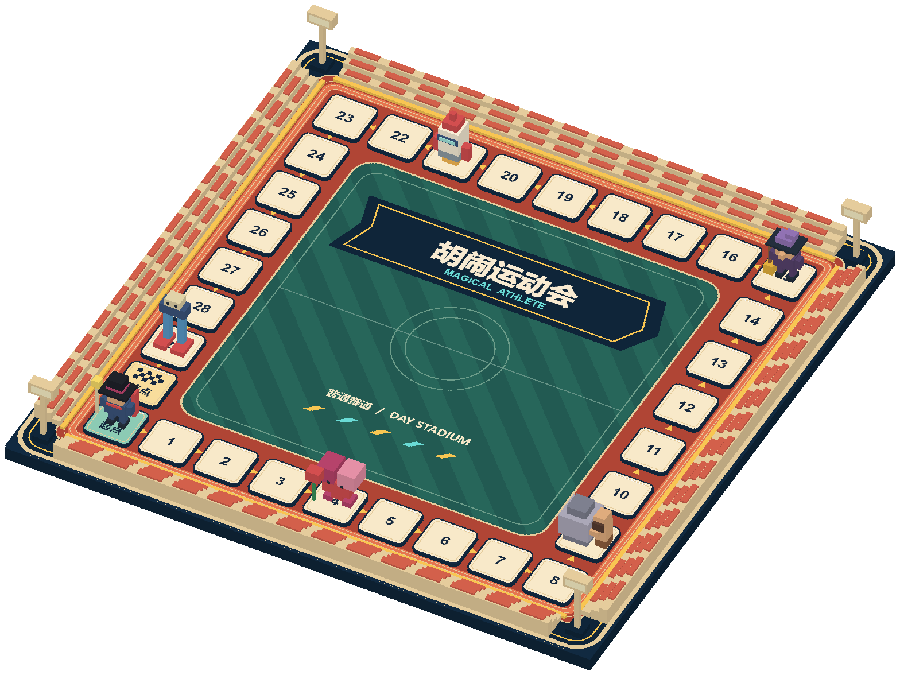

展示用选手仅用于辨认模型，比赛阵容与位置由实际对局决定。

### 狂野赛道 · 夜间体育场

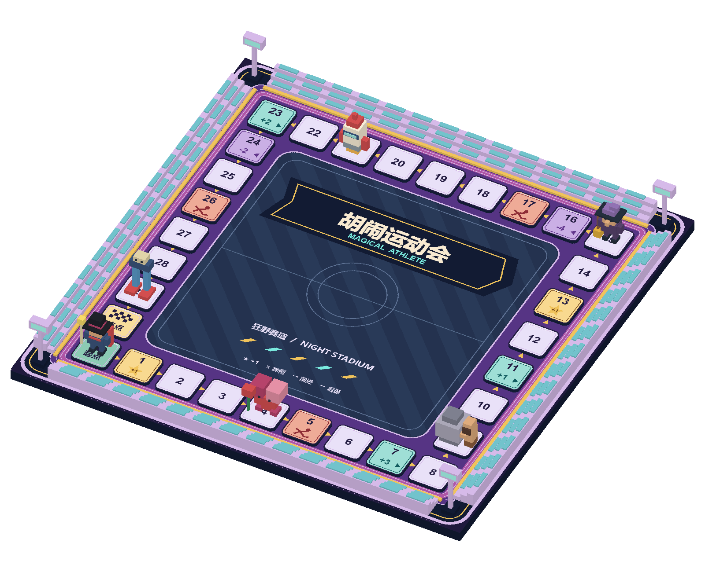

展示用选手仅用于辨认模型，比赛阵容与位置由实际对局决定。

### 36 位选手：立体棋子与完整能力

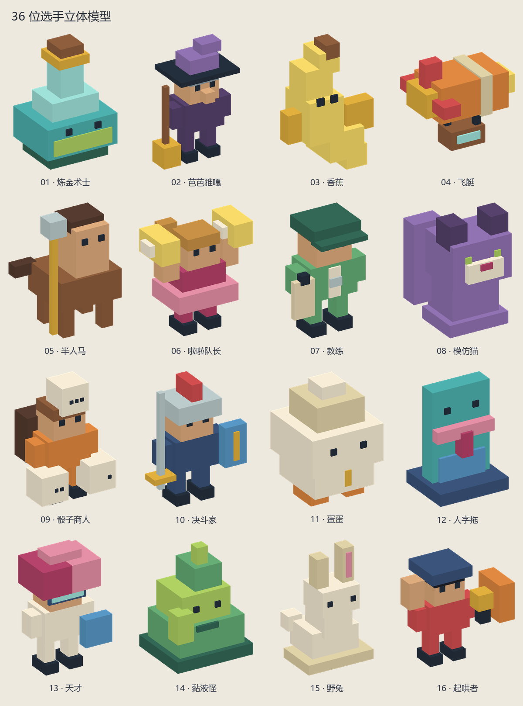

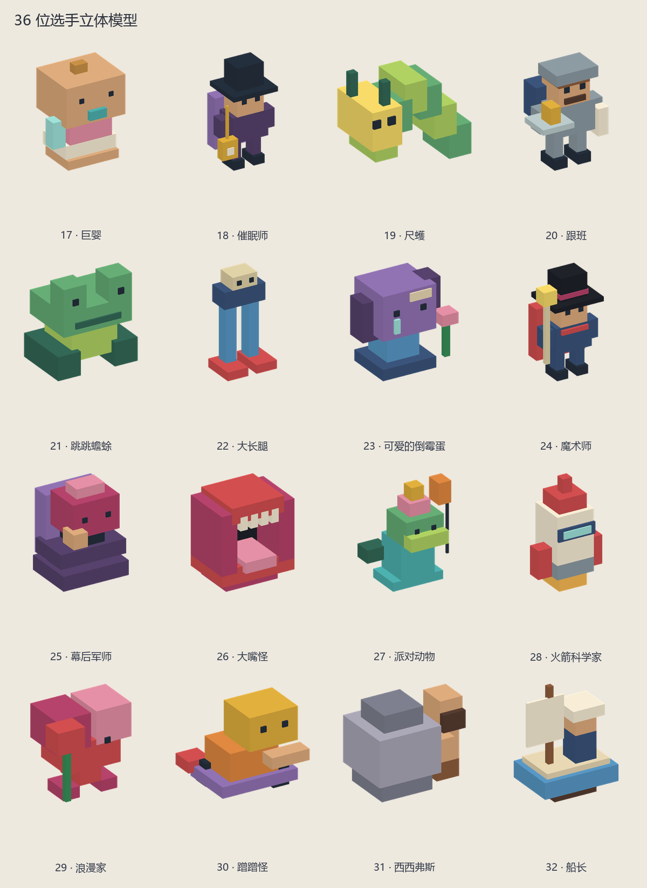

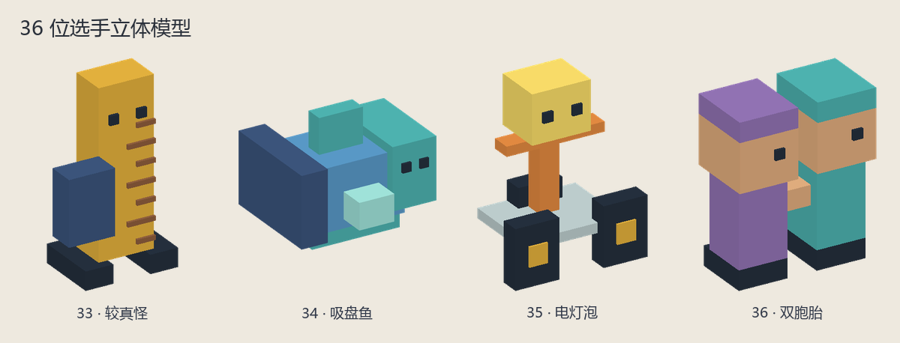

| 棋子模型 | 选手 | 完整能力 |
| --- | --- | --- |
| 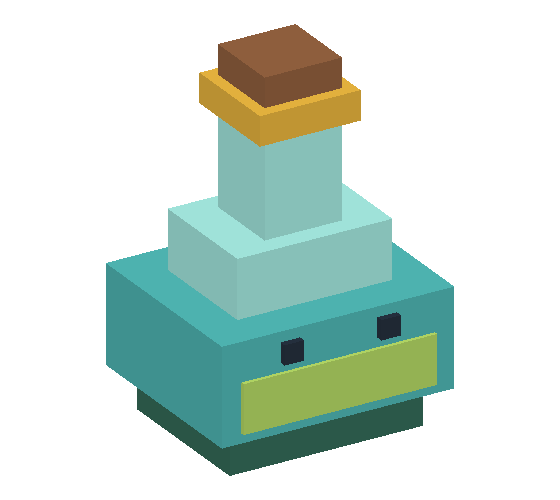 | 01 · 炼金术士 | 主要移动掷出1或2，可改走4格。 |
| 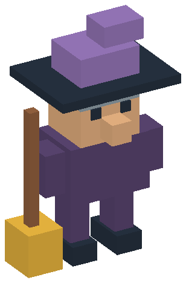 | 02 · 芭芭雅嘎 | 与别的运动员先后停在同一格时，绊倒对方。 |
| 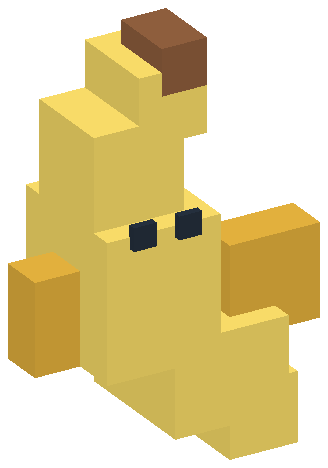 | 03 · 香蕉 | 超越你的运动员完成移动后绊倒。 |
| 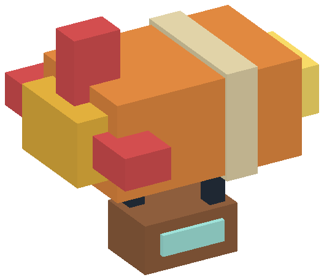 | 04 · 飞艇 | 回合开始在第15格前，主要移动加3；否则减1。 |
| 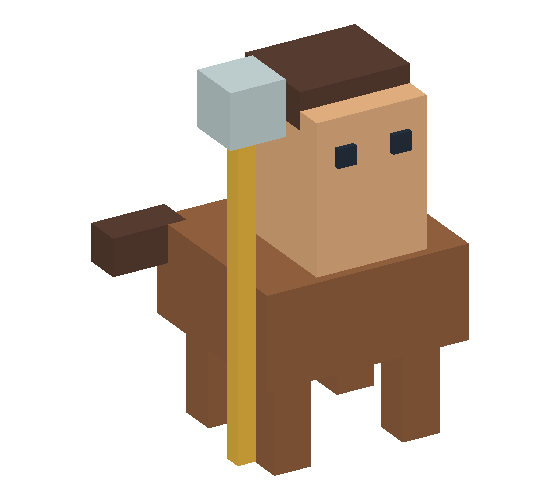 | 05 · 半人马 | 每超越一位运动员，让其后退2格，不退过起点。 |
| 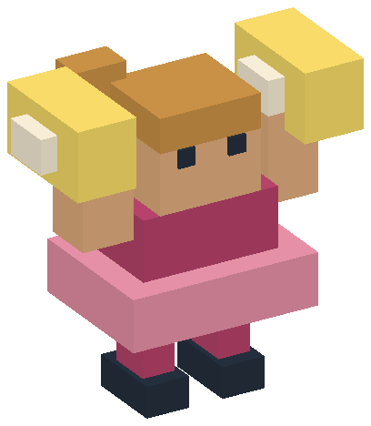 | 06 · 啦啦队长 | 主要移动前，可让所有末位前进2格，再自己前进1格。 |
| 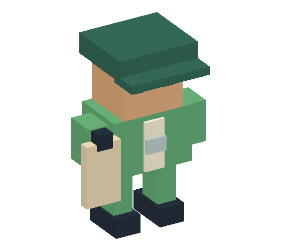 | 07 · 教练 | 与你同格的运动员主要移动加1，也包括你。 |
| 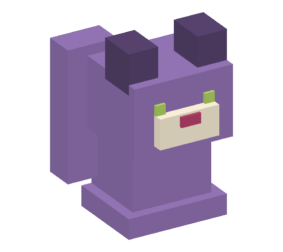 | 08 · 模仿猫 | 持续复制在场领先者的技能；并列时选一位，不复制赛前技能。 |
| 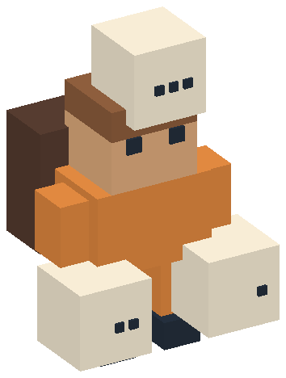 | 09 · 骰子商人 | 所有运动员每回合可额外重掷一次主要移动骰；别人使用时你先走1格。 |
| 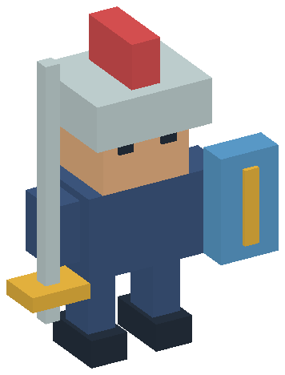 | 10 · 决斗家 | 与其他运动员同格时可决斗，掷骰较高者前进2格，平局你赢。 |
| 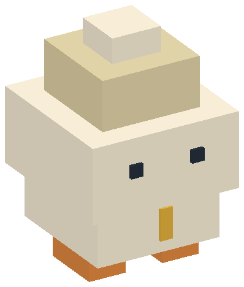 | 11 · 蛋蛋 | 赛前抽取3位未使用的角色，从中选一位获得技能，包含赛前技能。 |
| 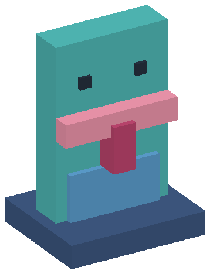 | 12 · 人字拖 | 可用与一位运动员同时交换位置，代替掷骰与主要移动。 |
| 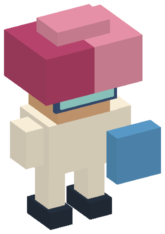 | 13 · 天才 | 主要移动掷骰前可猜点数，猜中则完整结算后再行动一次。 |
| 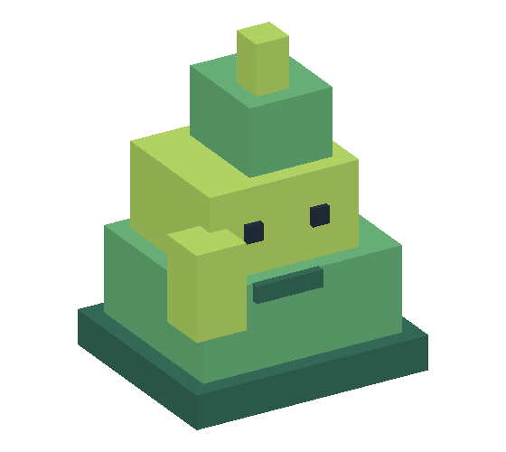 | 14 · 黏液怪 | 其他运动员的主要移动减1格，骰子点数不变。 |
| 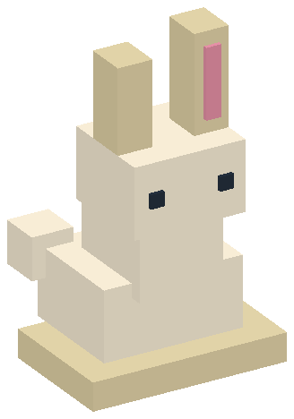 | 15 · 野兔 | 主要移动加2；回合开始若独自领先，跳过主要移动。 |
| 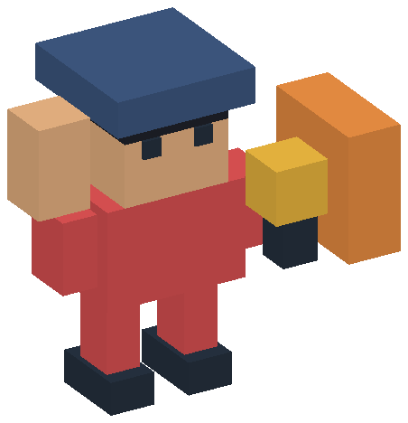 | 16 · 起哄者 | 一位运动员结束回合时，若位置比回合起点变化不超过1格，你前进2格。 |
| 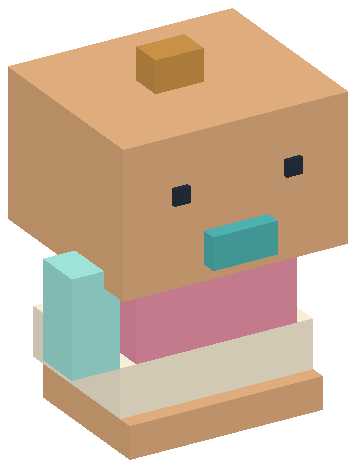 | 17 · 巨婴 | 起点以外不能与别人同格，其他运动员会被放到你后面一格，此放置不是移动。 |
| 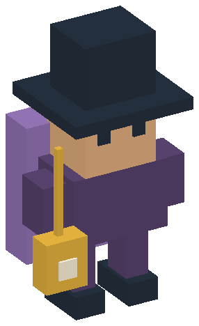 | 18 · 催眠师 | 主要移动前，可把另一位运动员传送到你所在格。 |
| 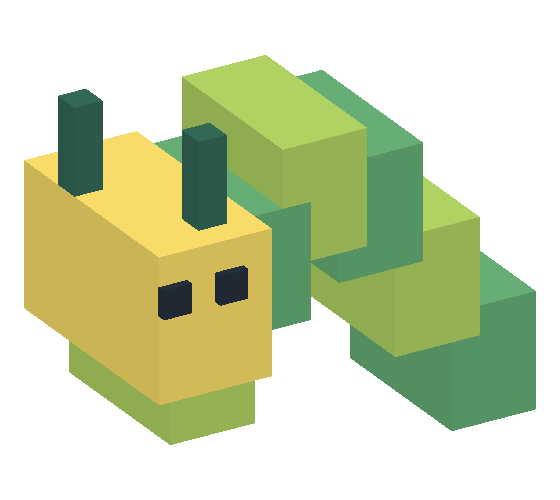 | 19 · 尺蠖 | 别人主要移动掷出1时，取消他的主要移动，你前进1格。 |
| 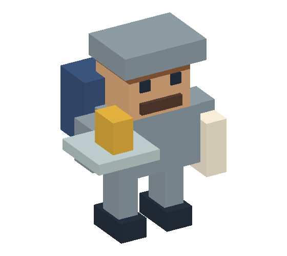 | 20 · 跟班 | 别人主要移动掷出6时，在他移动前，你前进2格。 |
| 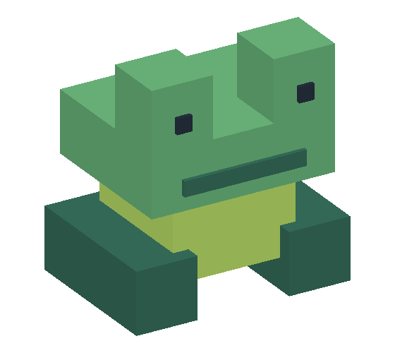 | 21 · 跳跳蟾蜍 | 移动经过有别的运动员的格子时跳过这些格子，不消耗步数；后退也适用。 |
| 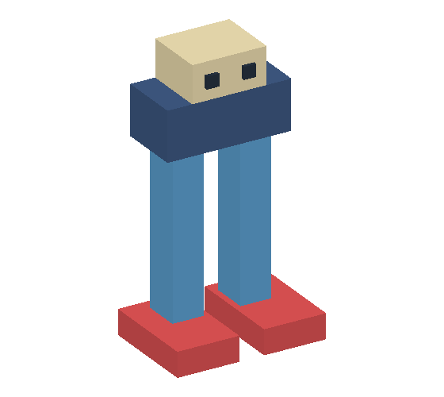 | 22 · 大长腿 | 可不掷骰，直接以5格作为主要移动的基础距离。 |
| 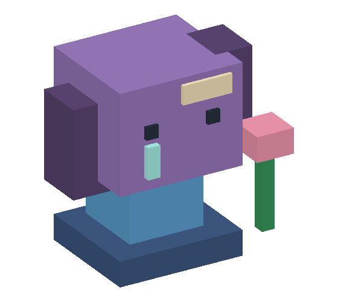 | 23 · 可爱的倒霉蛋 | 主要移动前，若独自在最后一名，获得1分。 |
| 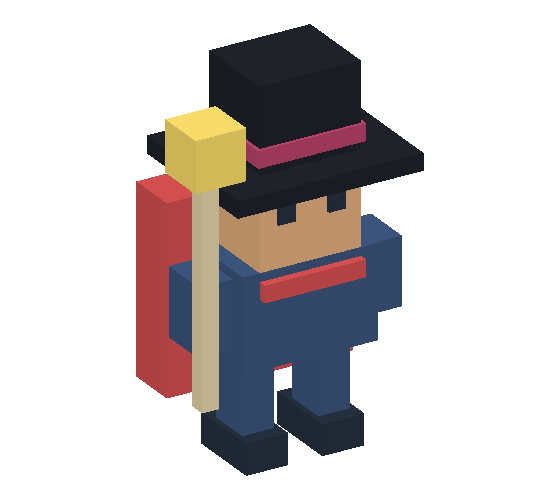 | 24 · 魔术师 | 每次主要移动，最多重掷两次，最后一次骰子结果必须使用。 |
| 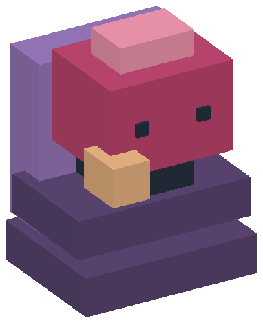 | 25 · 幕后军师 | 首个回合开始时预测本场冠军；猜中则立即结束比赛，你取得亚军，可预测自己。 |
| 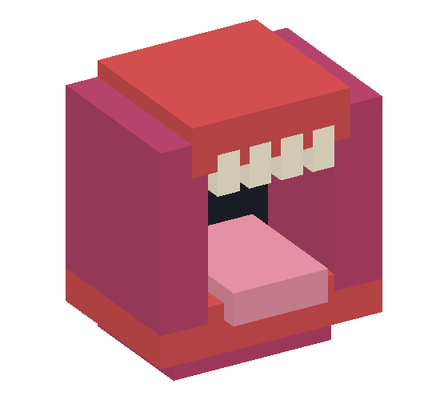 | 26 · 大嘴怪 | 你停到恰有一位其他运动员的格子时，淘汰对方；只剩一位时直接分配剩余名次。 |
| 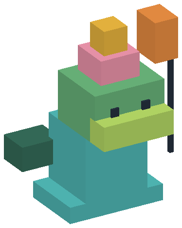 | 27 · 派对动物 | 主要移动前，其他运动员同时向你移动1格；每位同格者使你主要移动加1。 |
| 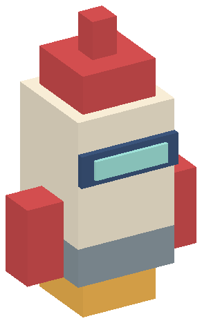 | 28 · 火箭科学家 | 掷出主要移动骰后，可把基础距离翻倍，但完成移动后绊倒。 |
| 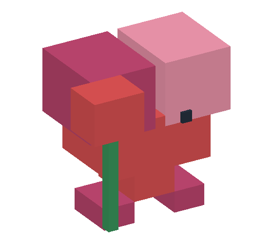 | 29 · 浪漫家 | 一位运动员停到恰有另一位的格子时，你前进2格；两位同时到达不触发。 |
| 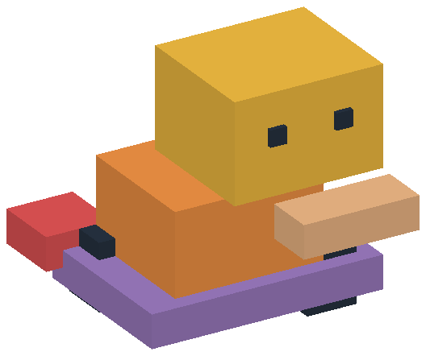 | 30 · 蹭蹭怪 | 其他运动员的一次技能实际生效时，你前进1格。 |
| 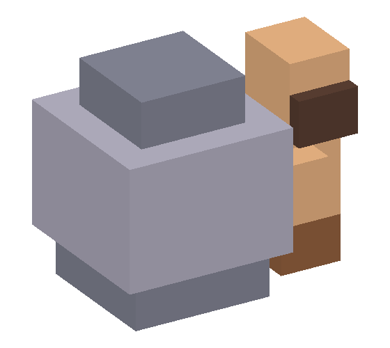 | 31 · 西西弗斯 | 赛前得4分；主要移动掷出6时，改为传送回起点并失去1分，分数不低于0。 |
| 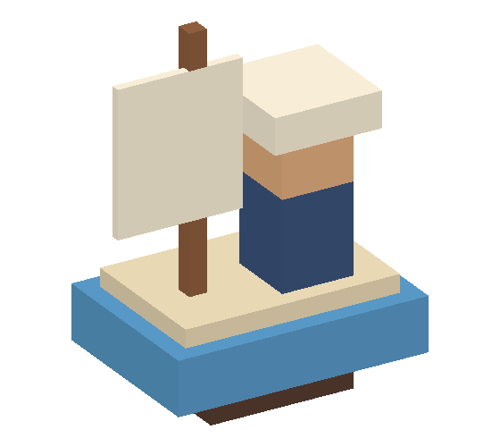 | 32 · 船长 | 任何运动员主要移动掷出1时，下一个回合由你开始，之后从你左邻继续。 |
| 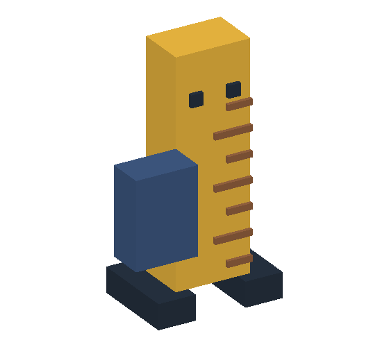 | 33 · 较真怪 | 其他运动员必须恰好到达第30格；任何一次移动若会超过终点，该次移动不执行。 |
| 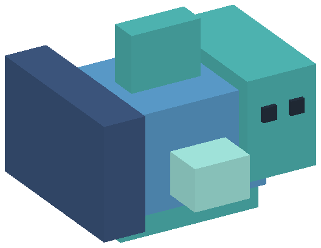 | 34 · 吸盘鱼 | 与你同格的一位运动员移动时，可与其一起到达目的地；不是传送，也能一起冲线。 |
| 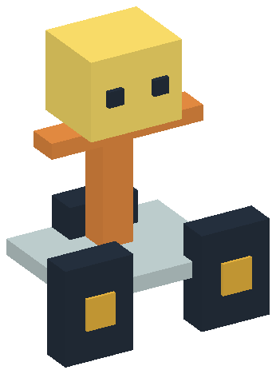 | 35 · 电灯泡 | 主要移动前，可传送到恰好站着两位运动员的格子，然后照常主要移动。 |
| 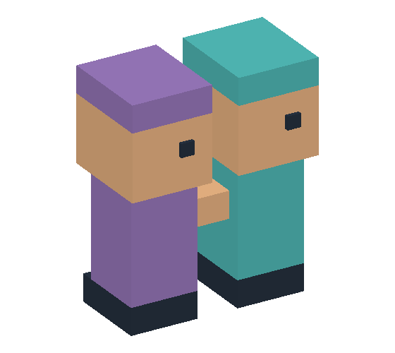 | 36 · 双胞胎 | 赛前可复制一位此前拿到冠军的运动员的技能，也执行其赛前技能。 |

### 天才的六种独立骰面选项

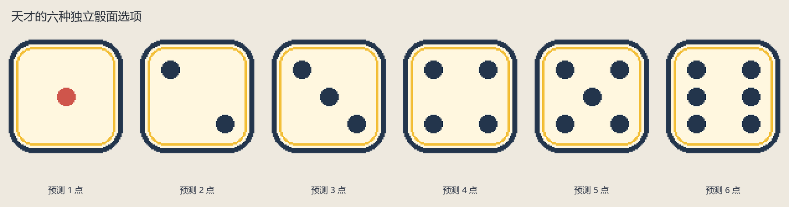

| 实图 | 名称 | 数量／所属 | 用途与区别 |
| --- | --- | --- | --- |
| 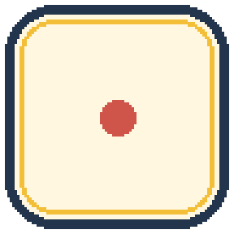 | 预测 1 点 | 1 | 天才技能：前六格依次放 1～6，Q 一次预测；第七格可不预测。 |
|  | 预测 2 点 | 1 | 天才技能：前六格依次放 1～6，Q 一次预测；第七格可不预测。 |
| 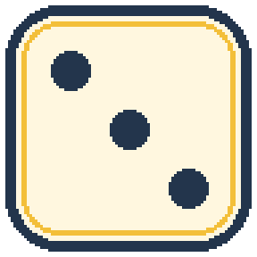 | 预测 3 点 | 1 | 天才技能：前六格依次放 1～6，Q 一次预测；第七格可不预测。 |
|  | 预测 4 点 | 1 | 天才技能：前六格依次放 1～6，Q 一次预测；第七格可不预测。 |
|  | 预测 5 点 | 1 | 天才技能：前六格依次放 1～6，Q 一次预测；第七格可不预测。 |
|  | 预测 6 点 | 1 | 天才技能：前六格依次放 1～6，Q 一次预测；第七格可不预测。 |

<!-- END COMPONENTS -->

[返回说明书目录](README.md)
