# Fimel Card v1.1：在 Minecraft 里，和朋友来一场桌游聚会

传一张牌，抢下桌心的按钮；用一句线索让队友猜到密码；或在岛上交换资源，把村庄一步步建成城市——**Fimel Card** 把 **23 款桌游**带进 Minecraft，让同一张牌桌可以陪你们玩上一个下午。

这是由 **Fimel Studio** 制作的 Minecraft Java 版数据包。加入已有存档、启用配套资源包，就能在自己的家、朋友的基地或服务器大厅创建牌桌，无需更换专用地图。

## 支持版本与安装

**数据包和资源包必须配套，并与 Minecraft 版本对应。**

| Minecraft Java 版本  | 选择的版本包           |
| -------------------- | ---------------------- |
| 1.21.11              | `1.21.11`            |
| 26.1、26.1.1、26.1.2 | `26.1-26.1.1-26.1.2` |
| 26.2                 | `26.2`               |
| 26.3                 | `26.3`               |

26.2 的 Fabric、钠（Sodium）环境已有作者实测记录；其他版本的模组、光影和字体资源包组合请按实际环境确认。

1. 将数据包(datapack) ZIP 放入存档的 `datapacks` 文件夹，无需解压。
2. **每位玩家**将对应资源包(resourcepack)放入客户端 `resourcepacks` 文件夹并启用。
3. 管理员进入世界执行 `/reload`；更新资源包后按 `F3+T`。
4. 开局前腾空需要使用的快捷栏，不确定时可清空九格；花火还需腾空副手。

前置功能已内置。建桌和管理命令需要 OP，默认设置下的正常游玩不要求全员 OP。

## 放下一张桌子，开始第一局

在空地执行，执行位置的高度对应桌面方块层：

```mcfunction
# 四座桌
/function cardtable:admin/create

# 八座桌
/function cardtable:admin/create8
```

四座桌连座椅占地 **5×5**，八座桌占地 **6×6**。建桌位置与已有桌心至少相距 **6 格**；两张八座桌并排、希望留一格通道时，桌心间距至少取 **7 格**。

**右键空座入座 → 点击“切换游戏” → 在“游戏设置”中调整参数 → 点击“开始游戏”。** 桌边的“规则介绍”随时可看。超过四人请使用八座桌，实际开局人数以各游戏为准。

## 一张牌桌，23 种玩法

下面按主要游玩方式分为牌类、棋类和语言类。点击游戏名称可查看完整的新手说明书、操作方法和组件图鉴；具体玩法以本数据包的规则为准。

### 牌类

| 图标 | 游戏 | 真人数量 | 怎么玩 |
| :---: | --- | :---: | --- |
| 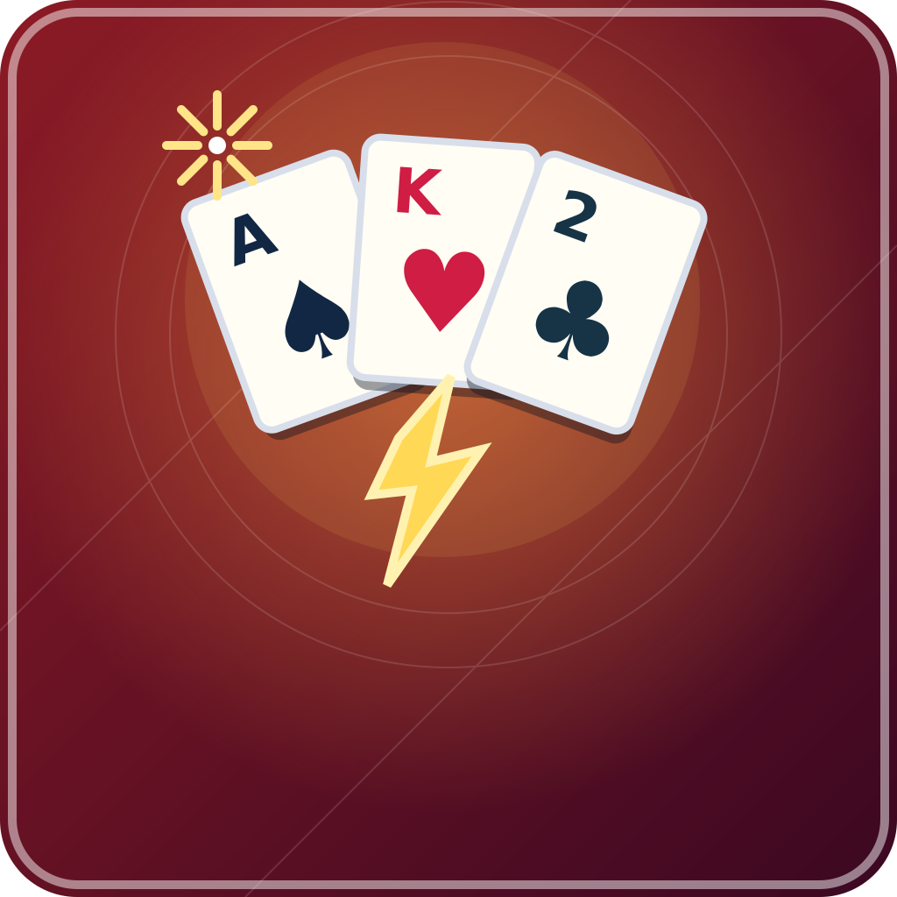 | [斗地主](https://studiofimel.com/#/docs/fimel-card-classic-dou-dizhu) | 1～8 | 叫地主、拿底牌，用顺子、飞机和炸弹争取先出完手牌；地主独自对抗两名农民。也可选固定队伍的 2v2，或八人双桌 4v4 比赛，按队伍累计成绩决胜。 |
| 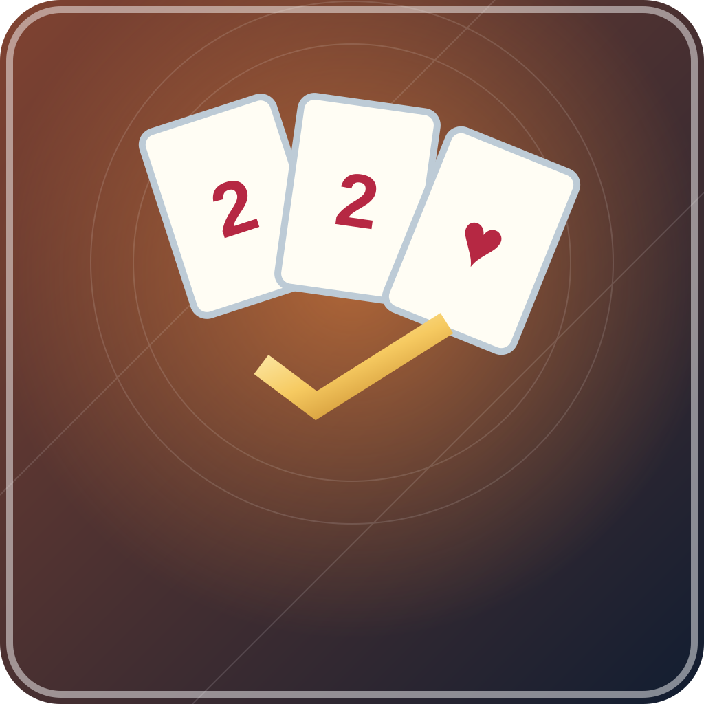 | [掼蛋](https://studiofimel.com/#/docs/fimel-card-guandan) | 1～4 | 两副牌、对座搭档，利用级牌和“逢人配”组织牌型，既要自己争先，也要帮队友出完。根据名次升级、进贡与还牌，一路争取过 A。 |
| 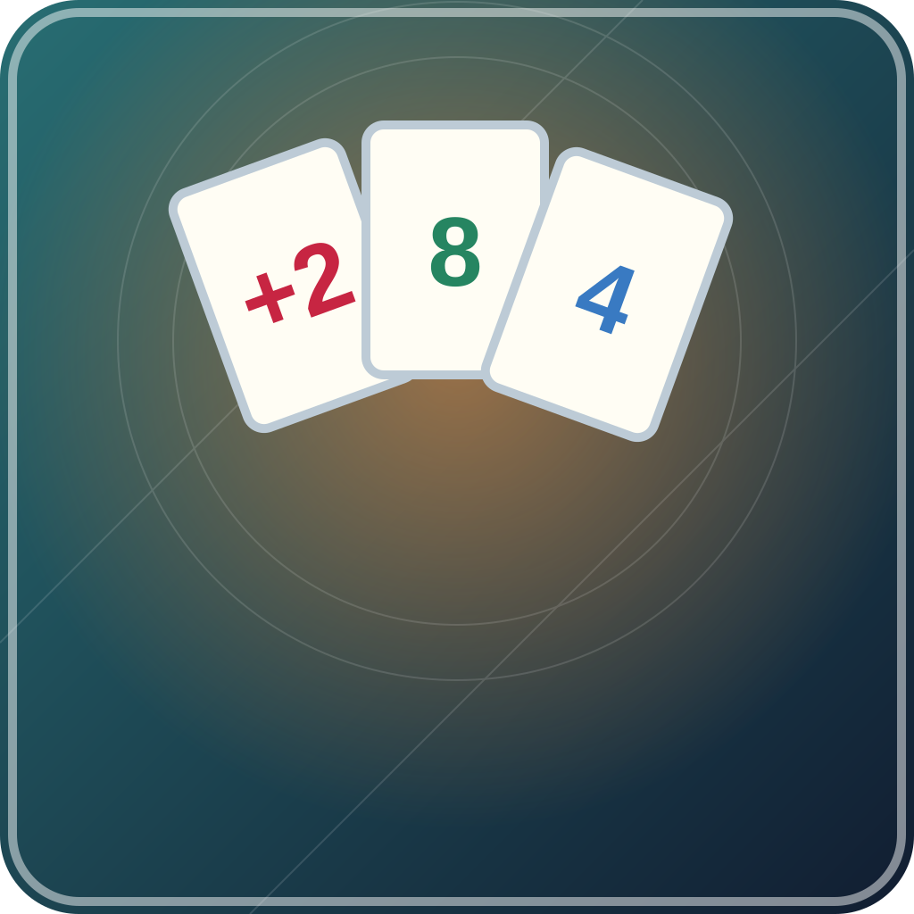 | [UNO](https://studiofimel.com/#/docs/fimel-card-uno) | 2～8 | 轮流打出同色、同数字或同符号的牌，利用反转、跳过和罚摸打乱对手节奏。剩一张时记得喊 UNO，先出完手牌赢下小局。 |
| 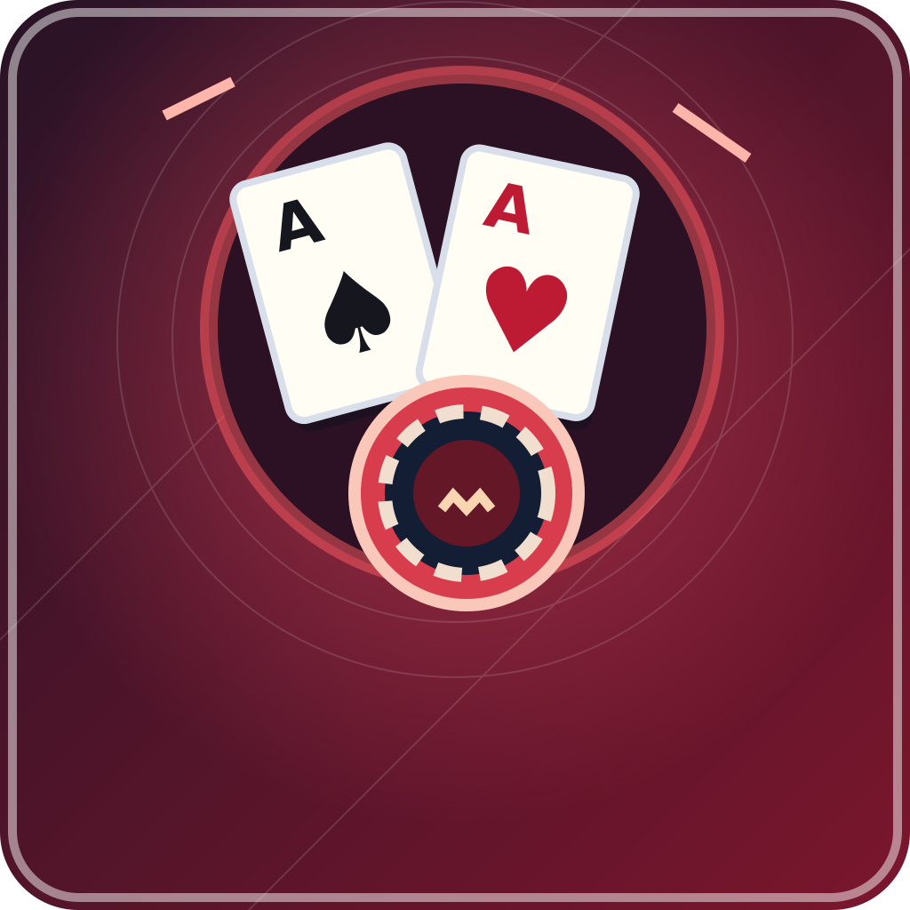 | [赌命德州扑克](https://studiofimel.com/#/docs/fimel-card-death-poker) | 2～8 | 用两张底牌和五张公共牌拼出最佳牌型，选择换牌、跟注、弃牌或全押。这里没有筹码奖池，弃牌或摊牌失利要接受左轮判定，最后存活者获胜。 |
|  | [情书](https://studiofimel.com/#/docs/fimel-card-love-letter) | 2～6 | 每回合摸一张、打出一张，借角色能力猜牌、窥视、保护或交换手牌。成为唯一存活者，或在牌库耗尽时留下最高牌，赚取好感争夺整场胜利。 |
| 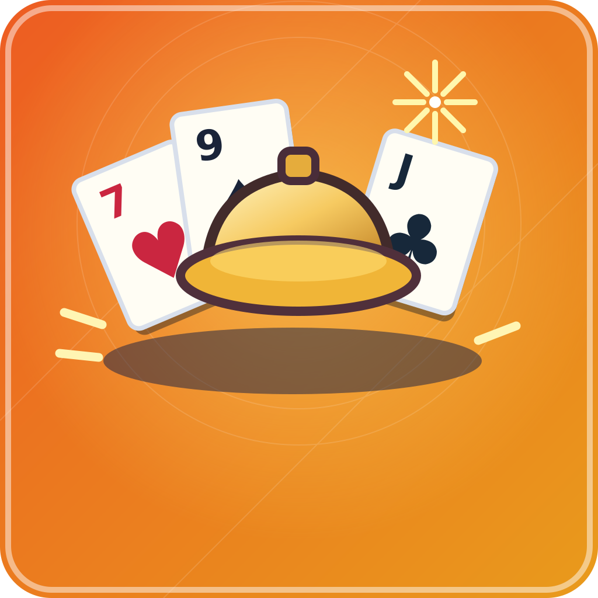 | [Fast Card](https://studiofimel.com/#/docs/fimel-card-fast-card) | 固定 4 人 | 不断把不需要的牌传给下家，凑好组合就抢按桌心按钮。别人先按了也要立刻跟上，迟疑可能扣分；打完约定局数比较累计分。 |
|  | [花火](https://studiofimel.com/#/docs/fimel-card-hanabi) | 2～5 | 看得见队友的牌，却看不见自己的。用有限的颜色、数字提示交流，决定出牌、弃牌或提示，合作把各色烟花从 1 接到 5，争取更高总分。 |
|  | [出包魔法师](https://studiofimel.com/#/docs/fimel-card-abraca-what) | 2～5 | 观察别人的咒语石和公开记录，推测自己手里有哪些法术。猜中就施法，还能继续挑战；猜错会失血。何时冒险、何时收手，决定能否累积足够塔层。 |
|  | [骷髅牌](https://studiofimel.com/#/docs/fimel-card-skull) | 2～6 | 把花和骷髅秘密扣在桌上，竞价承诺自己能安全翻几张。最高叫价者先翻自己的牌，再挑别人的牌堆；翻到骷髅就失败，成功挑战两次即可获胜。 |
| 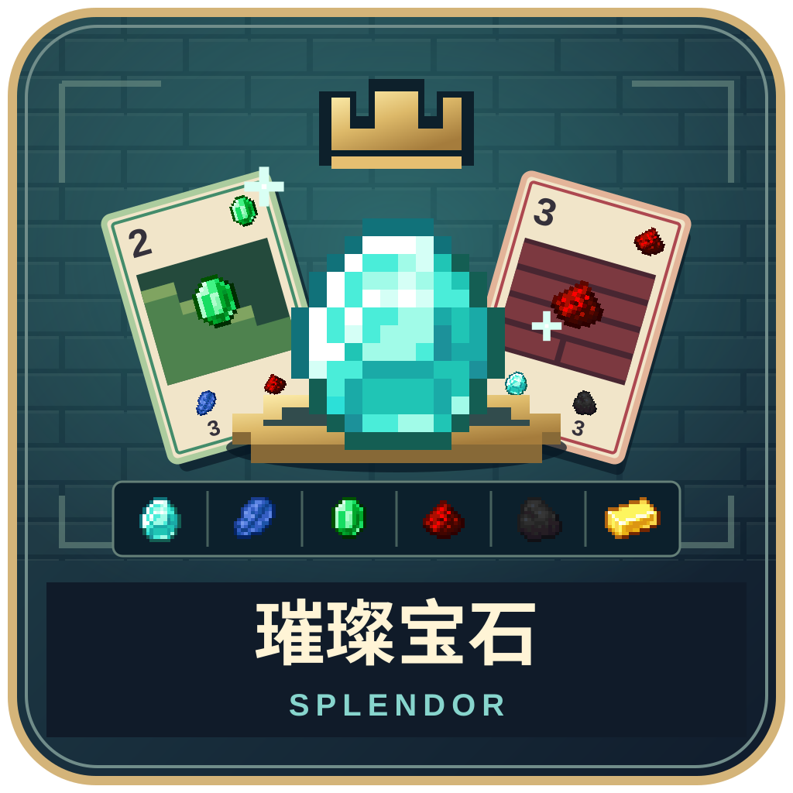 | [璀璨宝石](https://studiofimel.com/#/docs/fimel-card-splendor) | 2～4 | 每回合拿宝石、买发展卡或预定一张牌。发展卡提供永久折扣与声望，折扣还能吸引贵族；有人达到 15 分后完成最后一轮，再比较总分，先到 15 分不一定赢。 |

斗地主和掼蛋可以由人机补齐空位。斗地主经典局使用三席，2v2 使用四席，4v4 使用八席；掼蛋始终为四人对家合作。其余牌类游戏需要准备对应数量的真人玩家。

### 棋类

| 图标 | 游戏 | 真人数量 | 怎么玩 |
| :---: | --- | :---: | --- |
|  | [国际象棋](https://studiofimel.com/#/docs/fimel-card-chess) | 1～2 | 双方轮流走子，利用不同棋子的移动方式进攻、牵制并保护自己的王。让对方的王受到攻击且无路可解，也就是“将死”，即可获胜。 |
| 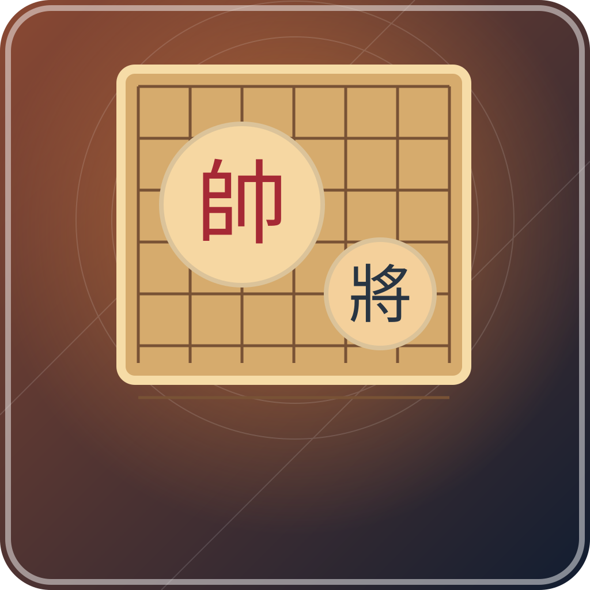 | [中国象棋](https://studiofimel.com/#/docs/fimel-card-xiangqi) | 1～2 | 红黑双方调动车马炮、攻守九宫，争取将死对方。也可选择“揭棋”：棋子起初盖住，首步翻开才揭示真实身份，在计算中加入未知与试探。 |
| 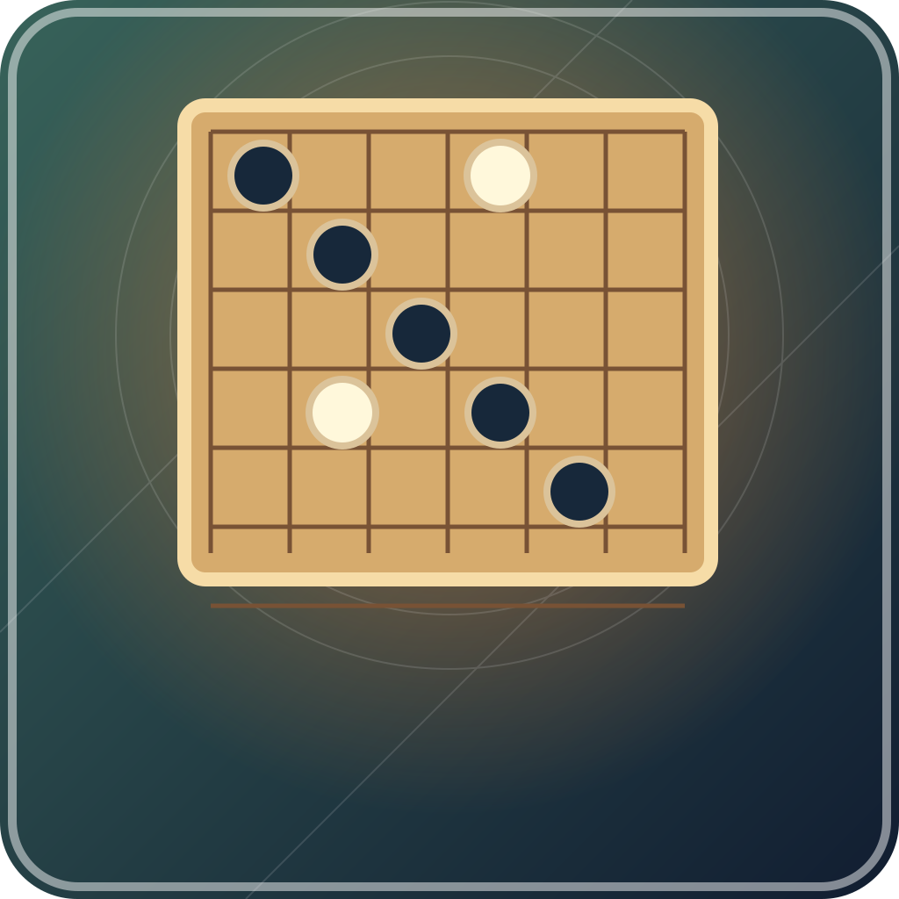 | [五子棋](https://studiofimel.com/#/docs/fimel-card-gomoku) | 1～2 | 在交点轮流落子，横、竖或斜向先连成五子者胜。使用自由规则，没有三三、四四等禁手，长连也算胜；可选 13、15、19 路棋盘。 |
| 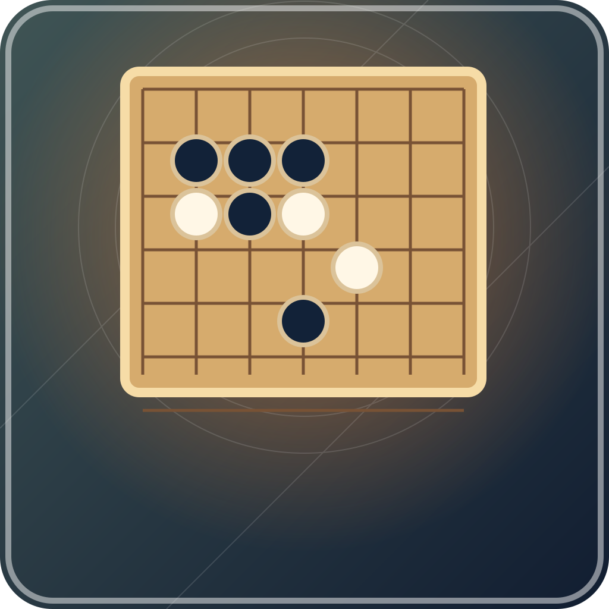 | [围棋](https://studiofimel.com/#/docs/fimel-card-go) | 1～2 | 通过连接、包围与提子争夺棋盘。没有气的棋串会被提走，终局确认死子并数子，比较活子与围空面积，白方计入贴目；可选 13、15、19 路。 |
|  | [飞行棋](https://studiofimel.com/#/docs/fimel-card-aeroplane-chess) | 1～4 | 投骰起飞并沿跑道前进，利用同色跳格和飞跃抢路，也可能把对手撞回机场。把自己的四架飞机全部送到终点，争取第一名。 |
|  | [卡坦岛](https://studiofimel.com/#/docs/fimel-card-catan) | 2～4 | 在岛上选择村庄位置，靠投骰生产资源，再与玩家、银行或港口交换。修路拓展地盘、建村升级城市，配合开发牌和道路／军队奖励，在自己的回合先达到 10 分。 |
|  | [胡闹运动会](https://studiofimel.com/#/docs/fimel-card-chaotic-sports) | 2～6 | 先招募选手，再为四场比赛安排不同角色。掷骰前进的同时触发角色能力与赛道事件，超车、换位或干扰对手；四场累计积分最高者夺冠，跑得最快未必总分最高。 |

国际象棋、中国象棋、五子棋和围棋均支持单人对人机。飞行棋可由电脑补位，关闭电脑时至少需要两名真人；卡坦岛与胡闹运动会需要准备对应数量的真人玩家。

### 语言类

| 图标 | 游戏 | 真人数量 | 怎么玩 |
| :---: | --- | :---: | --- |
|  | [谍报风云](https://studiofimel.com/#/docs/fimel-card-spy-games) | 3～8 | 加密者为三位密码写线索，队友结合秘密词解码，对手根据历轮线索尝试拦截。两队争取两次成功拦截，同时避免两次解密失误；三人局则由两人合作对抗一名截密者。 |
|  | [瞎掰王](https://studiofimel.com/#/docs/fimel-card-bluff-master) | 3～8 | 一人担任“大聪明”，向其他人提问，找出唯一知道冷知识真相的“老实人”。其余玩家即兴编出可信解释，争取被当成老实人；轮流猜、轮流演，累计分最高者赢。 |
|  | [问非所答](https://studiofimel.com/#/docs/fimel-card-wrong-answers) | 2～8 | 其他人先对秘密问题作答，猜题者只能看到答案，再给五道候选问题分配 0～4 分。真正问题得到的分值就是本轮得分，考验你对朋友的了解。 |
|  | [临界点](https://studiofimel.com/#/docs/fimel-card-critical-point) | 3～6 | 一位狼人混在村民中，大家先表态，再秘密打数字牌，设法让总和不超过安全线。村民要安全撑过五轮或投出狼人；狼人则利用有限信息诱导大家投错。 |
|  | [阿瓦隆](https://studiofimel.com/#/docs/fimel-card-avalon) | 5～8 | 围绕隐藏身份讨论，轮流提名队伍、公开表决，再由出任务者秘密决定成败。好人争取三次成功，坏人制造三次失败；即使任务成功，梅林仍要躲过刺客的最后一击。 |
| 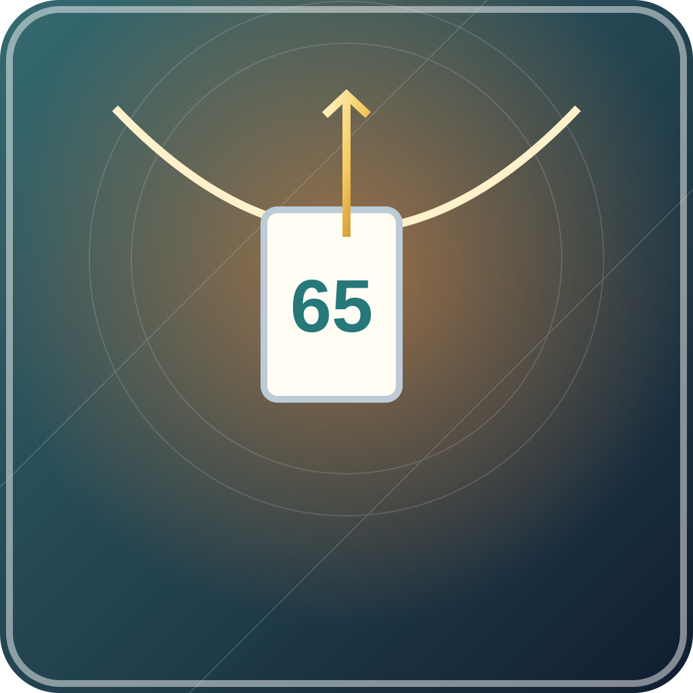 | [命悬一线](https://studiofimel.com/#/docs/fimel-card-hanging-by-a-thread) | 2～8 | 每人拿到秘密数字，只能按主题描述其程度，不能直接报数。“蛛丝”模式合作判断大小、依次出牌闯关；“红线”模式互选搭档，争取两人的数字之和接近 100。 |

这类游戏适合搭配语音或聊天讨论，但请遵守各游戏的信息限制：不要直接展示私人牌面或身份界面，密码与数字提示也不能用暗号直接传递。

## 按提示操作，随时换一局

各游戏使用的右键、Q、F 和快捷栏道具不同，请跟随屏幕提示。花火为 **Q 出牌、F 弃牌**；情书持牌选目标后按 Q 使用；璀璨宝石直接右键桌面选择宝石和卡牌。

问非所答、谍报风云、命悬一线默认使用书本输入：写完点击“完成”，不要签名，再按 Q 提交。若切换为文字对话框模式，提交文字的玩家需要 OP。

大厅中潜行即可离桌；游戏中下马保留参与身份，可以右键原座坐回。需要提前结束时，点击桌边“结束游戏”投票。有人离线则整桌暂停，原参与者返回后继续。

## 给牌桌换个样子

大厅可选 **默认、典雅、电音、玩偶、复古、竹影、春日**七种皮肤，并调整椅子数量，布置自己的客厅、茶室或服务器大厅。

坐在座位上按 **空格**可以打开表情包与语音菜单：72 张表情包可发送到在线玩家的聊天栏，36 段趣味语音可供同维度 16 格内的玩家听见。

## 下载、规则与项目

- **下载**：[Fimel Card](https://studiofimel.com/#/works/fimel-card?tab=versions)
- **桌游新手规则**：[23 款游戏说明书与组件图鉴](https://studiofimel.com/#/docs?category=fimel-card)
- **安装、管理与卸载**：[项目 README](https://github.com/FimelStudio/fimelcard-dp/blob/main/README.md)
- **版本改动**：[v1.1 更新日志](https://github.com/FimelStudio/fimelcard-dp/blob/main/docs/releases/v1.1/更新日志.md)
- **项目仓库**：[数据包](https://github.com/FimelStudio/fimelcard-dp) · [资源包](https://github.com/FimelStudio/fimelcard-rp)
- **作者**：歪浪Ylong、水晶Cesmos

允许免费游玩、使用、修改和分享；禁止盈利、广告推广及网盘分成等变现行为，完整条款见[使用许可](https://github.com/FimelStudio/fimelcard-dp/blob/main/LICENSE.md)。

感谢[文本动画库](https://space.bilibili.com/648638421)、[BetterTitle](https://github.com/Huoyuyuyu/BetterTitle)、[SK Firework](https://space.bilibili.com/1546917549)，以及 16bit 制作组的 [NyaaWork 喵工坊](https://space.bilibili.com/2907002)。第三方素材来源、署名与许可见项目说明。
