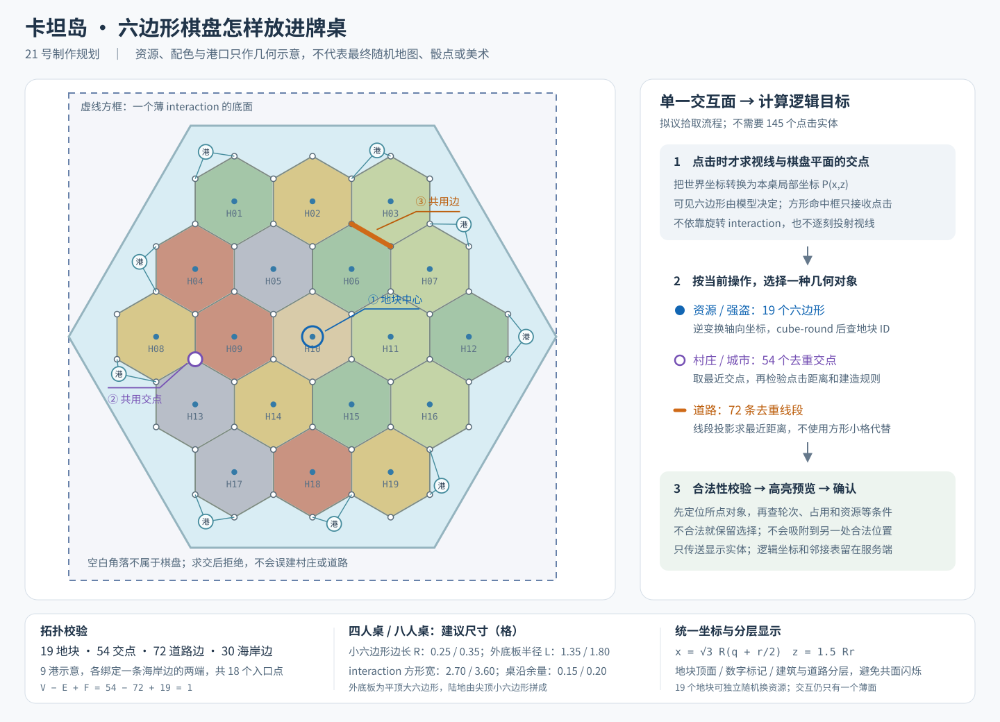

# 卡坦岛制作方案

**状态：规划，尚未实现。游戏编号 21，命名空间拟用 `catan`，专属前缀拟用 `ca_`。19 号留给同伴的游戏，20 号为围棋。**本方案不修改现有游戏编号、选择菜单或加载入口。

首版建议实现 **3～4 名真人的基础版**，同步适配四人桌、八人桌。采用官方 2025 第六版规则，目标 10 分；先完成完整真人对局，人机、扩展岛屿及航海玩法另行规划。最终玩家规则、操作与管理命令继续合并在本文，不再另建多份专题。

## 六边形棋盘如何还原

**棋盘模型和点击区域不必同形。**视觉上绘制真正的六边形地块与海框；只用一个覆盖全盘的薄交互实体接收点击，再根据玩家视线计算命中位置。矩形交互框的空角不会成为有效落点。



图为原创结构示意，不是最终美术。地块、交点和道路分别使用独立的逻辑编号。

| 层次 | 实现方式 |
| --- | --- |
| 外观 | 一块六边形海框底座、19 个地形面、18 个数字标记，以及按实际建造生成的建筑和道路 |
| 点击 | 本桌唯一的薄 `interaction`；不为每块地、每条边、每个交点生成交互实体 |
| 规则 | 固定图结构：19 地块、54 交点、72 条边、30 条海岸边；9 个港口各绑定一对海岸交点 |

后两组数量由布局去重计算，不能靠模型位置临时猜邻接关系。拓扑应满足 `54−72+19=1`、`6×19=2×42+30`。

### 模型与尺寸

地块顶面使用带六边形透明遮罩的薄模型，侧壁与外海框由旋转的薄长方体组成。相邻地块略留细缝，数字标记、强盗、村庄、城市和道路使用独立展示模型；底板没有实体方块碰撞，不改变玩家存档的桌面。

26.2 已支持模型元素任意角度旋转，60°／120°侧壁可直接制作；这一点已用本地客户端解析验证，参见 [Minecraft 官方模型更新](https://www.minecraft.net/en-us/article/minecraft-snapshot-25w46a)。不叠放多片同高、不同 UV 方向的顶面，以免闪烁。透明纹理只改变外观，不改变交互实体的碰撞形状。

| 项目 | 四人桌 | 八人桌 |
| --- | ---: | ---: |
| 桌面 | 3×3 | 4×4 |
| 小六边形中心到顶点 R | 0.25 | 0.35 |
| 陆地整体宽×深 | 约 2.165×2.000 | 约 3.031×2.800 |
| 外海框半径 L | 1.35 | 1.80 |
| 外海框宽×深 | 约 2.700×2.338 | 约 3.600×3.118 |
| 方形拾取框宽 | 2.70 | 3.60 |
| 桌沿最少余量 | 0.15 | 0.20 |

小地块尖顶朝向，外海框为平顶的大六边形；海框须满足 `L ≥ 8R/√3`，才能包住陆地。数字、建筑、道路与预选框共用同一缩放和旋转定义，不能分别手调到看起来相近。

### 统一坐标与邻接

采用半径为 2 的轴向坐标：`max(|q|,|r|,|q+r|) ≤ 2`，形成 3／4／5／4／3 五排地块。相对桌心的位置为：

```text
x = √3 × R × (q + r/2)
z = 3/2 × R × r
```

交点用整数键去重，避免浮点误差把同一个路口分成两个：

```text
u = 2q + r + [1, 0, -1, -1, 0, 1][k]
v = 3r     + [1, 2,  1, -1,-2,-1][k]
x = √3 × R/2 × u
z = R/2 × v                    k = 0..5
```

道路以排序后的两个交点编号作为唯一键。生成器一次输出地块相邻交点、交点相邻道路、道路端点、海岸顺序和港口对应关系；建造、生产、强盗与最长道路全部读取这份拓扑。

### 精确选择地块、交点与道路

优先复用五子棋／围棋的眼锚点射线定位流程：在 0～8 格内做有界二分，约 15 次探测，求视线与棋盘平面的交点。现有实现不是逐格扫描，也不是直接解析求交；可以复用定位流程，**不能复用它最后的最近方格选择**。

新输入按以下顺序处理：

1. 校验参与玩家、桌号、阶段、当前操作及窗口版本。
2. 求视线与桌面交点，转为本桌坐标，逆变换棋盘方向和缩放；朝上、超出范围或未命中平面则取消。
3. 按操作限定目标类型，不把所有物件混在一起选：移动强盗选地块，建村／升级选交点，建路选边。
4. 地块用轴向坐标取整后验证六边形内点；交点比较到各顶点的距离；道路比较到线段最近点的距离。边界平手使用固定编号顺序，容差按 R 缩放。
5. 只接受本操作的合法候选；海上、外框空角、已有建筑旁的禁建点不自动吸附到远处目标。公共高亮只按公开棋面判断位置是否合法，能否支付费用仅向本人提示，避免高亮泄露手中资源。
6. 显示一个预选轮廓或半透明建筑，说明费用；确认时再次校验资源、库存、拓扑和版本，再一次性提交。

**服务器能探测 8 格，不代表客户端能右键 8 格。**八人桌的远端可能超出生存／冒险模式实体交互距离。因此保留“手持专属操作物按 Q，按准星定位”的正式入口；近处可直接右键棋盘，两种方式共用定位和校验。优先用 Q 解决远端输入，不全局增加玩家触及距离。

村庄与道路目标较密，首版使用预览后确认，取消不扣资源。大厅仅展示棋盘预览，不启用局内拾取面，以免遮挡设置和开始按钮。

## 首版规则范围

以 [CATAN 官方第六版规则书](https://www.catan.com/sites/default/files/2025-03/CN3081%20CATAN%E2%80%93The%20Game%20Rulebook%20secure%20%281%29.pdf)为基准；交易、开发牌时点、银行短缺和奖励平手等细节参考[官方基础版 FAQ](https://www.catan.com/faq/basegame)。不混入 5～6 人扩展的额外建造流程或其他扩展规则。

- 地形：森林／牧场／麦田各 4，丘陵／矿山各 3，沙漠 1；银行五种资源各 19 张。18 个数字标记不含 7，沙漠没有数字。9 港包含 4 个通用 3:1 港和五种资源各一个 2:1 港。
- 每人库存：15 道路、5 村庄、4 城市。村庄 1 分，城市总计 2 分；城市替换己方村庄并归还村庄模型库存。建筑间须留至少一个空交点，道路不能穿过对方建筑继续延伸。
- 开发牌 25 张：骑士 14、胜利点 5，修路／垄断／发明各 2。非胜利点牌每回合最多用一张，且不能使用本回合买到的；胜利点按获胜规则处理。
- 最长道路至少 5 段、最大军队至少 3 张已使用骑士，各 2 分。**只在本人回合达到 10 分时获胜**，包括刚买到胜利点牌或回合开始已达标的情况。

| 行动 | 费用 |
| --- | --- |
| 建路 | 木＋砖，各 1 |
| 建村 | 木＋砖＋羊毛＋麦，各 1 |
| 升级城市 | 麦 2＋矿 3 |
| 买开发牌 | 羊毛＋麦＋矿，各 1 |

默认先提供官方推荐布局，随机布局按官方字母顺序放置数字、跳过沙漠；不要用随意洗数字代替规则布局。首版建议固定港口位置，减少无关随机变体。

## 对局状态与信息保密

开局按顺序各放一村一道，再逆序放第二组；每条起始道路须接在刚放的村庄上，仅第二个村庄领取相邻地形的起始资源。三人局保留空位，行动顺序独立于实际座号；八人桌每侧最多一名参与者。

正式回合：开始／可用旧开发牌 → 预先锁定两骰 → 动画 → 结算生产，或掷 7 的弃牌与强盗 → 交易、建造、使用开发牌自由穿插 → 结束回合。先保存骰值、扣费及结果，动画只负责表现；重载不重新投骰、生产或扣牌。

除 7 外，匹配数字的地块向所有相邻建筑所有者生产，不只给当前玩家：村庄 1 张、城市 2 张。强盗所在格不生产，但不封锁港口、道路或建造。

控制器保存地图种子、银行、开发牌顺序、建筑／道路归属、强盗位置、阶段、当前行动者、交易和奖励。玩家保存资源、旧／新开发牌、已用骑士、建筑库存与颜色。长期状态按桌隔离，不放在所有桌共用的临时 storage 中。

公开建筑、道路、资源总张数、开发牌总张数、已用骑士和公开得分；具体资源、未使用开发牌及隐藏胜利点只显示给本人。资源以后台数量为准，不发可复制、丢弃的真实资源卡物品。

### 交易、弃牌与强盗

- 银行和港口交易分别执行 4:1、3:1、指定资源 2:1；新建港口当回合即可使用。村庄／城市占据港口端点才取得资格，仅有道路经过不算。
- 玩家交易必须包含当前行动者；禁止赠送、同资源互换、未来承诺或交易开发牌。提议包含双方、资源数量、交易编号和版本；对方接受后重新核对并原子交换，取消或过期不扣款。
- 首版同桌只保留一项有效提议，避免多笔接受造成资源透支。交易对象在回合外也能通过常驻 Q 菜单回应；所有旧提议在结束回合、离线或中止后失效。
- 掷 7 时，资源多于 7 张者各弃一半向下取整，开发牌不计；所有人完成后才移动强盗并选相邻对手偷一张。弃牌等待期间禁止交易规避。骑士不触发弃半。
- 偷牌按资源卡总数加权随机，不能把五种资源等概率抽取。强盗必须换地块，可进入沙漠；无有效对手或其无牌时不得错误扣牌。
- 银行不足须按资源分别结算：多人应领而库存不足时该资源不发；只有一名应领者时可领剩余数量，其他资源正常发放。

### 最长道路与胜负

把本方道路视为图上的边，搜索**每条边最多经过一次的最长路线**，允许重复经过顶点；不能简单累计道路数量，也不能使用禁止顶点重复的普通最长路径算法。对方建筑阻断穿行，但路线可在那里终止。

利用每人最多 15 条道路的上界，以边使用掩码、连通分量和剪枝控制搜索；只在建路、建村切断道路等相关变动后重算。队列、DFS 栈和局面版本保存在本桌控制器，按刻处理；初步以每桌每刻 128 个搜索状态为预算起点，依实际命令计数调整。期间锁定相关提交和胜负结算，不每刻重扫全图，不提高默认 65536 命令上限。

原奖励持有者并列时保留；原持有者失格后其他人并列，则最长道路奖励暂归银行。重算所有受影响玩家后，再判断当前行动者是否获胜。

## 资源、界面与表现

资源拟放在 `assets/card/models/item/catan/`、`assets/card/items/catan/`、`assets/card/textures/item/catan/`，按 `tile/forest`、`tile/desert`、`road/red`、`settlement/red`、`city/red`、`robber` 等语义命名。地形、建筑、港口和数字采用原创美术，Blockbench 源文件与导出脚本保留在 `.source/catan/`；可复用已有六面骰几何和通用动画，游戏状态另设命名空间。

- 私有 HUD：本人五种资源数量、开发牌与可操作提示；具体资源种类与未公开开发牌内容仅本人可见，人数和手牌总数可公开。第 9 格 Q 菜单常驻，第 1 格瞄准道具按当前操作资格发放。
- 建造：预选高亮 → 确认扣费 → 道路铺设或建筑升起。城市替换村庄，模型不叠留。
- 骰子：两骰翻滚、弹跳、停稳；最终朝向与事先锁定的点数一致。音效区分投骰、建路、建村、升级、交易、强盗和获胜。
- 强盗与交易动画仅作表现；偷牌显示牌背，不透露被偷资源。胜者实际座位使用已内置的 SK Firework。
- 大厅设置采用单页即时生效：推荐／随机布局、棋盘方向、颜色分配及首位；10 分目标与基础费用首版固定。交易等待时限可单独设置，回合默认不限时。
- 结束返回大厅可保留公开终局；新开局或切换游戏再清理。重载恢复已提交状态，取消过期界面与交易入口；参与者离线按首版约定中止整场。

## 制作顺序

| 阶段 | 交付与通过条件 |
| --- | --- |
| 1．几何原型 | 生成唯一拓扑、六边形预览及三类选择；坐姿从四边能选中远端，先解决 Q 兜底和误选 |
| 2．规则核心 | 初始化、生产／短缺、建造、港口、开发牌、强盗、最长道路与获胜；先做独立规则用例 |
| 3．真人完整局 | 3／4 人、逆序初始摆放、自由交易／建造、回合外应答、资源保密和结束投票 |
| 4．资源与表现 | 双骰、地形／建筑、HUD、预选、建造与交易动画、音效和烟花；同步两桌型 |
| 5．恢复与接入 | 按[接入规范](新卡牌游戏接入规范.md)注册 21 号，补规则／设置／中止入口，验证重载、双桌、终局重开及发布包 |

人机若后续加入，须覆盖布局、资源估值、交易应答、开发牌与强盗策略，不能只随机选合法建造。先让真人基础版可以完整结束，再扩展。

## 验收（待制作后执行）

目前仅完成结构规划、SVG 拓扑推导及 26.2 模型旋转解析核对，**没有实现或运行卡坦岛游戏测试**。

- 几何：19／54／72／30 的去重及邻接、9 港端点、两桌型／方向、边角／海面拒绝、交点与道路切换；百万坐标避免定点运算溢出。
- 客户端输入：普通无 OP、实际生存／冒险坐姿、最远地块／交点／道路、Q 兜底；后台射线能算到不能代替真实交互距离验证。
- 规则：起始逆序与第二村庄资源、资源与开发牌守恒、银行短缺、港口即时生效、库存上限、掷 7 与骑士区别、按张数偷牌、旧／新开发牌与胜利点时点。
- 图与计分：分叉、环路、环加支路、敌方村庄切断、平手保留／归还奖励、非本人回合到 10 分；最大 15 道路和两桌并行保持默认命令预算。
- 交易与恢复：双方同时接受／取消、资源变化、旧版本、非本人回合回应、弃牌等待、每阶段真实重载、离线／中止、骰子不重掷、生产不重复、终局不继续输入。
- 视觉与发布：六边形顶面／侧壁无缝和无闪烁、合法预选、骰面、建筑替换、秘密牌背、音量与烟花；模型／纹理／字体／音效引用和打包白名单。
